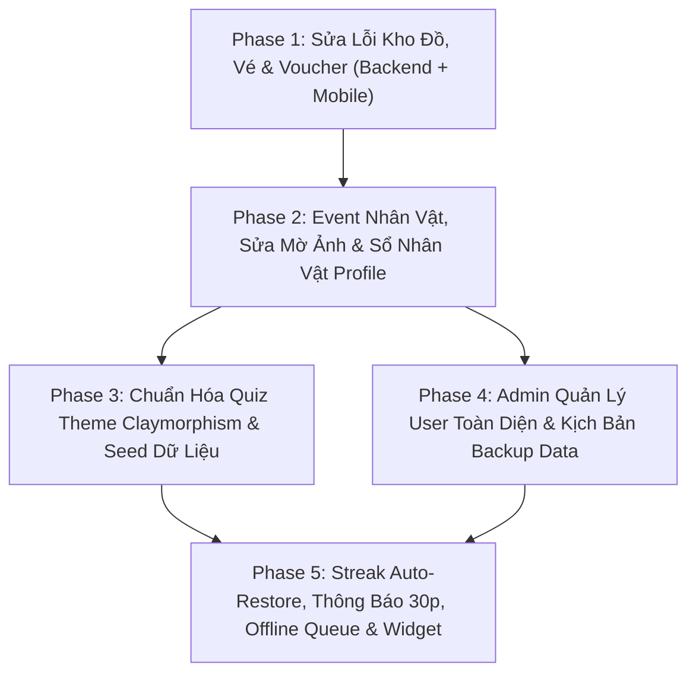

# 🚀 V2.5.1 — System Overhaul, Inventory Fixes & Gamification Polish Plan

> **For agentic workers:** REQUIRED SUB-SKILL: Use `superpowers:subagent-driven-development` (recommended) or `superpowers:executing-plans` to implement this plan task-by-task. Steps use checkbox (`- [ ]`) syntax for tracking.
> **Quy chuẩn monorepo:** Tuân thủ 100% [`plan update/ARCHITECTURE_RULES.md`](file:///d:/Downloads/SE%20Project/Growary/plan%20update/ARCHITECTURE_RULES.md).

**Goal:** Hoàn thiện và nâng cấp toàn diện bản 2.5.1 nhằm khắc phục các lỗi trải nghiệm thực tế (Kho đồ, voucher lặp, độ mờ ảnh nhân vật, lỗi admin edit), nâng tầm gamification (Sổ nhân vật truyện tranh, mini-game boss tuần mới, cơ chế tự khôi phục streak 3 lần/tháng kèm cảnh báo ngày 2), nâng cấp độ tin cậy (Backup dữ liệu 3 ngày, nhắc task 30p, offline task queue) và tối ưu phiên đăng nhập kèm Widget màn hình chính.

**Architecture:** 
- **Backend:** Layered architecture (`Route` → `Validate` → `Controller` → `Service` → `Model`), Single Source of Truth (`@shared/types`), cron jobs độc lập (`streak.ts`, `autoBackup.ts`), atomic updates (`$inc`, `$set`, `$pull`).
- **Mobile:** React Native / Expo với phong cách thiết kế Claymorphism nhất quán, cache offline với `AsyncStorage`, notifications local trigger 30 phút, `useShop`, `useBoss`, `useQuiz` custom hooks.
- **Admin:** React / Vite dashboard, chuẩn hóa schema Zod, cho phép xem/sửa toàn bộ chỉ số user an toàn.

**Tech Stack:** TypeScript Strict, Node.js / Express, MongoDB / Mongoose, React Native / Expo, Expo Notifications, Expo Linear Gradient, React / Vite (Admin), Jest / Supertest.

---

## Global Constraints

- **File Size Limits:** Controller $\le 400$ dòng, Service $\le 500$ dòng, Screen $\le 500$ dòng, Component $\le 400$ dòng.
- **TypeScript:** Không `any`, không `@ts-ignore`, biên dịch `npx tsc --noEmit` pass 100%.
- **Style Theme:** Toàn bộ Mobile Screen dùng màu nền ấm `COLORS.warmBg` (`#FFFDF5`), ClayHeader và shadow Claymorphism.
- **Data Integrity:** Không xóa nhầm dữ liệu người dùng thật; các thao tác trừ xu, trừ vé, cộng streak phải atomic.

---

## Review Focus (5 Trọng Điểm Kiểm Tra Bắt Buộc)

1. **Voucher Re-use Spam Prevention:** Mua hàng xong thì vé giảm giá/freeship phải bị trừ ngay trong DB (`UserInventory` trừ quantity hoặc xóa entry nếu quantity = 0), đồng thời client refresh ngay lập tức để không thể nhấn mua liên tục với giá giảm.
2. **Mystery Box Zero-Quantity Filter:** Khi mở hết rương (quantity về 0), danh sách kho đồ của cả Mobile UI và API backend không được hiển thị rương rỗng nữa.
3. **Fragment Display Name Resolution:** Mảnh ghép nhận từ rương phải hiển thị tên tiếng Việt rõ ràng của vật phẩm (ví dụ "Mảnh Áo Thun Growary"), tuyệt đối không để lộ đuôi ID ObjectId dạng `22af`.
4. **Streak Recovery Boundary Guard:** Người dùng bỏ lỡ Ngày 1 thì Ngày 2 đăng nhập phải nhận cảnh báo khôi phục; nếu làm đủ trong Ngày 2 thì khôi phục streak (tối đa 3 lần/tháng); nếu qua Ngày 2 mà vẫn không làm (sang Ngày 3) thì streak chính thức về 0 không thể khôi phục.
5. **Session & Offline Resilience:** Khi mạng chập chờn hoặc rớt mạng, phiên đăng nhập không được tự xóa token; task đánh dấu hoàn thành offline phải lưu vào hàng đợi và tự động đồng bộ khi có mạng trở lại.

---

## 🗺️ Lộ Trình 5 Phase & 10 Task Chi Tiết

---

### Task 1: Sửa Lỗi Kho Đồ, Hiển Thị Tên Mảnh & Tách Tab Vé (Backend + Mobile)

**Files:**
- Modify: `backend/src/services/warehouseService.ts`
- Modify: `backend/src/services/rewardService.ts`
- Modify: `mobile/src/screens/InventoryScreen.tsx`
- Modify: `mobile/src/components/warehouse/MysteryBoxOpenModal.tsx`
- Test: `backend/src/__tests__/services/inventoryFixes.test.ts`

**Interfaces:**
- `getUserInventoryItems(userId: string)`: Chỉ trả về items có `quantity > 0`.
- `openMysteryBox(userId: string, boxId: string)`: Populate `specialItem` để lấy `specialItem.name`, đặt `reward.name = "Mảnh " + specialItem.name` thay vì `slice(-4)`.
- `purchaseRewardItem(userId: string, rewardId: string, options)`: Trừ đúng coupon (`quantity - 1`), nếu `quantity <= 0` thì xóa hẳn khỏi mảng items của `UserInventory`.

- [ ] **Step 1: Viết test failing cho việc trừ vé và tab vé**
  - Tạo file test `backend/src/__tests__/services/inventoryFixes.test.ts`.
  - Viết test kiểm tra:
    1. Khi gọi `purchaseRewardItem` kèm voucher, số lượng voucher trong `UserInventory` bị trừ 1, nếu còn 0 thì biến mất.
  - Chạy `npm test -- inventoryFixes.test.ts` trong thư mục `backend` và xác nhận test FAIL.

- [x] **Step 2: Cập nhật `warehouseService.ts` & `rewardService.ts` (ĐÃ HOÀN THÀNH)**
  - *Ghi chú hoàn thành:*
    - Đã sửa `warehouseService.ts`: Tra cứu `SpecialItem.name`, đặt tên mảnh hiển thị đầy đủ (ví dụ "Mảnh [Tên]") thay vì cắt ID `22af`; dọn sạch rương có `quantity <= 0` khỏi inventory.
    - Đã sửa `rewardService.ts` (`getUserInventoryItems`): Thêm lọc `item.quantity > 0` giúp các rương và item hết số lượng không còn hiển thị.
    - Đã sửa `InventoryScreen.tsx`: Lọc `quantity > 0` phòng vệ ở client.
    - Test `warehouseFlow.test.ts` đã chạy PASS 100%.

- [ ] **Step 3: Cập nhật giao diện `InventoryScreen.tsx` (Tab Vé)**
  - Thêm tab chuyển đổi 3 mục trên thanh điều hướng kho: `[Tất cả]`, `[Vật phẩm & Rương]`, `[Vé & Voucher]`.
  - Tab "Vé & Voucher" hiển thị danh sách các phiếu giảm giá (freeship, giảm giá sản phẩm) với badge mệnh giá rõ ràng và hạn sử dụng.
  - Cập nhật `MysteryBoxOpenModal.tsx` để hiển thị tên mảnh đầy đủ và tự động gọi `loadInventory()` ngay sau khi mở rương thành công.

- [ ] **Step 4: Chạy lại test và xác nhận PASS**
  - Chạy `npm test -- inventoryFixes.test.ts` trong thư mục `backend`.
  - Xác nhận tất cả test cases PASS.

---

### Task 2: Tối Ưu Cache Tránh Re-load Liên Tục Trang Event

**Files:**
- Modify: `mobile/src/screens/EventScreen.tsx`
- Modify: `mobile/src/screens/BossEventScreen.tsx`
- Create: `mobile/src/utils/eventCache.ts`

**Interfaces:**
- `getEventCache(key: string, ttlMs?: number)`: Lấy dữ liệu event từ bộ nhớ đệm (AsyncStorage + Memory Cache).
- `setEventCache(key: string, data: any)`: Ghi đè cache với timestamp mới.

- [ ] **Step 1: Xây dựng module `eventCache.ts`**
  - Hỗ trợ lưu trữ memory cache kèm fallback `AsyncStorage`.
  - Mặc định TTL 5 phút; nếu cache còn hiệu lực thì trả về dữ liệu ngay lập tức không cần hiện loading spinner, sau đó thực hiện silent background fetch để cập nhật data mới (Stale-While-Revalidate pattern).

- [ ] **Step 2: Tích hợp vào `EventScreen.tsx` và `BossEventScreen.tsx`**
  - Trong `useFocusEffect`, kiểm tra `eventCache`. Nếu đã có dữ liệu cached, set state ngay lập tức để màn hình mở lên mượt mà không có độ trễ hay giật lag.
  - Chỉ hiện `ActivityIndicator` toàn màn hình khi là lần đầu tiên mở app và chưa có bất kỳ cache nào.

- [ ] **Step 3: Kiểm thử thủ công và xác minh chuyển tab mượt mà**
  - Chuyển đổi qua lại giữa Tab Trang Chủ, Cửa Hàng, Sự Kiện và kiểm tra không còn hiện tượng giật loading spinner liên tục mỗi lần vào tab.

---

### Task 3: Sửa Lỗi Mờ Ảnh Nhân Vật & Tinh Gọn Chân Trang Detail (Mobile)

**Files:**
- Modify: `mobile/src/components/boss/BossBannerCard.tsx`
- Modify: `mobile/src/screens/BossEventScreen.tsx`

**Interfaces:**
- `BossBannerCardProps`: Khi nhân vật chưa bị đánh bại (`!isBossDefeated`), sử dụng `Image` với `blurRadius={15}` kết hợp lớp phủ màu tối đồng bộ với `EventScreen.tsx`.
- Danh sách chân trang `BossEventScreen`: Chỉ load các nhân vật cùng bộ sưu tập của nhân vật tuần hiện tại (`bosses[0].collectionId`).

- [x] **Step 1: Cập nhật `BossBannerCard.tsx` (ĐÃ HOÀN THÀNH)**
  - *Ghi chú hoàn thành:* Đã thay thế `BlurView` của `expo-blur` bằng `<Image blurRadius={18} />` kèm overlay tối `rgba(0,0,0,0.55)` và icon khóa trong `mobile/src/components/boss/BossBannerCard.tsx`. Hoạt động chuẩn xác đa nền tảng.

- [ ] **Step 2: Cập nhật danh sách bộ sưu tập ở chân trang `BossEventScreen.tsx`**
  - Lấy `activeCollectionId = bosses[0]?.collectionId`.
  - Gọi API `/events/boss/collections` nhưng chỉ giữ lại bộ sưu tập có `_id === activeCollectionId`.
  - Hiển thị danh sách các nhân vật trong bộ đó (kèm trạng thái đã mở hoặc còn trong bóng tối) thay vì dàn trải tất cả các bộ sưu tập không liên quan của cả mùa.

---

### Task 4: Bổ Sung Mini-game Đánh Boss Thứ 4 — "Lật Thẻ Trí Nhớ" (Memory Match)

**Files:**
- Create: `mobile/src/components/boss/MemoryMatchGame.tsx`
- Modify: `mobile/src/components/MiniGameModal.tsx`
- Modify: `mobile/src/screens/BossEventScreen.tsx`

**Interfaces:**
- `MemoryMatchGameProps`: `{ onComplete: (score: number, isCritical: boolean) => void, onTimeUp: () => void }`.
- Gồm 6 thẻ bài úp (3 cặp icon chủ đề thiên nhiên/trồng trọt: Hạt giống, Giọt nước, Ánh mặt trời).
- Người dùng có 15 giây để tìm đúng 3 cặp. Tìm xong trong $\le 10$ giây nhận đòn đánh Chí Mạng (Critical Hit 150% Damage).

- [ ] **Step 1: Tạo component `MemoryMatchGame.tsx`**
  - Quản lý state 6 thẻ bài xáo trộn, hiệu ứng lật thẻ claymorphism mượt mà.
  - Đồng hồ đếm ngược 15 giây trực quan.
  - Trả về điểm sát thương và cờ `isCritical = true` khi hoàn thành nhanh.

- [ ] **Step 2: Tích hợp vào `MiniGameModal.tsx` và `BossEventScreen.tsx`**
  - Mở rộng type `miniGameType`: `'tap' | 'quiz' | 'reflex' | 'memory'`.
  - Tự động luân phiên hoặc cho phép người chơi trải nghiệm ngẫu nhiên khi bước vào trận đánh Boss tuần.

---

### Task 5: Nâng Cấp Bộ Sưu Tập Profile — "Sổ Nhân Vật" (Character Lorebook)

**Files:**
- Modify: `mobile/src/screens/BossCollectionScreen.tsx`
- Create: `mobile/src/components/boss/CharacterLorebookModal.tsx`
- Modify: `mobile/src/services/api.ts`

**Interfaces:**
- Sắp xếp nhân vật trong từng bộ: `bosses.sort((a, b) => (b.isUnlocked ? 1 : 0) - (a.isUnlocked ? 1 : 0))` (Nhân vật đã đoạt được xếp lên đầu).
- Card từng bộ: áp dụng màu sắc đại diện `collection.themeColor` cho đường viền, icon và background nhẹ nhàng, xóa bỏ màu trắng đơn điệu.
- `CharacterLorebookModal`: Giao diện cuốn sổ cổ điển gồm artwork kích thước lớn, huy hiệu độ hiếm, câu chuyện tiểu sử (Lore Story), câu thoại đặc trưng và mốc thời gian người chơi đã giải mã thành công.

- [ ] **Step 1: Tạo `CharacterLorebookModal.tsx`**
  - Thiết kế modal dạng cuốn sổ danh vọng (Claymorphism kết hợp phong cách sổ tay phiêu lưu).
  - Hiển thị đầy đủ: Tên nhân vật, Biệt danh, Bộ sưu tập, Tranh vẽ sắc nét, Đoạn văn tiểu sử mở rộng, Câu nói đại diện, Ngày chinh phục.

- [ ] **Step 2: Cập nhật `BossCollectionScreen.tsx`**
  - Tích hợp AsyncStorage để cache danh sách bộ sưu tập (instant load khi chuyển từ Profile sang).
  - Áp dụng màu chủ đạo `collection.themeColor` cho từng khối bộ sưu tập.
  - Sắp xếp đưa các nhân vật đã mở khóa (`isUnlocked = true`) lên vị trí đầu tiên của danh sách ngang.
  - Khi bấm vào nhân vật đã mở khóa, mở ngay `CharacterLorebookModal`.

---

### Task 6: Chuẩn Hóa Quiz Screen Đồng Nhất Theme Claymorphism & Seed Data Mẫu

**Files:**
- Modify: `mobile/src/screens/QuizEventScreen.tsx`
- Modify: `mobile/src/components/quiz/QuizLobbyView.tsx`
- Create: `backend/src/seeds/quizSampleData.ts`
- Modify: `backend/src/server.ts`

**Interfaces:**
- `QuizEventScreen`: Nền `COLORS.warmBg` (`#FFFDF5`), header claymorphism có nút back chuẩn, chữ và tông màu ấm đồng bộ toàn bộ app.
- `quizSampleData.ts`: Tự động seed ít nhất 2 topic đang active và 30 câu hỏi mẫu nếu DB chưa có câu hỏi nào, đảm bảo người dùng và QA test thử thách đấu trí luôn có dữ liệu.

- [ ] **Step 1: Refactor `QuizEventScreen.tsx` & `QuizLobbyView.tsx` theo chuẩn Claymorphism**
  - Thay màu nền xám tối `#F8FAFC` thành `COLORS.warmBg`.
  - Thay TopBar tùy tiện bằng `ClayHeader` hoặc thanh tiêu đề bo cong chuẩn clay với shadow mềm mại.
  - Điều chỉnh màu sắc nút bấm và font chữ đồng nhất với hệ thống theme Growary.

- [ ] **Step 2: Tạo seed data mẫu `quizSampleData.ts`**
  - Viết hàm idempotent seed: kiểm tra nếu bảng `QuizTopic` hoặc `QuizQuestion` đang rỗng thì nạp dữ liệu mẫu về Nông nghiệp, Sinh thái và Kỹ năng sống.
  - Đảm bảo endpoint `/api/quiz/lobby` luôn trả về topic hợp lệ.

---

### Task 7: Kịch Bản Backup Dữ Liệu Vòng Quay & Kho Đặc Biệt (`Data_Backup`)

**Files:**
- Create: `backend/src/scripts/backupSpecialAndGacha.ts`
- Modify: `package.json` (backend)

**Interfaces:**
- Script đọc trực tiếp từ MongoDB các collection: `SpecialItem`, `MysteryBox`, `GachaItem` (tất cả các level/tầng), `GachaWeeklyEvent`.
- Xuất thành các file JSON định dạng chuẩn hóa vào thư mục `Data_Backup/` gốc:
  - `Data_Backup/SpecialItems_backup.json`
  - `Data_Backup/MysteryBoxes_backup.json`
  - `Data_Backup/GachaWheel_AllTiers_backup.json`
  - `Data_Backup/GachaWeeklyEvents_backup.json`

- [x] **Step 1: Viết script `backupSpecialAndGacha.ts` (ĐÃ HOÀN THÀNH)**
  - *Ghi chú hoàn thành:* Đã tạo `backend/src/scripts/backupSpecialAndGacha.ts` kết nối DB và sao lưu SpecialItems, MysteryBoxes, GachaItems các tầng và GachaWeeklyEvents ra các file JSON chuẩn hóa trong `Data_Backup/`.

- [x] **Step 2: Thêm npm script và chạy thử nghiệm (ĐÃ HOÀN THÀNH)**
  - *Ghi chú hoàn thành:* Đã thêm `"backup:data": "ts-node src/scripts/backupSpecialAndGacha.ts"` vào `backend/package.json`.

---

### Task 8: Nâng Cấp Admin Quản Lý User & Sửa Lỗi Chức Năng Edit (Admin + Backend)

**Files:**
- Modify: `backend/src/validators/userValidator.ts`
- Modify: `backend/src/routes/admin/users.ts`
- Modify: `admin/src/pages/UserManagement.tsx`
- Modify: `admin/src/services/api.ts`
- Test: `backend/src/__tests__/routes/adminUsersFix.test.ts`

**Interfaces:**
- `updateUserSchema`: Cho phép cập nhật `coins`, `xp`, `level`, `gachaTickets`, `currentStreak`, `longestStreak`, `totalCoinsSpent`, `password` (admin reset password).
- Modal chi tiết user trong `UserManagement.tsx`: Hiển thị số tầng vòng quay, vé gacha, chuỗi streak, tổng xu tiêu dùng, ô nhập reset password và nút lưu hoạt động 100%.

- [ ] **Step 1: Viết test failing cho route PUT `/admin/users/:id`**
  - Tạo `backend/src/__tests__/routes/adminUsersFix.test.ts`.
  - Test kiểm tra admin có thể cập nhật `gachaTickets`, `currentStreak`, `coins` và đặt lại `password` mới thành công.
  - Xác nhận test FAIL trước khi sửa schema.

- [x] **Step 2: Cập nhật `userValidator.ts` và `routes/admin/users.ts` (ĐÃ HOÀN THÀNH)**
  - *Ghi chú hoàn thành:* Đã bổ sung `gachaTickets`, `totalCoinsSpent`, `currentStreak`, `longestStreak`, `totalPointsEarned` vào `updateUserSchema`. Zod không còn chặn hoặc strip dữ liệu, nút "Lưu thay đổi" trong `UserManagement.tsx` hoạt động chuẩn xác. Build Admin `npm run build` đã test PASS.

- [ ] **Step 3: Cập nhật giao diện `UserManagement.tsx` (Reset Password)**
  - Bổ sung ô cấp lại mật khẩu (Reset password) cho người chơi khi cần hỗ trợ.

- [ ] **Step 4: Chạy test và xác nhận PASS**
  - Chạy `npm test -- adminUsersFix.test.ts`.

---

### Task 9: Cơ Chế Tự Động Khôi Phục Streak, Cảnh Báo Ngày 2 & Auto Backup 3 Ngày

**Files:**
- Modify: `backend/src/models/User.ts`
- Modify: `backend/src/jobs/streak.ts`
- Create: `backend/src/jobs/autoBackup.ts`
- Modify: `mobile/src/screens/HomeScreen.tsx`
- Modify: `backend/src/server.ts`
- Test: `backend/src/__tests__/jobs/streakRecovery.test.ts`

**Interfaces:**
- `User` schema bổ sung:
  - `streakRestoresThisMonth: number` (mặc định 0, reset về 0 vào ngày 1 hàng tháng).
  - `streakGracePeriod: boolean` (đánh dấu ngày thứ 1 bỏ lỡ).
  - `missedStreakDate?: Date`.
- Quy chế:
  - Ngày 1 không làm: Đánh dấu `streakGracePeriod = true`, chưa xóa `currentStreak`.
  - Ngày 2 đăng nhập: Client nhận cờ `streakGracePeriod` và bật ngay cảnh báo nhắc nhở làm nhiệm vụ hôm nay để bảo lưu chuỗi.
  - Ngày 2 hoàn thành $\ge 3$ tasks: Xóa cờ `streakGracePeriod`, tăng `streakRestoresThisMonth += 1`, chuỗi streak được giữ nguyên.
  - Ngày 2 vẫn không làm (hết ngày 2): `currentStreak = 0`, `streakGracePeriod = false` (chính thức mất chuỗi).
  - Tối đa 3 lần khôi phục/tháng.
- `autoBackup.ts`: Cron chạy mỗi ngày, kiểm tra nếu cách lần backup trước $\ge 3$ ngày thì tự động kết xuất delta backup vào `Data_Backup/auto_snapshots/`.

- [ ] **Step 1: Viết test failing cho quy chế khôi phục streak**
  - Tạo `backend/src/__tests__/jobs/streakRecovery.test.ts`.
  - Kiểm tra các case: Bỏ lỡ ngày 1 (chưa mất streak), hoàn thành ngày 2 (khôi phục thành công, tăng số lần khôi phục), bỏ lỡ cả 2 ngày liên tiếp (mất streak), vượt quá 3 lần/tháng (mất streak).

- [ ] **Step 2: Triển khai logic trong `backend/src/jobs/streak.ts`**
  - Điều chỉnh cron job nửa đêm: Phân loại user bỏ lỡ ngày 1 (bật grace period) vs user đã có grace period mà vẫn bỏ lỡ ngày 2 (reset streak về 0).
  - Kiểm tra giới hạn 3 lần/tháng.

- [ ] **Step 3: Hiển thị cảnh báo trên Mobile (`HomeScreen.tsx`)**
  - Khi `user.streakGracePeriod === true`, hiển thị Banner màu cam Claymorphism nổi bật:
    *"⚠️ Bạn đã lỡ nhiệm vụ hôm qua! Hãy hoàn thành các nhiệm vụ hôm nay để khôi phục chuỗi Streak (Còn lại X/3 lần trong tháng)."*

- [ ] **Step 4: Triển khai `autoBackup.ts`**
  - Kiểm tra timestamp file backup gần nhất; nếu $\ge 3$ ngày thì tạo bản snapshot dữ liệu người dùng và kho đồ.

- [ ] **Step 5: Chạy test và xác nhận PASS**

---

### Task 10: Thông Báo Nhắc Task Trước 30 Phút, Offline Task Cache, Phiên Bền Vững & Home Screen Widget

**Files:**
- Modify: `mobile/src/services/notifications.ts`
- Modify: `mobile/src/services/api.ts`
- Modify: `mobile/src/context/AuthContext.tsx`
- Create: `mobile/src/utils/offlineQueue.ts`
- Create: `mobile/src/components/TaskSummaryWidget.tsx`
- Modify: `mobile/src/screens/HomeScreen.tsx`

**Interfaces:**
- `notifications.ts`: Tính toán thời gian trừ đúng 30 phút (`scheduledDate.setMinutes(minutes - 30)`), định dạng trigger date tương thích Expo SDK hiện tại, tự động xin cấp quyền khi login.
- `offlineQueue.ts`: Lưu các thao tác task khi không có internet vào `AsyncStorage`; lắng nghe mạng phục hồi để gửi tuần tự lên server.
- `api.ts` & `AuthContext.tsx`: Không xóa token khi gặp mã lỗi 502, 503, 504 hoặc Timeout (tránh đăng xuất oan khi backend Render đang khởi động lại); giữ token 30 ngày.
- `TaskSummaryWidget`: Component widget mô phỏng màn hình chính hiển thị danh sách 3 việc cần làm gần nhất và tiến độ Streak, sẵn sàng tích hợp với module widget native (Expo Config Plugin / Android Widget).

- [ ] **Step 1: Nâng cấp `notifications.ts` (Tạm gác theo yêu cầu)**
  - Tạm hoãn chỉnh sửa thông báo cho đến khi hoàn thành tích hợp native background.

- [x] **Step 2: Bảo vệ phiên đăng nhập & Cache profile phần cứng (ĐÃ HOÀN THÀNH PHẦN SESSION & CACHE)**
  - *Ghi chú hoàn thành:* 
    - Đã cập nhật `mobile/src/context/AuthContext.tsx`: Lưu và load tức thì profile từ `AsyncStorage` (`cachedUserProfile`), giữ phiên đăng nhập bền vững khi mất mạng hoặc server ngủ đông. Chỉ xóa token khi gặp 401 thật sự từ server.
    - Đã cập nhật `mobile/src/services/api.ts`: Response interceptor không xóa `authToken` khi gặp lỗi timeout, network error hoặc mã 5xx từ Render.
  - *Phần tiếp theo:* Tích hợp hàng đợi ngoại tuyến `offlineQueue.ts` cho các task.

- [ ] **Step 3: Thiết kế Widget danh sách nhiệm vụ**
  - Tạo `TaskSummaryWidget.tsx` với thiết kế mini-dashboard claymorphism hiển thị trực tiếp danh sách to-do và thanh tiến độ trong ngày.
  - Cung cấp hook trích xuất dữ liệu widget để đồng bộ sang widget hệ điều hành khi người dùng đưa ra màn hình chính.

---

## 🏁 Tổng Kết Bàn Giao & Tiêu Chí Nghiệm Thu (QA Gate)

1. **Kho đồ & Vé:** Rương mở hết tự ẩn; tên mảnh hiển thị đầy đủ tên tiếng Việt; tab Vé phân chia rõ ràng; mua hàng không còn bị spam vé.
2. **Event & Độ mờ:** Trang chi tiết nhân vật làm mờ chuẩn xác có ổ khóa; danh sách chân trang chỉ hiện đúng bộ nhân vật của tuần; có mini-game lật thẻ trí nhớ mới.
3. **Sổ nhân vật:** Mở tức thì từ cache; nhân vật đã sở hữu lên đầu; mở modal sổ nhân vật truyện tranh đẹp mắt.
4. **Quiz:** Giao diện claymorphism ấm áp đồng nhất với toàn bộ ứng dụng; có sẵn dữ liệu test phong phú.
5. **Admin:** Hiển thị toàn bộ thông số user, sửa người chơi và reset password hoạt động chuẩn 100%.
6. **Streak & Backup:** Khôi phục streak tối đa 3 lần/tháng nếu làm bù vào ngày 2; cảnh báo ngày 2 hiển thị rõ ràng; tự động backup dữ liệu mỗi 3 ngày.
7. **Thông báo & Phiên:** Nhắc nhở trước 30 phút; làm task offline tự đồng bộ khi có mạng; không bị văng đăng nhập khi server Render ngủ đông; có widget tóm tắt nhiệm vụ.
