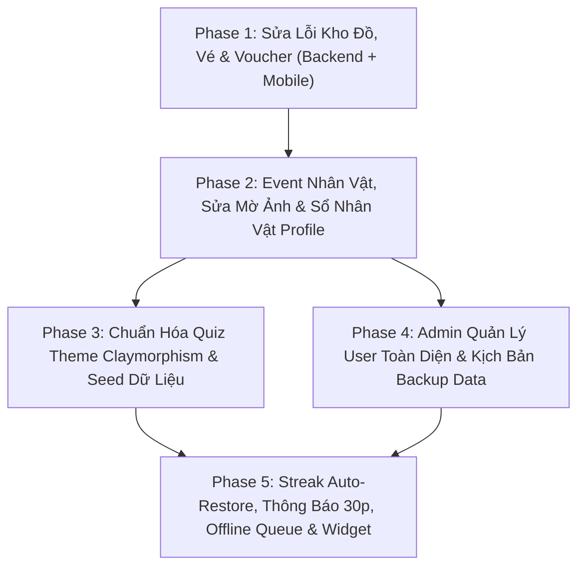

# 🚀 V2.5.1 — System Overhaul, Inventory Fixes & Gamification Polish Plan

> **For agentic workers:** REQUIRED SUB-SKILL: Use `superpowers:subagent-driven-development` (recommended) or `superpowers:executing-plans` to implement this plan task-by-task. Steps use checkbox (`- [ ]`) syntax for tracking.
> **Quy chuẩn monorepo:** Tuân thủ 100% [`plan update/ARCHITECTURE_RULES.md`](file:///d:/Downloads/SE%20Project/Growary/plan%20update/ARCHITECTURE_RULES.md).

**Goal:** Hoàn thiện và nâng cấp toàn diện bản 2.5.1 nhằm khắc phục các lỗi trải nghiệm thực tế (Kho đồ, voucher lặp, độ mờ ảnh nhân vật, lỗi admin edit), nâng tầm gamification (Sổ nhân vật truyện tranh, mini-game boss tuần mới, cơ chế tự khôi phục streak 3 lần/tháng kèm cảnh báo ngày 2), nâng cấp độ tin cậy (Backup dữ liệu 3 ngày, nhắc task 30p, offline task queue) và tối ưu phiên đăng nhập kèm Widget màn hình chính.

**Architecture:** 
- **Backend:** Layered architecture (`Route` → `Validate` → `Controller` → `Service` → `Model`), Single Source of Truth (`@shared/types`), cron jobs độc lập (`streak.ts`, `autoBackup.ts`), atomic updates (`$inc`, `$set`, `$pull`).
- **Mobile:** React Native / Expo với phong cách thiết kế Claymorphism nhất quán, cache offline với `AsyncStorage`, notifications local trigger 30 phút, `useShop`, `useBoss`, `useQuiz` custom hooks.
- **Admin:** React / Vite dashboard, chuẩn hóa schema Zod, cho phép xem/sửa toàn bộ chỉ số user an toàn.

**Tech Stack:** TypeScript Strict, Node.js / Express, MongoDB / Mongoose, React Native / Expo, Expo Notifications, Expo Linear Gradient, React / Vite (Admin), Jest / Supertest.

---

## Global Constraints

- **File Size Limits:** Controller $\le 400$ dòng, Service $\le 500$ dòng, Screen $\le 500$ dòng, Component $\le 400$ dòng.
- **TypeScript:** Không `any`, không `@ts-ignore`, biên dịch `npx tsc --noEmit` pass 100%.
- **Style Theme:** Toàn bộ Mobile Screen dùng màu nền ấm `COLORS.warmBg` (`#FFFDF5`), ClayHeader và shadow Claymorphism.
- **Data Integrity:** Không xóa nhầm dữ liệu người dùng thật; các thao tác trừ xu, trừ vé, cộng streak phải atomic.

---

## Review Focus (5 Trọng Điểm Kiểm Tra Bắt Buộc)

1. **Voucher Re-use Spam Prevention:** Mua hàng xong thì vé giảm giá/freeship phải bị trừ ngay trong DB (`UserInventory` trừ quantity hoặc xóa entry nếu quantity = 0), đồng thời client refresh ngay lập tức để không thể nhấn mua liên tục với giá giảm.
2. **Mystery Box Zero-Quantity Filter:** Khi mở hết rương (quantity về 0), danh sách kho đồ của cả Mobile UI và API backend không được hiển thị rương rỗng nữa.
3. **Fragment Display Name Resolution:** Mảnh ghép nhận từ rương phải hiển thị tên tiếng Việt rõ ràng của vật phẩm (ví dụ "Mảnh Áo Thun Growary"), tuyệt đối không để lộ đuôi ID ObjectId dạng `22af`.
4. **Streak Recovery Boundary Guard:** Người dùng bỏ lỡ Ngày 1 thì Ngày 2 đăng nhập phải nhận cảnh báo khôi phục; nếu làm đủ trong Ngày 2 thì khôi phục streak (tối đa 3 lần/tháng); nếu qua Ngày 2 mà vẫn không làm (sang Ngày 3) thì streak chính thức về 0 không thể khôi phục.
5. **Session & Offline Resilience:** Khi mạng chập chờn hoặc rớt mạng, phiên đăng nhập không được tự xóa token; task đánh dấu hoàn thành offline phải lưu vào hàng đợi và tự động đồng bộ khi có mạng trở lại.

---

## 🗺️ Lộ Trình 5 Phase & 10 Task Chi Tiết



---

### Task 1: Sửa Lỗi Kho Đồ, Hiển Thị Tên Mảnh & Tách Tab Vé (Shared + Backend + Mobile)

**Files:**
- Modify: `shared/types/reward.ts`
- Modify: `backend/src/services/warehouseService.ts` (217 lines — OK $\le 500$)
- Modify: `backend/src/services/rewardService.ts` (473 lines — ⚠️ 94.6% of 500 limit, không thêm hàm mới vượt 500 dòng)
- Modify: `mobile/src/screens/InventoryScreen.tsx` (285 lines — trần Screen 500 dòng, giữ $\le 390$ dòng tránh cảnh báo M1)
- Modify: `mobile/src/components/warehouse/MysteryBoxOpenModal.tsx` (393 lines — ⚠️ 98.2% of 400 limit, chỉ còn 7 dòng: rút gọn JSX/styles thừa nếu cần để luôn $\le 398$ dòng)
- Test (đã tồn tại): `backend/src/__tests__/services/inventoryFixes.test.ts` (414 lines), `backend/src/__tests__/integration/warehouseFlow.test.ts`

**Interfaces & Architecture Rules Guardrails:**
- **Rule 4.1 (Shared Types First):** Bổ sung vào `InventoryItem` tại `shared/types/reward.ts`:
  - `type?: string;` (ví dụ: `'coupon_freeship'`, `'coupon_discount_10k'`, `'coin'`, `'gacha_ticket'`)
  - `requiredFragments?: number;`
- **Phát hiện 4 lỗi thực tế Backend ↔ Mobile & UI State (Bắt buộc cấp dưới phải sửa):**
  1. **Lệch trường nhận diện vật phẩm (`rewardService.ts:259-284` vs `InventoryScreen.tsx`):** Backend trả về `itemType: 'special_item' | 'mystery_box'`, `rewardForm: 'fragment' | 'full'`, và `type: sp?.type`, nhưng `InventoryScreen.tsx` đang check `item.itemType.startsWith('frag_')` / `coupon_` và coi mọi thứ còn lại (`!isFragment && !isCoupon`) là Mystery Box. Nếu có vật phẩm tiêu hao (`rewardForm === 'full'`, `type: 'coin' | 'exp' | 'gacha_ticket'`) bấm vào sẽ mở nhầm `MysteryBoxOpenModal` với `boxId: 'special_item'` và lỗi API!
     - Định nghĩa 3 pure helper trong `InventoryScreen.tsx`:
       - `isFragmentItem(item: InventoryItem): boolean` $\rightarrow$ `item.rewardForm === 'fragment' || item.itemType.startsWith('frag_')`
       - `isCouponItem(item: InventoryItem): boolean` $\rightarrow$ `Boolean(item.type?.startsWith('coupon_') || item.type === 'freeship' || item.itemType.startsWith('coupon_')) && !isFragmentItem(item)`
       - `isMysteryBoxItem(item: InventoryItem): boolean` $\rightarrow$ `item.itemType === 'mystery_box'`
  2. **Trùng React `key` và Stale State khi đổi mảnh (`InventoryScreen.tsx:97, 115-116`):**
     - `renderGridItem` đang dùng `key={item.itemType}` khiến nhiều `special_item` / `mystery_box` trùng key React! Đổi sang key duy nhất: `` `${item.itemType}-${item.boxId || item.id || item.displayName}-${item.rewardForm || 'full'}` ``.
     - Nút đổi nhanh `inlineRedeemBtn` gọi `setSelectedItem(item); setTimeout(exchangeFragment, 100)` dễ đọc nhầm state cũ — truyền thẳng `item` vào `exchangeFragment(targetItem: InventoryItem)`.
  3. **Không tự tải lại kho khi quay lại từ Shop/Boss (`InventoryScreen.tsx:30-32`):** Đổi `useEffect(..., [])` sang `useFocusEffect(useCallback(() => { loadInventory(); }, []))` để khi user vừa dùng coupon bên `ShopScreen` quay lại sẽ thấy kho cập nhật ngay.
  4. **Stale `remainingQty` trong `MysteryBoxOpenModal.tsx:37`:** `useState(box?.quantity || 1)` chỉ chạy 1 lần lúc mount; mở rương A về `0` rồi mở rương B sẽ bị kẹt hiển thị `0`. Phải thêm `useEffect` reset `remainingQty`, `step`, `result`, `errorMsg` theo `[visible, box]` (đồng thời dọn nhẹ dòng trống để tổng dòng $\le 398$).
- **Backend Interfaces (Đã có trong code & đã có `inventoryFixes.test.ts`):**
  - `getUserInventoryItems(userId: string)`: Chỉ trả về items có `quantity > 0`.
  - `openMysteryBox(userId: string, boxId: string)`: Populate `specialItem.name`, trả về `"Mảnh " + specialItem.name` thay vì cắt ID `slice(-4)`.
  - `purchaseRewardItem(userId: string, rewardId: string, options: PurchaseOptions)`: Trừ atomic `$inc: { 'items.$.quantity': -1 }` và `$pull` xóa hẳn entry khi `quantity <= 0`.

- [x] **Step 1: Cập nhật `warehouseService.ts` & `rewardService.ts` (ĐÃ HOÀN THÀNH)**
  - *Ghi chú hoàn thành:*
    - Đã sửa `warehouseService.ts`: Tra cứu `SpecialItem.name`, đặt tên mảnh hiển thị đầy đủ (`"Mảnh [Tên]"`) thay vì cắt ID `22af`; dọn sạch rương có `quantity <= 0` khỏi inventory.
    - Đã sửa `rewardService.ts` (`getUserInventoryItems` & `purchaseRewardItem`): Lọc `item.quantity > 0`, trừ atomic coupon và `$pull` khi `quantity <= 0`.
    - Đã có integration test tại `backend/src/__tests__/integration/warehouseFlow.test.ts` (144 lines).

- [ ] **Step 2: Cập nhật `shared/types/reward.ts` theo Rule 4.1**
  - Thêm `type?: string;` và `requiredFragments?: number;` vào interface `InventoryItem` trong `shared/types/reward.ts`.

- [ ] **Step 3: Rà soát, chạy và bổ sung (nếu thiếu) test tại `backend/src/__tests__/services/inventoryFixes.test.ts`**
  - File `backend/src/__tests__/services/inventoryFixes.test.ts` (414 lines) **đã tồn tại sẵn** — KHÔNG ghi đè mất test cũ!
  - Chạy `cd backend && npx jest src/__tests__/services/inventoryFixes.test.ts src/__tests__/integration/warehouseFlow.test.ts` để xác nhận cả 3 kịch bản (trừ & rollback coupon, lọc item 0, format `"Mảnh <SpecialItem.name>"`) đều PASS 100%; nếu thiếu case edge-case nào thì bổ sung thêm.

- [ ] **Step 4: Cập nhật `InventoryScreen.tsx` & `MysteryBoxOpenModal.tsx`**
  - Trong `InventoryScreen.tsx`:
    - Chuyển `loadInventory` từ `useEffect` sang `useFocusEffect`.
    - Thêm state `activeTab: 'all' | 'items' | 'coupons'` (mặc định `'all'`) với thanh 3 tab Claymorphism dưới header:
      - `'all'`: Tất cả (`inventory`)
      - `'items'`: Vật phẩm & Rương (`inventory.filter(i => !isCouponItem(i))`)
      - `'coupons'`: Vé & Voucher (`inventory.filter(isCouponItem)`)
    - Áp dụng 3 helper `isFragmentItem`, `isCouponItem`, `isMysteryBoxItem` trong `renderGridItem`, `handleItemPress` và `renderBottomSheet`:
      - Nếu `isMysteryBoxItem(item)`: mở `MysteryBoxOpenModal` với `boxId: item.boxId || item.id || ''`.
      - Nếu vật phẩm tiêu hao (`!isFragmentItem && !isCouponItem && !isMysteryBoxItem`): hiển thị sheet cho phép dùng via `apiService.useItem(id)` thay vì gọi nhầm `/warehouse/open-box`.
      - Sửa `exchangeFragment(targetItem)` truyền `targetItem.id || targetItem.specialItem?._id || ''` và `key` duy nhất cho từng grid item.
    - Hiển thị badge phân loại (`FREESHIP` / `GIẢM GIÁ`) trong tab `Vé & Voucher`; giữ file $\le 390$ dòng, không dùng inline style $> 3$ thuộc tính (Rule 0.3).
  - Trong `MysteryBoxOpenModal.tsx`:
    - Thêm `useEffect` đồng bộ `setRemainingQty(box.quantity)` và reset `step`/`result`/`errorMsg` khi `[visible, box]` thay đổi; rút gọn dòng trống nếu cần để giữ $\le 398$ dòng ($\le 400$ trần Component).

- [ ] **Step 5: Kiểm tra biên dịch & Test Task 1**
  - Chạy: `cd backend && npx tsc --noEmit && npx jest src/__tests__/services/inventoryFixes.test.ts src/__tests__/integration/warehouseFlow.test.ts`
  - Chạy: `cd mobile && npx tsc --noEmit`

---

### Task 2: Tối Ưu Cache Tránh Re-load Liên Tục Trang Event (Stale-While-Revalidate)

**Files:**
- Create: `mobile/src/utils/eventCache.ts`
- Modify: `mobile/src/screens/EventScreen.tsx` (450 lines — ⚠️ 90% giới hạn 500 dòng, giữ $\le 480$ dòng)
- Modify: `mobile/src/screens/BossEventScreen.tsx` (467 lines — ⚠️ 93.4% giới hạn 500 dòng, kết hợp tách component ở Task 3 để giảm xuống $< 420$ dòng)

**Interfaces & Architecture Rules Guardrails:**
- **Rule 0.2 (Cấm `any`) & Rule 0.4 (JSDoc bắt buộc trong `mobile/src/utils/`):**
  - Tuyệt đối KHÔNG dùng `data: any`. Sử dụng Generic `<T>`:
    ```ts
    export interface CacheEntry<T> {
        data: T;
        timestamp: number;
    }

    /**
     * Lấy dữ liệu sự kiện từ bộ nhớ đệm (Memory Cache ưu tiên, fallback AsyncStorage).
     * @param key - Khóa định danh cache
     * @param ttlMs - Thời gian sống tính bằng ms (mặc định 5 phút = 300_000ms)
     * @returns Object chứa data (hoặc null nếu chưa có) và cờ isStale
     */
    export async function getEventCache<T>(
        key: string,
        ttlMs?: number
    ): Promise<{ data: T | null; isStale: boolean }>;

    /**
     * Lưu dữ liệu sự kiện vào cả Memory Cache và AsyncStorage kèm timestamp hiện tại.
     * @param key - Khóa định danh cache
     * @param data - Dữ liệu cần cache
     */
    export async function setEventCache<T>(key: string, data: T): Promise<void>;

    /**
     * Xóa một khóa cache cụ thể hoặc toàn bộ cache sự kiện khi có thay đổi (ví dụ sau khi đánh Boss).
     * @param key - Khóa cần xóa (bỏ trống để xóa toàn bộ prefix 'event_cache_')
     */
    export async function clearEventCache(key?: string): Promise<void>;
    ```

- [ ] **Step 1: Xây dựng module `mobile/src/utils/eventCache.ts`**
  - Dùng `Map<string, CacheEntry<unknown>>` làm L1 Memory Cache và `AsyncStorage` (với prefix `'@growary:event_cache:'`) làm L2 Persistent Cache.
  - Mặc định `ttlMs = 5 * 60 * 1000` (5 phút). Khi tìm thấy trong L1 hoặc L2, trả về `{ data, isStale: Date.now() - entry.timestamp > ttlMs }` để UI hiển thị ngay lập tức (Stale-While-Revalidate).
  - Đảm bảo đầy đủ JSDoc cho cả 3 hàm public theo Rule 0.4.

- [ ] **Step 2: Tích hợp Stale-While-Revalidate vào `EventScreen.tsx` và `BossEventScreen.tsx`**
  - Tại `EventScreen.tsx` (key `'active_bosses_list'`):
    - Dùng `ActiveBoss` import từ `'../components/boss'` thay cho `useState<any[]>` (giảm bớt `any`).
    - Trong `useFocusEffect`: Đọc `getEventCache<ActiveBoss[]>('active_bosses_list')`. Nếu `cached.data` tồn tại $\rightarrow$ `setActiveBosses(cached.data)` và `setIsLoading(false)` ngay lập tức.
    - Vẫn gọi ngầm `/events/boss/active` ở background để cập nhật `setActiveBosses` và `setEventCache('active_bosses_list', res.activeBosses || [])`.
    - **Guard chống mất cache khi offline (`EventScreen.tsx:49-50`):** Trong khối `catch`, **TUYỆT ĐỐI KHÔNG** gọi `setActiveBosses([])` nếu trước đó đã hydrate được `cached.data`!
  - Tại `BossEventScreen.tsx` (key `'active_bosses_payload'` lưu `{ activeBosses, userRecords }` đầy đủ chưa lọc, và `'boss_collections'`):
    - Đọc cache trước khi fetch (sau đó mới lọc theo `targetBossId` ở UI để không làm ghi đè cache tổng thành 1 boss duy nhất); chỉ hiện `ActivityIndicator` toàn màn hình khi `bosses.length === 0` và chưa có cache.
    - Sau khi `handleMiniGameComplete` (tấn công Boss thành công), gọi `clearEventCache()` trước khi `fetchData()` để đảm bảo HP mới nhất được cập nhật.

- [ ] **Step 3: Kiểm tra biên dịch Mobile**
  - Chạy: `cd mobile && npx tsc --noEmit` (Exit code 0, không lỗi type).

---

### Task 3: Sửa Lỗi Mờ Ảnh Nhân Vật & Tinh Gọn Chân Trang Detail (Mobile)

**Files:**
- Modify: `mobile/src/components/boss/BossBannerCard.tsx` (233 lines — xóa import thừa)
- Create: `mobile/src/components/boss/BossWeekCollectionSection.tsx` (Tách mới để tuân thủ Rule 0.1 & 2.2)
- Modify: `mobile/src/components/boss/index.ts`
- Modify: `mobile/src/screens/BossEventScreen.tsx` (Giảm từ 467 dòng xuống $\le 410$ dòng)

**Interfaces & Architecture Rules Guardrails:**
- **Rule 0.1 & 2.4 (Giới hạn kích thước Screen $\le 500$ dòng, tách UI $> 100$ dòng JSX):**
  - `BossEventScreen.tsx` hiện đang 467 dòng (93.4% giới hạn). BẮT BUỘC tách phần hiển thị bộ sưu tập ở chân trang thành component riêng `BossWeekCollectionSection.tsx` (bọc `React.memo` theo Rule 2.2.5) và export qua `mobile/src/components/boss/index.ts`.
- **Phát hiện bẫy dữ liệu `collectionId` từ Backend (`eventController.ts:14`):**
  - Endpoint `GET /events/boss/active` có gọi `.populate('collectionId', 'themeColor title iconEmoji')`, nên `bosses[0]?.collectionId` ở client có thể là **Object** `{ _id: string, title: string, themeColor: string, iconEmoji: string }` hoặc **string** ID.
  - Phải chuẩn hóa:
    ```ts
    const rawColId = bosses[0]?.collectionId as string | { _id?: string } | undefined;
    const activeCollectionId = typeof rawColId === 'object' && rawColId !== null ? rawColId._id : rawColId;
    ```
- **Interface `BossWeekCollectionSectionProps`:**
  ```ts
  export interface BossWeekCollectionSectionProps {
      collectionItem: {
          collection: {
              _id: string;
              title: string;
              iconEmoji?: string;
              themeColor?: string;
          };
          bosses: Array<{
              _id: string;
              title: string;
              avatarImageUrl?: string;
              isUnlocked: boolean;
          }>;
          userProgress: {
              unlockedCount: number;
              totalCount: number;
              isCompleted: boolean;
          };
      } | null;
      onPressCollection?: (collectionId: string) => void;
  }
  ```

- [x] **Step 1: Cập nhật `BossBannerCard.tsx` (ĐÃ HOÀN THÀNH + Dọn import thừa)**
  - *Ghi chú hoàn thành:* Đã thay thế `BlurView` bằng `<Image blurRadius={18} />` kèm overlay tối `rgba(0,0,0,0.55)` và icon khóa trong `mobile/src/components/boss/BossBannerCard.tsx`.
  - *Việc cần làm thêm:* Xóa dòng `import { BlurView } from 'expo-blur';` không còn sử dụng ở dòng 5 của `BossBannerCard.tsx`.

- [ ] **Step 2: Tạo `mobile/src/components/boss/BossWeekCollectionSection.tsx` & export trong `index.ts`**
  - Nhận `collectionItem` (bộ sưu tập của Boss tuần hiện tại).
  - Hiển thị tiêu đề bộ sưu tập (`iconEmoji` + `title` + tiến độ `unlockedCount/totalCount`) với viền/nhãn theo `themeColor`.
  - Render danh sách ngang (`FlatList` hoặc `ScrollView horizontal`) các **nhân vật (`collectionItem.bosses`)** thuộc bộ sưu tập tuần đó:
    - Nếu `char.isUnlocked === true`: Hiện ảnh rõ nét + tên thật `char.title` + viền `themeColor`.
    - Nếu `char.isUnlocked === false`: Hiện ảnh `blurRadius={15}` + lớp phủ tối `rgba(0,0,0,0.55)` + icon ổ khóa `lock` + nhãn `"Bí ẩn"`.

- [ ] **Step 3: Tích hợp `BossWeekCollectionSection` vào `BossEventScreen.tsx`**
  - Trích xuất `activeCollectionId` an toàn (xử lý cả trường hợp populated object lẫn string ID).
  - Lọc lấy đúng 1 bộ sưu tập có `c.collection?._id === activeCollectionId` để truyền vào `<BossWeekCollectionSection />`, thay thế khối `FlatList` cũ ở dòng 310–337.

- [ ] **Step 4: Kiểm tra biên dịch & kích thước file**
  - Chạy: `cd mobile && npx tsc --noEmit`
  - Đảm bảo `BossEventScreen.tsx` $< 430$ dòng và `BossWeekCollectionSection.tsx` $< 200$ dòng.

---

### Task 4: Bổ Sung Mini-game Đánh Boss Thứ 4 — "Lật Thẻ Trí Nhớ" (Shared + Backend + Mobile + Admin)

**Files:**
- Modify: `shared/types/boss.ts`
- Modify: `backend/src/models/BossEvent.ts` (89 lines — dòng 26 & 74)
- Modify: `admin/src/components/boss/BossFormModal.tsx` (338 lines — thêm option `'memory'` trong select Cơ Chế Minigame)
- Create: `mobile/src/components/boss/MemoryMatchGame.tsx`
- Modify: `mobile/src/components/boss/index.ts`
- Modify: `mobile/src/components/MiniGameModal.tsx` (357 lines — ⚠️ 89.2% giới hạn 400 dòng, giữ $\le 385$ dòng)
- Modify: `mobile/src/screens/BossEventScreen.tsx`

**Interfaces & Architecture Rules Guardrails:**
- **Rule 4.1 (Shared Types First) & Đồng bộ Backend + Admin + Mobile:**
  - Kế hoạch cũ thiếu cập nhật `@shared`, `BossEvent` model và Admin UI. Phải cập nhật đồng bộ cả 3 nơi:
    1. `shared/types/boss.ts`: `export type MiniGameType = 'random' | 'tap' | 'reflex' | 'quiz' | 'memory';`
    2. `backend/src/models/BossEvent.ts` (dòng 26 & 74): Mở rộng kiểu và `enum` của `miniGameType` thành `['random', 'tap', 'reflex', 'quiz', 'memory']`. (Lưu ý: `eventController.ts:attackBoss` và `BossRecord.ts:26` nhận `miniGameType: string` nên đã hỗ trợ sẵn `'memory'`).
    3. `admin/src/components/boss/BossFormModal.tsx` (dòng 265–269): Bổ sung `<option value="memory">Lật thẻ trí nhớ (Memory)</option>` để Admin cấu hình được mini-game mới cho Boss.
- **Phát hiện bẫy & lỗi tiềm ẩn tại `MiniGameModal.tsx` và `BossEventScreen.tsx`:**
  1. **Stale closure ở `MiniGameModal.tsx:46-69`:** Bộ đếm `setInterval` gọi `handleTimeUp()` bên trong `useEffect([visible, type, quizQuestion])` chỉ bắt được giá trị state khởi tạo. Với `type === 'memory'`, chỉ cần khi hết giờ trong `handleTimeUp` gọi thẳng `onCompleteRef.current('normal')` (dùng `useRef` giữ `onComplete` mới nhất); còn khi ghép đủ 3 cặp thì `MemoryMatchGame` gọi ngay `onAllMatched(timeLeft >= 5)` trước khi hết giờ.
  2. **Lỗi thiếu `bossId` khi lấy Quiz (`BossEventScreen.tsx:170`):** Hiện tại dòng 170 đang gọi `apiService.get('/events/boss/quiz')` thiếu `?bossId=${targetBoss._id}`, trong khi `backend/src/controllers/eventController.ts:166` trả về `400` nếu thiếu `bossId`. Tiện tay cập nhật `handleAttackPress` thì sửa luôn thành `` `/events/boss/quiz?bossId=${targetBoss._id}` ``.
- **Rule 0.1 & Cơ chế phối hợp Timer giữa `MiniGameModal` và `MemoryMatchGame`:**
  - `MiniGameModal.tsx` quản lý đồng hồ đếm ngược `timeLeft` chung ở header modal:
    - Khi `type === 'memory'`, `MiniGameModal` đặt `initialTime = 15` (15 giây).
    - `MemoryMatchGameProps`:
      ```ts
      export interface MemoryMatchGameProps {
          /** Thời gian còn lại (giây) truyền từ MiniGameModal xuống để tính Critical */
          timeLeft: number;
          /** Callback gọi ngay khi lật đúng cả 3 cặp thẻ */
          onAllMatched: (isCritical: boolean) => void;
      }
      ```
    - Khi người chơi lật khớp đủ 3 cặp (6 thẻ): Kiểm tra `const isCritical = timeLeft >= 5;` (tức hoàn thành trong $\le 10$ giây trên tổng 15 giây) $\rightarrow$ gọi `onAllMatched(isCritical)`, và `MiniGameModal` chuyển tiếp thành `onComplete(isCritical ? 'critical' : 'normal')`.

- [ ] **Step 1: Cập nhật `shared/types/boss.ts`, `backend/src/models/BossEvent.ts` & `admin/src/components/boss/BossFormModal.tsx`**
  - Thêm `'memory'` vào union `MiniGameType` trong `shared/types/boss.ts` và mảng `enum` trong `backend/src/models/BossEvent.ts`.
  - Thêm `<option value="memory">Lật thẻ trí nhớ (Memory)</option>` vào `<select>` tại `admin/src/components/boss/BossFormModal.tsx`.

- [ ] **Step 2: Tạo component `mobile/src/components/boss/MemoryMatchGame.tsx` (< 220 dòng)**
  - Khởi tạo mảng 6 thẻ bài từ 3 cặp chủ đề thiên nhiên Growary:
    1. `{ pairId: 'seed', icon: 'spa', label: 'Hạt Giống', color: '#10B981' }`
    2. `{ pairId: 'water', icon: 'water-drop', label: 'Giọt Nước', color: '#3B82F6' }`
    3. `{ pairId: 'sun', icon: 'wb-sunny', label: 'Mặt Trời', color: '#F59E0B' }`
  - Xáo trộn ngẫu nhiên (Fisher-Yates shuffle) khi mount.
  - Xử lý logic lật tối đa 2 thẻ cùng lúc (`flippedIds: number[]`, `matchedPairIds: string[]`, `isLocked: boolean`):
    - Nếu 2 thẻ trùng `pairId`: Đánh dấu vào `matchedPairIds`. Khi đạt 3 cặp, gọi `onAllMatched(timeLeft >= 5)`.
    - Nếu 2 thẻ khác `pairId`: Khóa chạm `500ms` rồi úp lại (nhớ lưu timer ref và `clearTimeout` trong cleanup `useEffect` khi unmount để tránh memory leak nếu đóng modal giữa chừng).
  - Bọc `React.memo(MemoryMatchGame)` theo Rule 2.2.5 và export trong `mobile/src/components/boss/index.ts`.

- [ ] **Step 3: Tích hợp vào `MiniGameModal.tsx` và `BossEventScreen.tsx`**
  - Trong `MiniGameModal.tsx`:
    - Import `MiniGameType` từ `'../types'` và mở rộng prop `type: Exclude<MiniGameType, 'random'>`.
    - Dùng `onCompleteRef` để tránh stale callback trong `setInterval`. Nếu `type === 'memory'`, đặt `initialTime = 15`; trong `handleTimeUp` gọi `onCompleteRef.current('normal')`.
    - Render `<MemoryMatchGame timeLeft={timeLeft} onAllMatched={(isCrit) => onComplete(isCrit ? 'critical' : 'normal')} />` khi `type === 'memory'`.
  - Trong `BossEventScreen.tsx`:
    - Dùng `Exclude<MiniGameType, 'random'>` cho state `miniGameType`.
    - Trong `handleAttackPress`: Thêm `'memory'` vào danh sách random (`hasQuiz ? ['tap', 'quiz', 'reflex', 'memory'] : ['tap', 'reflex', 'memory']`), và sửa URL quiz thành `` `/events/boss/quiz?bossId=${targetBoss._id}` ``.

- [ ] **Step 4: Kiểm tra biên dịch Backend, Admin & Mobile**
  - Chạy: `cd backend && npx tsc --noEmit`
  - Chạy: `cd mobile && npx tsc --noEmit`
  - Chạy: `cd admin && npm run build`
  - Kiểm tra `MiniGameModal.tsx` $\le 400$ dòng (Rule 0.1).

---

### Task 5: Nâng Cấp Bộ Sưu Tập Profile — "Sổ Nhân Vật" (Shared + Backend + Mobile)

**Files:**
- Modify: `shared/types/boss.ts`
- Modify: `backend/src/controllers/eventController.ts` (253 lines — sửa `getBossCollections` dòng 187–224)
- Create: `mobile/src/components/boss/CharacterLorebookModal.tsx` (< 280 dòng)
- Modify: `mobile/src/components/boss/index.ts`
- Modify: `mobile/src/screens/BossCollectionScreen.tsx` (328 lines — giữ $\le 360$ dòng)

**Interfaces & Architecture Rules Guardrails:**
- **Phát hiện lỗi thiếu dữ liệu ở Backend (`eventController.ts:192`) & Schema thực tế:**
  - Hiện tại `getBossCollections` trong `backend/src/controllers/eventController.ts` chỉ query:
    `BossEvent.find({ collectionId: col._id }, '_id title avatarImageUrl status')`
  - Nếu không sửa câu query và object trả về này, Mobile sẽ **không có** `description`, `loreTitle`, `loreContent`, `isLimited`, `colorBg`, `colorIcon`, `weekActivatedAt` để hiển thị trong "Sổ Nhân Vật"!
  - *(Lưu ý kỹ thuật cho cấp dưới)*: Model `UserBossCollection` chỉ lưu mảng `unlockedBosses: ObjectId[]` (không lưu timestamp mở khóa từng boss riêng lẻ — chỉ có `completedAt` của cả bộ sưu tập và `boss.weekActivatedAt` / `boss.updatedAt`). Tuyệt đối không bịa field không tồn tại; dùng `weekActivatedAt` làm mốc tuần sự kiện xuất hiện của nhân vật.
- **Rule 4.1 (Shared Types First) & Rule 0.2 (Xóa bỏ `any` trong `BossCollectionScreen.tsx`):**
  - Bổ sung vào `shared/types/boss.ts`:
    ```ts
    export interface CollectionCharacterItem {
        _id: string;
        title: string;
        description?: string;
        avatarImageUrl?: string;
        status: BossStatus;
        isUnlocked: boolean;
        loreTitle?: string;
        loreContent?: string;
        isLimited?: boolean;
        colorBg?: string;
        colorIcon?: string;
        weekActivatedAt?: string | Date;
    }

    export interface BossCollectionWithProgress {
        collection: {
            _id: string;
            title: string;
            description?: string;
            iconEmoji: string;
            themeColor: string;
            bonusTickets: number;
            month?: number;
            year?: number;
        };
        bosses: CollectionCharacterItem[];
        userProgress: {
            unlockedCount: number;
            totalCount: number;
            isCompleted: boolean;
            bonusTicketsClaimed: boolean;
            completedAt?: string | Date;
        };
    }
    ```

- [ ] **Step 1: Cập nhật `shared/types/boss.ts` và `backend/src/controllers/eventController.ts`**
  - Thêm `CollectionCharacterItem` và `BossCollectionWithProgress` vào `shared/types/boss.ts`.
  - Trong `eventController.ts` (`getBossCollections`):
    - Mở rộng projection của `BossEvent.find` thành `'_id title description avatarImageUrl status loreTitle loreContent isLimited colorBg colorIcon weekActivatedAt updatedAt'`.
    - Trả về đầy đủ các trường trên trong từng phần tử của `bosses`, kèm `completedAt: userCol.completedAt` trong `userProgress`, và sắp xếp sẵn `bosses` đưa nhân vật `isUnlocked: true` lên đầu danh sách.

- [ ] **Step 2: Tạo `mobile/src/components/boss/CharacterLorebookModal.tsx`**
  - Props interface rõ ràng (Rule 2.2.4):
    ```ts
    export interface CharacterLorebookModalProps {
        visible: boolean;
        character: (CollectionCharacterItem & { collectionTitle?: string; themeColor?: string }) | null;
        onClose: () => void;
    }
    ```
  - Giao diện "Sổ Nhân Vật" chuẩn truyện tranh / sổ tay phiêu lưu Claymorphism:
    - Khung ảnh Artwork lớn bo góc kèm viền `themeColor` và badge độ hiếm (`LIMITED` / `STORY`).
    - Tên nhân vật (`character.title`), Danh hiệu tiểu sử (`character.loreTitle || 'Huyền Thoại Bí Ẩn'`), Tên bộ sưu tập (`character.collectionTitle`) và mốc tuần xuất hiện (`character.weekActivatedAt`).
    - Khung trích dẫn câu thoại/mô tả đặc trưng (`character.description`) chữ nghiêng có icon ngoặc kép.
    - Cuộn nội dung cốt truyện (`character.loreContent || character.description || 'Câu chuyện về nhân vật này đang được ghi chép vào biên niên sử Growary...'`).
  - Bọc `React.memo` và export qua `mobile/src/components/boss/index.ts`.

- [ ] **Step 3: Nâng cấp `mobile/src/screens/BossCollectionScreen.tsx`**
  - Thay thế toàn bộ `useState<any[]>` và `useState<any | null>` bằng kiểu chuẩn `BossCollectionWithProgress[]` và `CharacterLorebookModalProps['character']` (Rule 0.2 — Cấm `any`).
  - Chuyển `useEffect(..., [])` sang `useFocusEffect` kết hợp `getEventCache<BossCollectionWithProgress[]>('my_boss_collections')` và `setEventCache` từ `mobile/src/utils/eventCache.ts` (Task 2) để mở tức thì từ Profile và cập nhật ngay khi vừa đánh thắng Boss.
  - Áp dụng màu chủ đạo `collection.themeColor` cho từng card bộ sưu tập: nền pha nhẹ `${collection.themeColor}12`, viền `${collection.themeColor}45`, badge tiến độ mang màu `collection.themeColor`.
  - Sắp xếp nhân vật phía client phòng vệ: `[...bosses].sort((a, b) => Number(b.isUnlocked) - Number(a.isUnlocked))`.
  - Thay `<Modal>` đơn giản cũ (dòng 151–168) bằng `<CharacterLorebookModal />`.

- [ ] **Step 4: Kiểm tra biên dịch toàn diện cho Phase 1 & Phase 2 (Tasks 1–5)**
  - Chạy: `cd backend && npx tsc --noEmit && npm test`
  - Chạy: `cd mobile && npx tsc --noEmit`

---

### Task 6: Chuẩn Hóa Quiz Screen Đồng Nhất Theme Claymorphism & Seed Data Mẫu (Backend + Mobile)

**Files:**
- Modify: `mobile/src/screens/QuizEventScreen.tsx` (274 lines — OK $\le 500$)
- Modify: `mobile/src/components/quiz/QuizLobbyView.tsx` (332 lines — giữ $\le 370$ dòng)
- Create: `backend/src/seeds/quizSampleData.ts` (< 250 dòng)
- Modify: `backend/src/server.ts` (160 lines — gọi `ensureQuizSampleSeed()` sau `connectDB()`)

**Interfaces & Architecture Rules Guardrails:**
- **Phát hiện lỗ hổng nghiêm trọng ở kế hoạch cũ (Thiếu seed `QuizEvent` active):**
  - Kế hoạch cũ chỉ nhắc seed `QuizTopic` và `QuizQuestion`, và nhắc sai tên endpoint `/api/quiz/lobby` (endpoint thực tế là `GET /api/quiz/status` xử lý bởi `getUserQuizStatus` trong `backend/src/services/quizService.ts:56-125`).
  - Trong `getUserQuizStatus`, hệ thống kiểm tra `getActiveQuizEvent()` trước tiên. Nếu bảng `QuizEvent` chưa có sự kiện nào đang `'active'`, API sẽ trả về `hasActiveEvent: false` dù có hàng trăm câu hỏi!
  - Vì vậy, hàm `ensureQuizSampleSeed(): Promise<void>` trong `backend/src/seeds/quizSampleData.ts` BẮT BUỘC phải seed idempotent cả **3 bảng**:
    1. `QuizTopic`: Nếu `countDocuments({ isActive: true }) === 0`, tạo 2 chủ đề active:
       - `"Nông Nghiệp & Hệ Sinh Thái Xanh"` (`iconName: 'eco'`, `colorAccent: '#10B981'`)
       - `"Kỹ Năng Sống & Quản Lý Thời Gian"` (`iconName: 'psychology'`, `colorAccent: '#F59E0B'`)
    2. `QuizQuestion`: Nếu `countDocuments() < 15`, nạp tối thiểu 30 câu hỏi tiếng Việt chất lượng (15 câu/chủ đề, đủ 4 đáp án `options`, `correctIndex` $0..3$, `difficulty`: `'easy' | 'medium' | 'hard'`).
    3. `QuizEvent`: Nếu không có `QuizEvent` nào đang active (`countDocuments({ status: 'active', endTime: { $gt: new Date() } }) === 0`), tự động tạo 1 sự kiện active kéo dài 30 ngày (`title: 'Đấu Trường Tri Thức Growary'`, `rewardPerCorrect: 50`, `maxAttemptsPerUser: 5`, `attemptCooldownHours: 4`, `questionsPerAttempt: 5`).
- **Rule 2.6 (Theme & Styling Claymorphism trên Mobile):**
  - Không hardcode `#F8FAFC`, `#FFFFFF`, `#E2E8F0`, `#6B7280`. Sử dụng `COLORS.warmBg` (`#FFFDF5`), `COLORS.clayCard`, `COLORS.clayText`, `SHADOWS.clayLight` và `SHADOWS.clay` từ `mobile/src/theme.ts`.

- [ ] **Step 1: Tạo `backend/src/seeds/quizSampleData.ts` và tích hợp vào `backend/src/server.ts`**
  - Viết hàm `export async function ensureQuizSampleSeed(): Promise<void>` có `try/catch` an toàn (không làm crash server nếu lỗi mạng tạm thời).
  - Gọi `await ensureQuizSampleSeed();` ngay sau `await connectDB();` trong `startServer()` tại `backend/src/server.ts`.

- [ ] **Step 2: Refactor `QuizEventScreen.tsx` & `QuizLobbyView.tsx` theo chuẩn Claymorphism**
  - Trong `QuizEventScreen.tsx`:
    - Đổi nền `safeArea` và `StatusBar` từ `#F8FAFC` sang `COLORS.warmBg` (`#FFFDF5`).
    - Thiết kế lại `topBar`: nền `COLORS.warmBg`, nút Back và nút Bảng Vàng dạng nổi bo góc 14px nền `COLORS.clayCard` kèm `...SHADOWS.clayLight` (tương tự `BossEventScreen`).
  - Trong `QuizLobbyView.tsx`:
    - Đổi card lượt chơi từ `#FFFFFF` phẳng sang `COLORS.clayCard` có viền ấm `rgba(93, 64, 55, 0.12)` và `...SHADOWS.clayLight`.
    - Đổi nút Bảng Vàng (`secondaryButton`) sang phong cách Claymorphism ấm áp đồng bộ với `EventScreen`.

- [ ] **Step 3: Kiểm tra biên dịch Backend & Mobile**
  - Chạy: `cd backend && npx tsc --noEmit`
  - Chạy: `cd mobile && npx tsc --noEmit`

---

### Task 7: Kịch Bản Backup Dữ Liệu Vòng Quay & Kho Đặc Biệt (`Data_Backup`)

**Files:**
- Create: `backend/src/scripts/backupSpecialAndGacha.ts` (69 lines — ĐÃ HOÀN THÀNH)
- Modify: `backend/package.json` (ĐÃ HOÀN THÀNH)

**Interfaces & Architecture Rules Guardrails:**
- **Lưu ý quan trọng từ Manager cho Task 9 (`autoBackup.ts`):**
  - File `backend/src/scripts/backupSpecialAndGacha.ts` là script chạy CLI độc lập nên có gọi `mongoose.connect()` và `mongoose.disconnect()` trong khối `finally`.
  - Khi làm Task 9 (`autoBackup.ts` chạy ngầm trong tiến trình Express server), **TUYỆT ĐỐI KHÔNG** gọi trực tiếp `runBackup()` nếu hàm đó ngắt kết nối `mongoose.disconnect()`, vì sẽ làm sập kết nối DB của toàn bộ server đang online!
  - Giải pháp chuẩn: Bổ sung tham số `export async function runBackup(options?: { standalone?: boolean; targetDir?: string }): Promise<string>` trong `backupSpecialAndGacha.ts` (chỉ `connect`/`disconnect` khi `options?.standalone !== false`), để `autoBackup.ts` ở Task 9 tái sử dụng an toàn (DRY).

- [x] **Step 1: Viết script `backupSpecialAndGacha.ts` (ĐÃ HOÀN THÀNH)**
  - *Ghi chú hoàn thành:* Đã tạo `backend/src/scripts/backupSpecialAndGacha.ts` kết nối DB và sao lưu `SpecialItems`, `MysteryBoxes`, `GachaItems` các tầng và `GachaWeeklyEvents` ra các file JSON chuẩn hóa trong `Data_Backup/`.

- [x] **Step 2: Thêm npm script và chạy thử nghiệm (ĐÃ HOÀN THÀNH)**
  - *Ghi chú hoàn thành:* Đã thêm `"backup:data": "ts-node src/scripts/backupSpecialAndGacha.ts"` vào `backend/package.json`.

---

### Task 8: Nâng Cấp Admin Quản Lý User & Sửa Lỗi Chức Năng Edit (Shared + Backend + Admin)

**Files:**
- Modify: `shared/types/user.ts`
- Modify: `backend/src/validators/userValidator.ts` (41 lines — OK)
- Modify: `backend/src/routes/admin/users.ts` (100 lines — OK $\le 300$)
- Modify: `admin/src/pages/UserManagement.tsx` (304 lines — ⚠️ giữ $\le 380$ dòng, trần Admin Page là 400 dòng)
- Test: `backend/src/__tests__/routes/adminUsersFix.test.ts`

**Interfaces & Architecture Rules Guardrails:**
- **Phát hiện 4 lỗi nghiêm trọng trong code hiện tại (Cấp dưới bắt buộc phải xử lý):**
  1. **Reset Password bị chặn và thiếu mã hóa `bcrypt`:**
     - Tại `backend/src/validators/userValidator.ts`, `updateUserSchema` hiện **chưa có** trường `password` và `gachaTier`.
     - Tại `backend/src/routes/admin/users.ts` (dòng 89), code đang viết `delete updates.password; // Keep it safe`! Nếu Admin gửi mật khẩu mới lên sẽ bị xóa bỏ; còn nếu bỏ dòng `delete` mà không băm (`bcrypt.hash`) thì mật khẩu sẽ bị lưu dạng plain-text vào DB (user không thể đăng nhập)!
     - **Cách sửa chuẩn:**
       - Trong `updateUserSchema` (`userValidator.ts`): Thêm `gachaTier: z.number().int().min(1).max(10).optional()` và `password: z.string().trim().min(6, 'Password must be at least 6 characters').max(100).optional()`.
       - Trong `PUT /users/:id` (`backend/src/routes/admin/users.ts`): Dùng `import bcrypt from 'bcryptjs';` (gói đã cài sẵn ở `backend`):
         ```ts
         if (updates.password && typeof updates.password === 'string' && updates.password.trim().length >= 6) {
             updates.password = await bcrypt.hash(updates.password.trim(), 10);
         } else {
             delete updates.password;
         }
         ```
  2. **Vi phạm Rule 4.1 (Trùng lặp `UserData` trong `UserManagement.tsx:4-25` & thiếu `gachaTier`):**
     - `backend/src/models/User.ts` đã có `gachaTier: number` (mặc định 1), nhưng `shared/types/user.ts` chưa khai báo `gachaTier?: number;`, còn `UserManagement.tsx` đang định nghĩa lại `interface UserData` (22 dòng trùng lặp `@shared`).
     - Phải thêm `gachaTier?: number;` vào `User` tại `shared/types/user.ts`, và trong `UserManagement.tsx` **import `User` từ `'../types'`** thay thế cho `UserData` (dùng `type UserRow = User & { _id: string; createdAt: string }` nếu cần khóa `_id` non-optional).
  3. **Bẫy State `newPassword` & Payload rỗng ở `UserManagement.tsx`:**
     - Nếu `newPassword` không được reset trong `openModal(u, edit)` và sau khi `handleSaveEdits()` xong, mật khẩu vừa gõ cho User A có thể còn sót lại khi mở modal cho User B!
     - Nếu Admin để trống ô mật khẩu, **TUYỆT ĐỐI KHÔNG** gửi `password: ""` trong `adminApi.updateUser(...)`, vì Zod `.min(6)` sẽ trả lỗi `400` làm hỏng luôn tính năng sửa! Chỉ gửi `password` khi `newPassword.trim().length >= 6`.
     - Trong `openModal`: phải khởi tạo thêm `gachaTier: u.gachaTier || 1` vào `editForm`.
  4. **Rule 0.1 & 3.2 (Giới hạn Admin Page $\le 400$ dòng):**
     - `admin/src/pages/UserManagement.tsx` đang ở mức **304/400 dòng**. Việc bỏ `UserData` trùng lặp giúp tiết kiệm ~20 dòng, đủ chỗ sạch sẽ cho cột `Tầng Gacha` và ô `newPassword` mà vẫn giữ file $\le 370$ dòng.

- [x] **Step 1: Cập nhật một phần `userValidator.ts` (ĐÃ HOÀN THÀNH CƠ BẢN)**
  - *Ghi chú hoàn thành:* Đã bổ sung `gachaTickets`, `totalCoinsSpent`, `currentStreak`, `longestStreak`, `totalPointsEarned` vào `updateUserSchema`.

- [ ] **Step 2: Viết test failing cho `gachaTier` và `password` (bcrypt hash) tại `backend/src/__tests__/routes/adminUsersFix.test.ts`**
  - Viết 2 test cases:
    1. `'should allow admin to update gachaTickets, gachaTier, currentStreak, totalCoinsSpent, and coins'`.
    2. `'should hash new password with bcryptjs when admin resets user password via PUT /api/admin/users/:id'`.
  - Chạy `cd backend && npx jest src/__tests__/routes/adminUsersFix.test.ts` $\rightarrow$ Xác nhận FAIL ở phần `password` / `gachaTier`.

- [ ] **Step 3: Bổ sung `gachaTier` + `password` vào `@shared`, `userValidator.ts` và `routes/admin/users.ts`**
  - Cập nhật `shared/types/user.ts`: Thêm `gachaTier?: number;` vào `User`.
  - Cập nhật `backend/src/validators/userValidator.ts`: Thêm `gachaTier` và `password` vào `updateUserSchema`.
  - Cập nhật `backend/src/routes/admin/users.ts`: Import `bcrypt` từ `'bcryptjs'` và băm `updates.password` nếu có truyền lên.
  - Chạy lại test Step 2 và xác nhận PASS 100%.

- [ ] **Step 4: Cập nhật `admin/src/pages/UserManagement.tsx` ($\le 380$ dòng)**
  - Thay `interface UserData` bằng `User` từ `'../types'` (`type UserRow = User & { _id: string; createdAt: string }`) và thêm state `const [newPassword, setNewPassword] = useState('')`.
  - Trong `openModal`: set `gachaTier: u.gachaTier || 1` vào `editForm` và **luôn gọi `setNewPassword('')`**.
  - Trong bảng danh sách & Modal xem chi tiết: Hiển thị **Tầng Vòng Quay (`Tầng ${u.gachaTier || 1}`)** cùng Vé Gacha, Chuỗi Streak, Ngày tạo, Tổng xu tiêu dùng.
  - Trong Modal Chỉnh sửa (`editMode === true`):
    - Thêm ô chỉnh sửa `🎡 Tầng Vòng Quay (gachaTier)` (min 1, max 10).
    - Thêm ô `🔑 Cấp lại mật khẩu mới (Để trống nếu không đổi)` (min 6 ký tự). Khi lưu (`handleSaveEdits`), chỉ đính kèm `password: newPassword.trim()` vào payload nếu `newPassword.trim().length >= 6`, sau đó reset `setNewPassword('')`.
  - Chạy `cd admin && npm run build` $\rightarrow$ Xác nhận Exit code 0.

---

### Task 9: Cơ Chế Tự Động Khôi Phục Streak (3 Lần/Tháng), Cảnh Báo Ngày 2 & Auto Backup 3 Ngày

**Files:**
- Modify: `shared/types/user.ts`
- Modify: `backend/src/models/User.ts` (145 lines — OK $\le 250$)
- Modify: `backend/src/services/planService.ts` (40 lines — chuyển logic streak & penalty từ controller sang đây)
- Modify: `backend/src/controllers/planController.ts` (439 lines — ⚠️ **ĐANG VI PHẠM H1 (> 400 dòng)**, bắt buộc rút gọn xuống $\le 380$ dòng!)
- Modify: `backend/src/jobs/streak.ts` (158 lines — OK)
- Create: `backend/src/jobs/autoBackup.ts` (< 120 dòng)
- Modify: `backend/src/scripts/backupSpecialAndGacha.ts` (Hỗ trợ gọi từ cron không ngắt DB)
- Modify: `backend/src/server.ts` (Khởi chạy `startAutoBackupCronJob()`)
- Create: `mobile/src/components/StreakGraceBanner.tsx` (< 80 dòng — bọc `React.memo`, tránh làm phình `HomeScreen.tsx`)
- Modify: `mobile/src/screens/HomeScreen.tsx` (450 lines — ⚠️ **ĐANG 90% (450/500)**, dùng `<StreakGraceBanner />` để giữ $\le 480$ dòng sau cả Task 9 & 10)
- Test: `backend/src/__tests__/jobs/streakRecovery.test.ts` (và giữ nguyên PASS cho `backend/src/__tests__/services/planService.test.ts`)

**Interfaces & Architecture Rules Guardrails:**
- **Phát hiện 5 lỗ hổng kiến trúc & xung đột logic trong kế hoạch cũ & code thực tế:**
  1. **Vi phạm H1 tại `planController.ts` (439/400 dòng) & Thiếu nơi kích hoạt khôi phục Ngày 2:**
     - Kế hoạch cũ chỉ liệt kê `jobs/streak.ts` (chạy lúc nửa đêm), quên mất rằng khi người dùng làm đủ $\ge 3$ task vào Ngày 2 thì việc khôi phục diễn ra ngay trong hàm `completeTask` (`planController.ts:270`)!
     - Đồng thời `planController.ts` đang dài **439 dòng** (vượt trần 400 dòng của Controller theo Rule 0.1).
     - **Giải pháp Manager:** Chuyển logic xử lý cộng/khôi phục streak khi hoàn thành task VÀ logic tạo carryover/penalty ngày hôm qua từ `planController.ts` sang `backend/src/services/planService.ts` (hiện mới có 40 dòng), giúp `planController.ts` giảm xuống dưới **380 dòng**!
  2. **Race condition cực kỳ nguy hiểm giữa `planController.ts:43,58` (`lastStreakCheckDate`) và `jobs/streak.ts:42`:**
     - Hiện tại hàm `getTodayPlan` (`planController.ts:43-59`) khi kiểm tra phạt task bỏ lỡ hôm qua đang ghi đè `user.lastStreakCheckDate = today` dù **chưa hề kiểm tra hay reset `currentStreak` / `streakGracePeriod`**!
     - Nếu `jobs/streak.ts` chạy sau (hoặc server vừa thức dậy), câu lệnh `if (user.lastStreakCheckDate >= today) continue;` sẽ **BỎ QUA LUÔN** việc kiểm tra streak của user đó!
     - **Giải pháp bắt buộc:** Tách riêng quyền sở hữu! `lastStreakCheckDate` **CHỈ DO `processDailyStreakCheck` (`jobs/streak.ts`)** cập nhật. Logic phạt tiền/penalty khi mở app (`reconcileYesterdayPlanAndPenalties` trong `planService.ts`) dùng trường riêng `lastPenaltyCheckDate?: Date` (hoặc kiểm tra đã ghi penalty hôm nay chưa) và **TUYỆT ĐỐI KHÔNG** chạm vào `user.lastStreakCheckDate`!
  3. **Lỗi bỏ sót User không mở app ở `jobs/streak.ts`:**
     - Code `streak.ts` hiện tại chỉ quét `DailyPlan.find({ date: yesterday })`. Nếu một người chơi đang có `currentStreak = 10` hoặc `streakGracePeriod = true` nhưng **không mở app cả ngày hôm qua** (không sinh ra document `DailyPlan`), cron job sẽ bỏ qua họ hoàn toàn (kể cả khi đang ở Ngày 2 `streakGracePeriod = true` mà không mở app)!
     - **Giải pháp Manager:** Quét hợp nhất tất cả user có `currentStreak > 0` hoặc `streakGracePeriod: true` kết hợp với `DailyPlan` của ngày hôm qua (dùng `Map` và batch `bulkWrite` / `updateMany` theo Rule 1.5.3, tuyệt đối không N+1 query trong loop):
       - Nếu user đang `!streakGracePeriod` và `< 3` tasks hôm qua (hoặc không có `DailyPlan`): nếu số lần khôi phục trong tháng `'YYYY-MM'` hiện tại `< 3` $\rightarrow$ giữ `currentStreak`, bật `streakGracePeriod = true`, lưu `missedStreakDate = yesterday`; nếu đã đủ 3 lần $\rightarrow$ `currentStreak = 0`, Boss hồi `+BOSS_HEAL_AMOUNT` HP.
       - Nếu user đang `streakGracePeriod === true` và `< 3` tasks hôm qua (hoặc không có `DailyPlan`): lỡ 2 ngày liên tiếp $\rightarrow$ `currentStreak = 0`, `streakGracePeriod = false`, `missedStreakDate = null`, Boss hồi `+BOSS_HEAL_AMOUNT` HP.
  4. **Rule 4.1 (Shared Types First) & Làm rõ phép toán khôi phục Ngày 2:**
     - Các trường mới trong `shared/types/user.ts` & `backend/src/models/User.ts`:
       - `streakRestoresThisMonth?: number;` (mặc định `0`)
       - `lastStreakRestoreMonth?: string;` (định dạng `'YYYY-MM'` theo giờ VN UTC+7 để tự động coi như `0` khi sang tháng mới)
       - `streakGracePeriod?: boolean;` (mặc định `false` — đang ở Ngày 2 chờ làm bù)
       - `missedStreakDate?: string | Date | null;`
       - `lastPenaltyCheckDate?: Date;` (chỉ trong `User.ts` backend để tách khỏi `lastStreakCheckDate`)
     - Trong `applyDailyTaskStreakProgress`: Khi ở Ngày 2 (`streakGracePeriod === true`) làm đủ `>= STREAK_MIN_TASKS` và `!isDailyScoreCalculated`: nếu `lastStreakRestoreMonth !== currentVnMonth`, reset `streakRestoresThisMonth = 0` trước rồi tăng `streakRestoresThisMonth += 1`, đặt `lastStreakRestoreMonth = currentVnMonth`, `streakGracePeriod = false`, `missedStreakDate = null`, và cộng `currentStreak += 1` (vừa bảo toàn chuỗi cũ, vừa ghi nhận hoàn thành Ngày 2) kèm `longestStreak = Math.max(currentStreak, longestStreak)`.
  5. **Rule 1.6 (Chuẩn Cron Job cho `autoBackup.ts`) & Ngân sách dòng `HomeScreen.tsx` (450/500):**
     - `autoBackup.ts` phải có JSDoc header ghi rõ schedule (`0 19 * * *` = 02:00 sáng giờ VN), timezone, models affected; gọi `runBackup({ standalone: false, targetDir })` để **không gọi `mongoose.disconnect()`**.
     - `HomeScreen.tsx` hiện đang 450/500 dòng: **bắt buộc** tách banner cảnh báo Ngày 2 thành component `mobile/src/components/StreakGraceBanner.tsx` để không làm vỡ trần 500 dòng khi gộp cùng Task 10.

- [ ] **Step 1: Cập nhật `shared/types/user.ts` và `backend/src/models/User.ts`**
  - Thêm `streakRestoresThisMonth`, `lastStreakRestoreMonth`, `streakGracePeriod`, `missedStreakDate` vào interface `User` (`shared/types/user.ts`), `IUser` và `UserSchema` (`backend/src/models/User.ts`, kèm `lastPenaltyCheckDate`).

- [ ] **Step 2: Viết unit test TDD tại `backend/src/__tests__/jobs/streakRecovery.test.ts`**
  - Kiểm tra 5 kịch bản bắt buộc:
    1. **Ngày 1 bỏ lỡ (kể cả không tạo DailyPlan):** `currentStreak` giữ nguyên (VD: `5`), `streakGracePeriod` chuyển thành `true`, `missedStreakDate` được ghi nhận (nếu số lần khôi phục trong tháng $< 3$).
    2. **Ngày 2 làm bù đủ $\ge 3$ tasks (`applyDailyTaskStreakProgress`):** `streakGracePeriod` về `false`, `streakRestoresThisMonth` tăng thêm `1`, `currentStreak` tăng lên `6`.
    3. **Ngày 2 tiếp tục bỏ lỡ (kể cả không tạo DailyPlan ngày 2):** `currentStreak` reset về `0`, `streakGracePeriod` về `false`, `missedStreakDate` về `null`, Boss được hồi máu.
    4. **Vượt quá 3 lần khôi phục trong cùng tháng `'YYYY-MM'`:** Bỏ lỡ Ngày 1 sẽ bị reset `currentStreak = 0` ngay lập tức, không được bật `streakGracePeriod`.
    5. **Sang tháng mới (`lastStreakRestoreMonth` khác tháng hiện tại):** Bộ đếm `streakRestoresThisMonth` tự động reset về `0`, cho phép hưởng lại 3 lần khôi phục.

- [ ] **Step 3: Triển khai `processDailyStreakCheck` (`jobs/streak.ts`) & `applyDailyTaskStreakProgress` (`services/planService.ts`), đồng thời rút gọn `planController.ts` $\le 380$ dòng**
  - Trong `backend/src/services/planService.ts`:
    - Giữ nguyên contract `getMandatoryTasks` và `buildCarryoverTasks` (bảo đảm `planService.test.ts` vẫn PASS).
    - Thêm JSDoc và hàm `applyDailyTaskStreakProgress(user: IUser, completedApprovedCount: number, isDailyScoreCalculated: boolean, now?: Date): { streakUpdated: boolean; restoredGrace: boolean }`.
    - Tách hàm `reconcileYesterdayPlanAndPenalties(userId: string, today: Date, yesterday: Date)` từ `getTodayPlan` của `planController.ts` sang `planService.ts` (dùng `lastPenaltyCheckDate`, KHÔNG ghi đè `lastStreakCheckDate`) để kéo `planController.ts` xuống $< 380$ dòng.
  - Trong `backend/src/jobs/streak.ts`:
    - Tách logic bên trong cron thành hàm độc lập `export async function processDailyStreakCheck(referenceDate?: Date): Promise<void>` dùng batch query (`User.find`, `DailyPlan.find`, `User.bulkWrite`) để unit test gọi trực tiếp được.

- [ ] **Step 4: Tạo `backend/src/jobs/autoBackup.ts` và đăng ký trong `backend/src/server.ts`**
  - Cập nhật `backupSpecialAndGacha.ts` để hàm `runBackup(options?: { standalone?: boolean; targetDir?: string }): Promise<string>` dùng kết nối Mongoose hiện có khi `standalone === false`, và lưu thêm snapshot `Users` (ẩn `password`) + `UserInventories` khi chạy auto-backup.
  - Tạo `backend/src/jobs/autoBackup.ts` với hàm `export function startAutoBackupCronJob(): void` và `export async function checkAndRunThreeDayBackup(): Promise<boolean>`:
    - Khi server khởi động và mỗi ngày lúc `02:00 VN` (`0 19 * * *` UTC), đọc file `Data_Backup/auto_snapshots/last_backup_meta.json`.
    - Nếu chưa tồn tại hoặc `Date.now() - lastBackupTime >= 3 * 24 * 60 * 60 * 1000` (3 ngày), tạo thư mục `Data_Backup/auto_snapshots/YYYY-MM-DD/` chứa bản sao lưu và cập nhật `last_backup_meta.json`.

- [ ] **Step 5: Tạo `StreakGraceBanner.tsx` và gắn lên `mobile/src/screens/HomeScreen.tsx`**
  - Tạo `mobile/src/components/StreakGraceBanner.tsx` (`React.memo`, $< 80$ dòng): khi `user?.streakGracePeriod === true`, hiển thị banner cảnh báo màu cam Claymorphism ngay dưới `ClayHeader`:
    - Nội dung: *"⚠️ Bạn đã lỡ nhiệm vụ hôm qua! Hoàn thành đủ 3 nhiệm vụ hôm nay để cứu chuỗi 🔥 {user.currentStreak} ngày (Còn {Math.max(0, 3 - remainingRestores)}/3 lượt khôi phục tháng này)."* (tính xét trường hợp sang tháng mới chưa reset DB).
  - Mount `<StreakGraceBanner user={user} />` trong `HomeScreen.tsx` (chỉ tốn ~3–4 dòng).
  - Chạy `cd backend && npx tsc --noEmit && npx jest src/__tests__/jobs/streakRecovery.test.ts src/__tests__/services/planService.test.ts` và `cd mobile && npx tsc --noEmit`.

---

### Task 10: Thông Báo Nhắc Task Trước 30 Phút, Offline Task Queue, Phiên Bền Vững & Home Screen Widget (Mobile + Auth JWT)

**Files:**
- Modify: `backend/src/controllers/authController.ts` (207 lines — nâng JWT `expiresIn: '7d'` $\rightarrow$ `'30d'` tại `register` & `login` cho khớp mục tiêu giữ phiên 30 ngày)
- Modify: `mobile/src/services/notifications.ts` (64 lines — OK)
- Modify: `mobile/src/services/api.ts` (320 lines — đã xong interceptor, thêm helper `completeTaskWithProofOfflineSafe`)
- Modify: `mobile/src/context/AuthContext.tsx` (118 lines — ĐÃ HOÀN THÀNH)
- Create: `mobile/src/utils/offlineQueue.ts` (< 180 dòng — bắt buộc có JSDoc theo Rule 0.4)
- Modify: `mobile/src/components/QuestListContent.tsx` (950 lines — ⚠️ **CHỈ sửa tối thiểu $\le 10$ dòng** trong `handleComplete`, không phình logic)
- Create: `mobile/src/components/TaskSummaryWidget.tsx` (< 220 dòng — bọc `React.memo` theo Rule 2.2.5)
- Modify: `mobile/src/screens/HomeScreen.tsx` (450 lines — giữ tổng số dòng $\le 485$ dòng theo Rule 0.1)

**Interfaces & Architecture Rules Guardrails:**
- **Phát hiện 3 lỗi chí mạng trong thiết kế Offline Queue nếu chỉ bọc mỗi `apiService.completeTask`:**
  1. **Lỗi chết từ bước `uploadProofImage` (`QuestListContent.tsx:291-297`):**
     - Khi user bấm hoàn thành quest trong `QuestListContent.tsx:292`, code gọi `await apiService.uploadProofImage(base64Image)` **TRƯỚC** rồi mới gọi `apiService.completeTask(planId, realIndex, true, url)`.
     - Nếu rớt mạng, `uploadProofImage` sẽ nổ lỗi Axios **ngay lập tức** và nhảy vào `catch` — hàm `completeTask` sẽ **KHÔNG BAO GIỜ ĐƯỢC GỌI**!
     - **Giải pháp bắt buộc:** Lưu được cả `proofImageBase64?: string` trong `OfflineTaskAction` (`offlineQueue.ts`). Đóng gói toàn bộ luồng upload + complete + offline fallback vào 1 hàm tại `mobile/src/services/api.ts`:
       ```ts
       async completeTaskWithProofOfflineSafe(
           planId: string,
           taskIndex: number,
           base64Image?: string
       ): Promise<{ plan?: DailyPlan; grantedRewards?: GrantedRewards; offlineQueued: boolean; taskIndex: number }>
       ```
       - Khi online: upload `base64Image` (nếu có) $\rightarrow$ gọi `completeTask`.
       - Khi lỗi mạng (`!error.response` hoặc mã `502 | 503 | 504` hoặc `ECONNABORTED`): đẩy `{ planId, taskIndex, isCompleted: true, proofImageBase64: base64Image }` vào `offlineQueue` và trả về `{ offlineQueued: true, taskIndex }`.
       - Khi đồng bộ online (`flushOfflineTaskQueue`): nếu item có `proofImageBase64` mà chưa có `proofImageUrl`, tự upload ảnh trước rồi mới gọi `completeTask`!
  2. **Lỗi crash/mất danh sách task khi `onPlanUpdated(undefined)` (`HomeScreen.tsx:86-87`):**
     - Hiện tại `QuestListContent.tsx:298` gọi `onPlanUpdated(plan, grantedRewards)` và `HomeScreen.tsx:87` gọi thẳng `setPlan(updatedPlan)`. Nếu trả `{ offlineQueued: true }` mà `plan` là `undefined`, UI `HomeScreen` sẽ bị xóa sạch danh sách quest!
     - **Cách sửa:** `HomeScreen.tsx` nâng cấp `handlePlanUpdated(updatedPlan: DailyPlan | null, newRewards?: GrantedRewards, offlineTaskIndex?: number)` — nếu `updatedPlan` có mặt thì cập nhật bình thường; nếu `updatedPlan === null` và có `offlineTaskIndex !== undefined`, cập nhật optimistic `prev.tasks[offlineTaskIndex].isCompleted = true` và lưu xuống cache!
  3. **Lỗi trắng màn hình nếu mở app lúc đang mất mạng hoàn toàn (`HomeScreen.tsx:46-54`):**
     - Nếu `getTodayPlan()` fail vì mất mạng lúc mới mở app, `plan` vẫn là `null` $\rightarrow$ người dùng không thấy task nào để tick offline!
     - **Cách sửa:** Cache `DailyPlan` gần nhất vào `AsyncStorage` (`'@growary:cached_today_plan'`) mỗi khi fetch/cập nhật thành công, và fallback đọc cache đó khi `getTodayPlan()` lỗi mạng.
- **Lưu ý JWT `expiresIn: '30d'` (`authController.ts:57, 101`) & `login` vs `/auth/me`:**
  - `authController.ts` hiện vẫn để `{ expiresIn: '7d' }` ở `register` và `login`; nâng lên `'30d'` (`authFlow.test.ts` chỉ kiểm tra `token` tồn tại nên vẫn PASS 100%).
  - Vì `authController.login` trả về ít field hơn `/auth/me`, `HomeScreen` gọi `refreshUser()` khi vào màn hình là chuẩn xác (giữ nguyên).
- **Rule 0.2 & Rule 0.4 cho `mobile/src/services/notifications.ts` và `mobile/src/utils/offlineQueue.ts`:**
  - Tại `notifications.ts` (dòng 36 & 50):
    - Đổi từ trừ 15 phút (`- 15`) sang trừ đúng **30 phút** (`scheduledDate.setMinutes(scheduledDate.getMinutes() - 30)`).
    - Xóa bỏ `as any` ở `scheduleNotificationAsync`; sử dụng trigger chuẩn của `expo-notifications`:
      `trigger: { type: Notifications.SchedulableTriggerInputTypes.DATE, date: scheduledDate }`.
  - Tại `mobile/src/utils/offlineQueue.ts` (bắt buộc đầy đủ JSDoc cho mọi hàm export theo Rule 0.4):
    ```ts
    export interface OfflineTaskAction {
        id: string;
        planId: string;
        taskIndex: number;
        isCompleted: boolean;
        proofImageUrl?: string;
        proofImageBase64?: string;
        queuedAt: string;
    }

    /**
     * Đưa một thao tác đánh dấu hoàn thành nhiệm vụ vào hàng đợi cục bộ khi mất mạng.
     * @param action - Thông tin nhiệm vụ cần lưu hàng đợi
     */
    export async function enqueueOfflineTaskAction(
        action: Omit<OfflineTaskAction, 'id' | 'queuedAt'>
    ): Promise<OfflineTaskAction>;

    /**
     * Lấy danh sách các thao tác nhiệm vụ đang chờ đồng bộ trong AsyncStorage.
     * @returns Mảng các OfflineTaskAction theo thứ tự thời gian
     */
    export async function getOfflineTaskQueue(): Promise<OfflineTaskAction[]>;

    /**
     * Gửi tuần tự các thao tác trong hàng đợi lên server khi có mạng trở lại.
     * @param executor - Hàm gọi API thực tế cho từng item (tự upload ảnh proof nếu có proofImageBase64)
     * @returns Số lượng thao tác đã đồng bộ thành công và số còn lại
     */
    export async function flushOfflineTaskQueue(
        executor: (item: OfflineTaskAction) => Promise<unknown>
    ): Promise<{ syncedCount: number; remainingCount: number }>;
    ```
- **Interface `TaskSummaryWidgetProps` (`mobile/src/components/TaskSummaryWidget.tsx`):**
  ```ts
  export interface TaskSummaryWidgetProps {
      tasks: DailyTask[];
      currentStreak: number;
      streakGracePeriod?: boolean;
      onPressTask?: (taskIndex: number) => void;
  }
  ```

- [x] **Step 1: Bảo vệ phiên đăng nhập & Cache profile phần cứng (ĐÃ HOÀN THÀNH)**
  - *Ghi chú hoàn thành:*
    - Đã cập nhật `mobile/src/context/AuthContext.tsx`: Lưu và load tức thì profile từ `AsyncStorage` (`cachedUserProfile`), giữ phiên đăng nhập bền vững khi mất mạng hoặc server Render ngủ đông (502/503/504/timeout). Chỉ xóa token khi gặp 401 thật sự từ `/auth/me`.
    - Đã cập nhật `mobile/src/services/api.ts`: Response interceptor không xóa `authToken` khi gặp lỗi mạng hoặc mã 5xx.

- [x] **Step 2: Nâng JWT 30 ngày (`authController.ts`) & Chuẩn hóa nhắc nhở 30 phút (`notifications.ts`)**
  - Trong `backend/src/controllers/authController.ts` (dòng 57 & 101): đổi `{ expiresIn: '7d' }` thành `{ expiresIn: '30d' }`.
  - Trong `mobile/src/services/notifications.ts`:
    - Đổi `scheduledDate.setMinutes(scheduledDate.getMinutes() - 15)` thành `scheduledDate.setMinutes(scheduledDate.getMinutes() - 30)`.
    - Cập nhật nội dung thông báo: `Nhiệm vụ "${task.title}" sẽ bắt đầu sau 30 phút (lúc ${task.scheduledTime}). Chuẩn bị hoàn thành đúng giờ để nhận 100% thưởng nhé!`.
    - Sử dụng `Notifications.SchedulableTriggerInputTypes.DATE` thay vì ép kiểu `as any`.

- [x] **Step 3: Xây dựng `mobile/src/utils/offlineQueue.ts` và tích hợp vào `api.ts`, `QuestListContent.tsx` & `HomeScreen.tsx`**
  - Viết `offlineQueue.ts` lưu vào `AsyncStorage` dưới khóa `'@growary:offline_task_queue'`, deduplicate theo `(planId, taskIndex)` (nếu lưu thêm ảnh base64 nhớ chỉ giữ ở item cần pending để tiết kiệm bộ nhớ, xoá ngay khi sync xong).
  - Trong `mobile/src/services/api.ts`: Triển khai `completeTaskWithProofOfflineSafe(planId, taskIndex, base64Image)` xử lý lỗi mạng (`!error.response` hoặc `502 | 503 | 504` hoặc `ECONNABORTED`) tại cả bước `uploadProofImage` lẫn `completeTask`.
  - Trong `mobile/src/components/QuestListContent.tsx` (chỉ sửa tối thiểu $\le 8$ dòng tại `handleComplete`): gọi `completeTaskWithProofOfflineSafe`; nếu `offlineQueued === true`, gọi `onPlanUpdated(null, undefined, realIndex)` và hiện thông báo *"Đã lưu ngoại tuyến — sẽ tự đồng bộ khi có mạng"* (với `showCelebration` nhẹ hoặc Alert).
  - Trong `HomeScreen.tsx`:
    - Cache `plan` vào `'@growary:cached_today_plan'` khi online và đọc fallback khi offline.
    - Trong `fetchData`: gọi `flushOfflineTaskQueue` (nếu item có `proofImageBase64` thì gọi `uploadProofImage` trước rồi gọi `completeTask`, chỉ dừng retry nếu lỗi mạng, còn lỗi 401 thì bỏ qua) TRƯỚC khi tải `getTodayPlan()`.
    - Cập nhật `handlePlanUpdated` hỗ trợ `offlineTaskIndex` cập nhật lạc quan UI.

- [x] **Step 4: Tạo `mobile/src/components/TaskSummaryWidget.tsx` và tích hợp lên `HomeScreen.tsx`**
  - Thiết kế `TaskSummaryWidget.tsx` dạng thẻ Widget Mini-Dashboard chuẩn Claymorphism:
    - Hiển thị tối đa **3 nhiệm vụ chưa hoàn thành gần nhất** trong ngày (ưu tiên sắp xếp theo `scheduledTime`), kèm tiến độ `completed/total` và huy hiệu chuỗi `🔥 {currentStreak}`.
    - Tự động lưu snapshot dữ liệu widget vào `AsyncStorage` (`'@growary:widget_summary_snapshot'`) mỗi khi danh sách task hoặc streak thay đổi để sẵn sàng cho Native OS Widget đọc.
  - Đặt `<TaskSummaryWidget />` gọn gàng trên `HomeScreen.tsx` (đảm bảo `HomeScreen.tsx` $\le 485$ dòng).

- [x] **Step 5: Kiểm tra Pre-Commit Toàn Dự Án & Lưu Ý Đa-Repo Git (Rule 5.3 — BẮT BUỘC)**
  - Chạy đủ 3 lệnh kiểm tra kiến trúc:
    1. `cd backend && npx tsc --noEmit && npm test`
    2. `cd mobile && npx tsc --noEmit`
    3. `cd admin && npm run build`
  - **Lưu ý Multi-Repo Git (theo skill `growary-architecture`):** `backend/` (và `.agent/`) là nested git repo riêng. Khi commit, cấp dưới phải commit `backend/` trước rồi mới commit repo gốc `Growary/`!

---

## 🏁 Tổng Kết Bàn Giao & Tiêu Chí Nghiệm Thu (QA Gate)

1. **Kho đồ & Vé (Task 1):** Rương mở hết tự ẩn; tên mảnh hiển thị đầy đủ tên tiếng Việt; sửa lỗi `rewardForm`/`type`/`boxId`, trùng `key`, `useFocusEffect` và `MysteryBoxOpenModal` `remainingQty` ($\le 398$ dòng); `inventoryFixes.test.ts` + `warehouseFlow.test.ts` PASS; mua hàng trừ vé atomic không thể spam.
2. **Event & Độ mờ (Task 2 & 3):** Cache Stale-While-Revalidate bằng Generic `<T>` (giữ cache khi lỗi mạng, không lưu đè cache tổng khi xem `targetBossId`); trang chi tiết nhân vật làm mờ chuẩn xác có ổ khóa (dọn `BlurView`); tách `BossWeekCollectionSection` giữ `BossEventScreen` $\le 420$ dòng.
3. **Minigame & Sổ nhân vật (Task 4 & 5):** Đồng bộ enum `'memory'` từ `@shared` $\rightarrow$ Backend $\rightarrow$ Admin `BossFormModal` $\rightarrow$ Mobile (15s tìm 3 cặp, $\le 10$s Chí Mạng, sửa lỗi `?bossId=` khi lấy quiz & tránh stale timer); API `getBossCollections` trả đủ `loreTitle`/`loreContent`/`weekActivatedAt`; mở modal Sổ Nhân Vật truyện tranh + SWR cache.
4. **Quiz & Backup (Task 6 & 7):** Giao diện Quiz đồng bộ `COLORS.warmBg` Claymorphism; seed idempotent cả `QuizTopic`, `QuizQuestion` VÀ `QuizEvent` active; script backup tách chế độ `standalone` để không làm ngắt DB của server.
5. **Admin User (Task 8):** Dùng chung `User` từ `@shared` (bỏ `UserData` trùng); hiển thị Tầng Vòng Quay (`gachaTier`), Vé Gacha, Streak, Tổng chi tiêu; reset mật khẩu có băm `bcryptjs` + reset `newPassword` an toàn và có integration test bảo vệ.
6. **Streak & Auto Backup (Task 9):** Tách service kéo `planController.ts` xuống $\le 380$ dòng; tách `lastPenaltyCheckDate` khỏi `lastStreakCheckDate` để tránh race condition; khôi phục streak tối đa 3 lần/tháng khi làm bù đủ 3 task vào Ngày 2 (kể cả user không mở app ngày lỡ); tách `StreakGraceBanner.tsx` giữ `HomeScreen` gọn gàng; tự động snapshot mỗi 3 ngày.
7. **Thông báo 30p, Offline Queue & Widget (Task 10):** JWT 30 ngày; nhắc trước 30 phút không dùng `as any`; xử lý trọn gói offline từ `uploadProofImage` $\rightarrow$ `completeTask` + optimistic state + cache plan hôm nay; không văng phiên khi Render ngủ đông; có `TaskSummaryWidget`.
