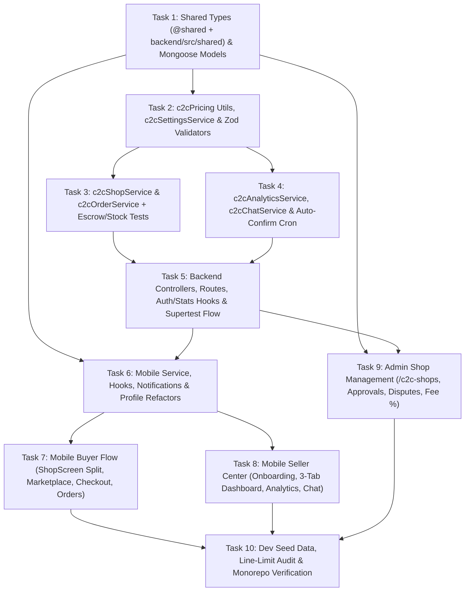

# V2.7 — Growary C2C User Shop (Shopee-Shop Style) Implementation Plan

> **For agentic workers:** REQUIRED SUB-SKILL: Use `superpowers:subagent-driven-development` (recommended) or `superpowers:executing-plans` to implement this plan task-by-task. Steps use checkbox (`- [ ]`) syntax for tracking.
> **Quy chuẩn bắt buộc:** Tuân thủ 100% [`plan update/ARCHITECTURE_RULES.md`](../../../plan%20update/ARCHITECTURE_RULES.md) và `.agent/skills/growary-architecture/SKILL.md`.

**Goal:** Xây dựng hệ thống **C2C User Shop (Shopee-Shop style)** cho phép người dùng mở shop cá nhân (sau khi Admin duyệt) từ Profile để bán các sản phẩm nhỏ (LEGO, thú đan len, đồ handmade...) bằng Coin trong app, tự giao qua Express ngoài hệ thống, nhận tiền qua Escrow trừ phí sàn (mặc định 10%, Admin chỉnh được), xử lý hoàn trả `"Chưa nhận được"`, theo dõi Cost/Nguồn nhập/Giảm giá %/Bán ngoài/Thống kê Lợi nhuận, và Chat trực tiếp trên từng sản phẩm.

**Architecture:**
- **Single Source of Truth (`@shared`):** Toàn bộ DTO/enums đặt tại `shared/types/c2cShop.ts` **VÀ đồng bộ mirror tại `backend/src/shared/c2cShop.ts`** (vì `backend/tsconfig.json` ưu tiên map `@shared` từ `./src/shared/*`). Backend **CHỈ** dùng `import type { ... } from '@shared'` (vì `backend/jest.config.ts` không cấu hình `moduleNameMapper` runtime).
- **Backend Layered + Compensating Rollback:** `Route -> Validate (Zod v4) -> Controller (try/catch -> next(error) + req.userId!) -> Service -> Model`. Dùng **atomic conditional `findOneAndUpdate` + explicit compensating rollback** (theo mẫu `rewardService.ts`, không dùng Mongo replica-set transaction để chạy ổn định trên mọi môi trường & Jest mock). Sử dụng `escapeRegex` có sẵn tại `backend/src/constants.ts:30` và reuse `/api/upload/proof` cho ảnh sản phẩm/shop/bằng chứng.
- **Mobile Refactors & Polling:** Không vượt trần dòng `ARCHITECTURE_RULES.md` — extract `<ProfileHeaderCard />` + `<ProfileShopEntryCard />` khỏi `ProfileScreen.tsx` (hiện `480/500`), extract `<ShippingAddressSection />` vào `EditProfileScreen.tsx`, extract `<AdminRewardShopView />` khỏi `ShopScreen.tsx` (hiện `432/500`) để `ShopScreen.tsx` thành 2-tab orchestrator (`Quà Growary` | `Chợ Cộng Đồng`), thêm generic `put/patch/delete` vào `mobile/src/services/api.ts` (`320` dòng), gom API C2C vào `mobile/src/services/c2cShopService.ts`, và polling chat 5s theo `useFocusEffect`.
- **Admin Independent Service:** Tạo `admin/src/services/c2cShopService.ts` dùng `httpClient` trực tiếp (**tuyệt đối KHÔNG** thêm delegate vào `admin/src/services/api.ts` đang `266/300` dòng), quản lý `/c2c-shops` với 3 tab: Duyệt & Khóa Shop, Đơn hàng & Khiếu nại, Cấu hình Phí sàn.

**Tech Stack:** TypeScript Strict (zero `any`, zero `@ts-ignore`), Node.js / Express 4.18, Mongoose 8.0, Zod 4.6.7, `node-cron` 3.0.3, Jest 30.5 + Supertest 7.3, React Native / Expo ~54, React 19 / Vite 6.1. Không cài thêm thư viện npm nào.

**Spec:** [`docs/superpowers/specs/2026-11-08-v2.7-c2c-user-shop-design.md`](../specs/2026-11-08-v2.7-c2c-user-shop-design.md)

---

## Global Constraints

- **Line-Count Ceilings (`ARCHITECTURE_RULES.md` §1):** Model $\le 220$ (warn `180`), Validator $\le 200$ (warn `150`), Controller $\le 400$ (warn `320`), Service $\le 500$ (warn `400`), Screen $\le 500$ (warn `400`), Component $\le 400$ (warn `320`), Hook $\le 200$, Mobile `api.ts` $\le 500$, Admin `services/c2cShopService.ts` $\le 300$.
- **Strict TypeScript:** Tuyệt đối không dùng `any`, `as any`, `@ts-ignore` trong bất kỳ file mới hoặc phần sửa đổi nào; export JSDoc chuẩn Rule 0.4 cho mọi hàm trong `utils/`, `services/`, `hooks/`.
- **Zero Real-Money & Anti-Farm Isolation:** Chỉ dùng `user.coins` in-app. Đơn C2C **tuyệt đối KHÔNG** cộng `user.totalCoinsSpent`, `monthlySpending`, `pendingCashback`, không kích hoạt VIP, và không áp mã/VIP discount của Admin Reward Shop. Chặn tự mua (`sellerId === buyerId` -> `400`) và Admin tự duyệt/tự xử lý shop của chính mình (`403`).
- **Error Envelope Convention:** Backend error middleware (`backend/src/middleware/errorHandler.ts`) trả JSON `{ error: string, code?: string }`. Mọi service ném `AppError(statusCode, message, code)` và controller forward via `next(error)`.
- **Rounding & Snapshot Conservation:**
  - `finalPriceCoins = discountPercent === 0 ? priceCoins : Math.max(1, Math.floor(priceCoins * (100 - discountPercent) / 100))`
  - `grossCoins = unitFinalCoins * quantity`
  - `platformFeeCoins = Math.floor(grossCoins * platformFeePercent / 100)`
  - `sellerNetCoins = grossCoins - platformFeeCoins` (bảo toàn tuyệt đối `platformFeeCoins + sellerNetCoins === grossCoins`)
  - Worked example: `costPrice = 45000` VNĐ, `priceCoins = 120000`, `discountPercent = 15`, `quantity = 2`, `platformFeePercent = 10`, `vndPerCoin = 1` $\rightarrow$ `unitFinalCoins = 102000`, `grossCoins = 204000`, `platformFeeCoins = 20400`, `sellerNetCoins = 183600`, `totalCostSnapshot = 90000`, `profitSnapshot = 93600`.
- **UI Design Tokens:** Mobile dùng `COLORS.warmBg` (`#FFFDF5`), `COLORS.clayText`, `COLORS.clayAccent1/2`, `SHADOWS` trong `mobile/src/theme.ts` (Rule 0.3: inline style tối đa 3 thuộc tính). Admin dùng CSS variables sẵn có trong `admin/src/index.css` và `ConfirmModal` / `StatusBadge` / `SearchBar` tại `admin/src/components/common/`.
- **Nested Git Repo & Dirty Worktree Safety:** `backend/` và `.agent/` là nested git repo độc lập. Khi commit, stage từng file rõ ràng (`git add <explicit paths>`), không dùng `git add -A` hoặc `git reset`, commit `backend/` trước rồi commit root repo cho `shared/`, `mobile/`, `admin/`.

## Review Focus

1. **Buyer-Seller Price Race at Checkout:** Seller sửa `priceCoins` hoặc `discountPercent` ngay giữa lúc người mua mở màn Chi tiết/Checkout và bấm `POST /api/c2c/orders` (với `expectedUnitFinalCoins`) $\rightarrow$ Server phải trả `409 Conflict` (`code: 'PRICE_CHANGED'`) trước khi trừ bất kỳ đồng `user.coins` hoặc `product.stock` nào (pinned ở **Task 3 & Task 5**).
2. **Double-Settlement Race on Disputed (`not_received`) Order:** Buyer bấm `"Đã nhận hàng"`, Seller bấm `"Hoàn Xu cho khách"`, Cron auto-confirm, và Admin bấm `"Giải quyết"` đồng thời trên cùng 1 `ShopOrder` $\rightarrow$ chỉ đúng 1 thao tác khớp atomic filter `{ _id, status: 'not_received', payoutReleased: false }` được phép thành công; mọi request đến sau phải trả `409` và không bao giờ giải ngân hoặc hoàn tiền 2 lần (pinned ở **Task 3 & Task 4**).
3. **Parcel Loss Stock Boundary (`not_received -> refunded` vs `pending -> cancelled`):** Khi hoàn Coin cho đơn `not_received` (`Express` đã nhận hàng gửi và xử lý mất hàng ngoài hệ thống), hệ thống hoàn `grossCoins` nhưng **KHÔNG** tự cộng lại `product.stock`; ngược lại khi hủy đơn còn ở trạng thái `pending` (chưa gửi hàng), hệ thống phải hoàn cả `grossCoins` lẫn `product.stock += quantity` (pinned ở **Task 3**).
4. **Minimum Price Floor & ExternalSale Double-Void Guard:** Sản phẩm giá nhỏ (`priceCoins = 5, discountPercent = 90`) phải giữ sàn `finalPriceCoins = 1`, `platformFeeCoins + sellerNetCoins === grossCoins` luôn đúng; và gọi `voidExternalSale` 2 lần liên tiếp chỉ được hoàn `stock` đúng 1 lần nhờ atomic filter `{ _id, sellerId, isVoided: false }` (pinned ở **Task 2 & Task 4**).
5. **Suspended Shop Frozen Payout & Soft-Deleted Product Chat Continuity:** Khi shop bị Admin chuyển sang `suspended`, mọi đơn mới bị chặn, Seller bị chặn bấm gửi Express đơn `pending` (`403`), và `c2cOrderAutoConfirmJob` phải **bỏ qua** giải ngân tự động cho các đơn `shipping` của shop đó (`skippedSuspended`); đồng thời khi Seller xóa mềm sản phẩm (`isDeleted: true`), các cuộc trò chuyện (`ShopConversation`) đã tồn tại vẫn phải cho phép nhắn tiếp hậu mãi, chỉ chặn mở cuộc trò chuyện *mới* với sản phẩm đã xóa (pinned ở **Task 3 & Task 4**).

---

## Lộ Trình 10 Task & Dependency Graph



### Pre-flight Check (Chạy trước khi bắt đầu Task 1)
- [ ] Kiểm tra baseline branch & test suite (không sửa code trước Task 1):
  - `git status --short` & `git -C backend status --short` (ghi nhận file đang dirty sẵn nếu có)
  - `cd backend && npx tsc --noEmit && npm test` (xác nhận PASS 100%)
  - `cd mobile && npx tsc --noEmit` (xác nhận PASS 100%)
  - `cd admin && npm run build` (xác nhận PASS 100%)

---

### Task 1: Shared Types (`@shared` + Mirror), Extended `User`/`Notification` & 6 C2C Models

**Files:**
- Create: `shared/types/c2cShop.ts`, `backend/src/shared/c2cShop.ts`
- Modify: `shared/types/user.ts`, `backend/src/shared/user.ts` (thêm `ShippingAddress` + `User.shippingAddresses`)
- Modify: `shared/types/event.ts`, `backend/src/shared/event.ts` (thêm `pendingC2CShops?`, `pendingC2CDisputes?` vào `DashboardStats`)
- Modify: `shared/types/index.ts`, `backend/src/shared/index.ts` (export `./c2cShop`)
- Modify: `backend/src/models/User.ts` (`145` lines -> $\le 185$ lines)
- Modify: `backend/src/models/Notification.ts` (`34` lines -> $\le 40$ lines, thêm `'shop'` vào enum `type`)
- Create: `backend/src/models/UserShop.ts` ($\le 110$ lines)
- Create: `backend/src/models/ShopProduct.ts` ($\le 120$ lines)
- Create: `backend/src/models/ShopOrder.ts` ($\le 175$ lines)
- Create: `backend/src/models/ExternalSale.ts` ($\le 95$ lines)
- Create: `backend/src/models/ShopConversation.ts` ($\le 85$ lines)
- Create: `backend/src/models/ShopMessage.ts` ($\le 75$ lines)
- Modify: `backend/src/models/index.ts` (`33` lines -> $\le 45$ lines)
- Test: `backend/src/__tests__/models/c2cModels.test.ts`

**Interfaces:**
- Consumes: Mongoose `Schema` / `Document` trong `backend/src/models/`
- Produces:
  - `@shared`: `ShippingAddress`, `ShopStatus`, `ProductCategory`, `OrderStatus`, `DisputeResolution`, `AnalyticsRange`, `UserShopDto`, `C2CProductDto`, `ShopOrderDto`, `ExternalSaleDto`, `ShopConversationDto`, `ShopMessageDto`, `C2CSettingsDto`, `SellerAnalyticsDto`, `AdminC2CStatsDto`, `CreateProductPayload`, `UpdateProductPayload`, `CreateOrderPayload`, `RecordExternalSalePayload`, `ApplyShopPayload`
  - `backend/src/models`: `UserShop` (`IUserShop`), `ShopProduct` (`IShopProduct`), `ShopOrder` (`IShopOrder`), `ExternalSale` (`IExternalSale`), `ShopConversation` (`IShopConversation`), `ShopMessage` (`IShopMessage`), updated `IUser` & `INotification`

- [ ] **Step 1: Viết schema & invariant unit test thất bại tại `backend/src/__tests__/models/c2cModels.test.ts`**

```ts
import mongoose from 'mongoose';
import {
    User,
    Notification,
    UserShop,
    ShopProduct,
    ShopOrder,
    ExternalSale,
    ShopConversation,
    ShopMessage,
} from '../../models';

describe('V2.7 C2C Shop Models & Indexes', () => {
    it('supports shippingAddresses subdocuments on User and shop type on Notification', () => {
        const userDoc = new User({
            username: 'buyer_v27',
            email: 'buyer_v27@example.com',
            password: 'hashedpassword',
            shippingAddresses: [{
                label: 'Nhà riêng',
                recipientName: 'Nguyễn An',
                phone: '0901234567',
                addressLine: '123 Lê Lợi',
                province: 'TP.HCM',
                isDefault: true,
            }],
        });
        expect(userDoc.shippingAddresses).toHaveLength(1);
        expect(userDoc.shippingAddresses[0].isDefault).toBe(true);

        const notifDoc = new Notification({
            userId: new mongoose.Types.ObjectId(),
            title: 'Shop đã được duyệt',
            message: 'Bạn có thể đăng sản phẩm ngay!',
            type: 'shop',
        });
        expect(notifDoc.validateSync()).toBeUndefined();
    });

    it('enforces core defaults and unique compound indexes across C2C models', () => {
        const shop = new UserShop({
            ownerId: new mongoose.Types.ObjectId(),
            name: 'Tiệm LEGO Nhỏ',
            normalizedName: 'tiệm lego nhỏ',
            description: 'Mô hình lắp ráp sưu tầm',
            phone: '0901234567',
            pickupAddress: 'Q1, TP.HCM',
        });
        expect(shop.status).toBe('pending');
        expect(shop.isActive).toBe(true);
        expect(shop.totalOrdersCompleted).toBe(0);

        const convIndexes = ShopConversation.schema.indexes();
        const uniqueConvIdx = convIndexes.find(([, opts]) => opts?.unique === true);
        expect(uniqueConvIdx?.[0]).toEqual({ shopId: 1, buyerId: 1, productId: 1 });

        const order = new ShopOrder({
            orderCode: 'C2C-20261108-0001',
            shopId: new mongoose.Types.ObjectId(),
            sellerId: new mongoose.Types.ObjectId(),
            buyerId: new mongoose.Types.ObjectId(),
            productId: new mongoose.Types.ObjectId(),
            productTitleSnapshot: 'Thú đan len gấu nâu',
            productImageSnapshot: 'https://img.example/bear.jpg',
            shopNameSnapshot: 'Tiệm Len',
            sellerUsernameSnapshot: 'len_shop',
            unitListCoins: 120000,
            discountPercentSnapshot: 15,
            unitFinalCoins: 102000,
            quantity: 1,
            grossCoins: 102000,
            platformFeePercentSnapshot: 10,
            platformFeeCoins: 10200,
            sellerNetCoins: 91800,
            vndPerCoinSnapshot: 1,
            unitCostSnapshot: 45000,
            totalCostSnapshot: 45000,
            profitSnapshot: 46800,
            shippingAddress: {
                label: 'Nhà',
                recipientName: 'An',
                phone: '0901234567',
                addressLine: '123 Lê Lợi',
                province: 'TP.HCM',
                isDefault: true,
            },
        });
        expect(order.status).toBe('pending');
        expect(order.payoutReleased).toBe(false);
        expect(order.validateSync()).toBeUndefined();
        expect(ShopProduct).toBeDefined();
        expect(ExternalSale).toBeDefined();
        expect(ShopMessage).toBeDefined();
    });
});
```

- [ ] **Step 2: Chạy test để xác nhận FAIL (model chưa tồn tại)**

Run: `cd backend && npx jest src/__tests__/models/c2cModels.test.ts`
Expected: FAIL (`Cannot find module '../../models'` hoặc exports missing cho `UserShop`/`ShopOrder`).

- [ ] **Step 3: Định nghĩa DTOs trong `shared/types/` và đồng bộ mirror sang `backend/src/shared/`**

- Trong `shared/types/user.ts` & `backend/src/shared/user.ts`: thêm `ShippingAddress`:
  ```ts
  export interface ShippingAddress {
      _id?: string;
      label: string;
      recipientName: string;
      phone: string;
      addressLine: string;
      ward?: string;
      district?: string;
      province: string;
      isDefault: boolean;
  }
  ```
  và thêm `shippingAddresses?: ShippingAddress[];` vào interface `User`.
- Trong `shared/types/event.ts` & `backend/src/shared/event.ts`: thêm `pendingC2CShops?: number;` và `pendingC2CDisputes?: number;` vào `DashboardStats`.
- Tạo `shared/types/c2cShop.ts` và copy chính xác sang `backend/src/shared/c2cShop.ts` với đầy đủ types:
  - Enums/Unions: `ShopStatus = 'pending' | 'approved' | 'rejected' | 'suspended'`, `ProductCategory = 'lego' | 'crochet' | 'handmade' | 'other'`, `OrderStatus = 'pending' | 'shipping' | 'completed' | 'cancelled' | 'not_received' | 'refunded'`, `DisputeResolution = 'refund_buyer' | 'release_to_seller'`, `AnalyticsRange = '7d' | '30d' | 'all'`, `MarketplaceSort = 'newest' | 'price_asc' | 'price_desc' | 'best_selling'`.
  - `C2CSettingsDto { platformFeePercent: number; vndPerCoin: number; autoConfirmDays: number }`
  - `UserShopDto`: `_id`, `ownerId`, `ownerUsername?`, `name`, `description`, `phone`, `pickupAddress`, `avatarUrl?`, `status`, `rejectionReason?`, `isActive`, `totalOrdersCompleted`, `approvedAt?`, `createdAt`.
  - `C2CProductDto`: `_id`, `shopId`, `sellerId`, `title`, `description`, `category`, `images`, `importSource?` (chỉ trả về cho owner/admin hoặc ẩn ở public DTO), `costPrice?` (seller/admin only — **KHÔNG** gửi `costPrice`/`importSource` ở marketplace public response), `priceCoins`, `discountPercent`, `finalPriceCoins`, `estimatedSellerNetCoins?`, `stock`, `soldInApp`, `soldExternal`, `isPublished`, `shopName?`, `shopAvatarUrl?`, `createdAt`.
  - `ShopOrderDto`: `_id`, `orderCode`, `shopId`, `sellerId`, `buyerId`, `buyerUsername?`, `productId`, `productTitleSnapshot`, `productImageSnapshot`, `shopNameSnapshot`, `sellerUsernameSnapshot`, `unitListCoins`, `discountPercentSnapshot`, `unitFinalCoins`, `quantity`, `grossCoins`, `platformFeePercentSnapshot`, `platformFeeCoins`, `sellerNetCoins`, `vndPerCoinSnapshot`, `unitCostSnapshot`, `totalCostSnapshot`, `profitSnapshot`, `shippingAddress`, `expressCarrier?`, `trackingCode?`, `status`, `buyerNote?`, `notReceivedReason?`, `buyerEvidenceUrl?`, `sellerDisputeNote?`, `sellerEvidenceUrl?`, `cancelReason?`, `cancelledBy?`, `payoutReleased`, `payoutReleasedAt?`, `shippedAt?`, `autoConfirmAt?`, `completedAt?`, `resolvedAt?`, `createdAt`.
  - `ExternalSaleDto`: `_id`, `shopId`, `productId`, `productTitleSnapshot`, `productImageSnapshot?`, `quantity`, `externalUnitPrice`, `totalExternalAmount`, `unitCostSnapshot`, `totalCostSnapshot`, `profitSnapshot`, `note?`, `isVoided`, `soldAt`.
  - `ShopConversationDto`: `_id`, `shopId`, `shopName?`, `shopAvatarUrl?`, `sellerId`, `buyerId`, `buyerUsername?`, `buyerAvatar?`, `productId`, `productTitleSnapshot`, `productImageSnapshot?`, `lastOrderId?`, `lastMessageText?`, `lastMessageAt`, `unreadByBuyer`, `unreadBySeller`.
  - `ShopMessageDto`: `_id`, `conversationId`, `senderId`, `senderRole: 'buyer' | 'seller'`, `orderId?`, `content`, `imageUrl?`, `isRead`, `createdAt`.
  - `SellerAnalyticsDto`: `range`, `summary: { totalCostVnd, totalRevenueVnd, totalProfitVnd }`, `inApp: { orderCount, unitsSold, grossCoins, feeCoins, netCoins, revenueVnd, costVnd, profitVnd }`, `external: { saleCount, unitsSold, revenueVnd, costVnd, profitVnd }`, `inventory: { totalProducts, totalStockUnits, inventoryCostValueVnd }`, `topProducts: Array<{ productId, title, imageUrl?, inAppUnits, externalUnits, totalRevenueVnd, totalProfitVnd }>`.
  - `AdminC2CStatsDto`: `pendingShops`, `approvedShops`, `suspendedShops`, `rejectedShops`, `openDisputes`, `totalOrdersCompleted`, `totalGmvCoins`, `totalPlatformFeeCoins`.
- Export `export * from './c2cShop';` trong `shared/types/index.ts` và `backend/src/shared/index.ts`.

- [ ] **Step 4: Cập nhật `User.ts`, `Notification.ts` và tạo 6 Mongoose models + export tại `models/index.ts`**

- `backend/src/models/User.ts`: thêm `ShippingAddressSubSchema` (`label`, `recipientName`, `phone`, `addressLine`, `ward`, `district`, `province`, `isDefault`) vào `IUser` (`shippingAddresses`) và `UserSchema` (`default: []`).
- `backend/src/models/Notification.ts`: mở rộng `type: 'system' | 'reward' | 'penalty' | 'event' | 'shop'` trong `INotification` và `enum`.
- Tạo `backend/src/models/UserShop.ts`: `ownerId` (`unique: true`), `name`, `normalizedName` (`unique: true`), `description`, `phone`, `pickupAddress`, `avatarUrl`, `status` (`enum: ['pending', 'approved', 'rejected', 'suspended']`, `default: 'pending'`), `rejectionReason`, `approvedAt`, `approvedBy`, `isActive` (`default: true`), `totalOrdersCompleted` (`default: 0`). Index `{ status: 1, createdAt: -1 }`.
- Tạo `backend/src/models/ShopProduct.ts`: `shopId`, `sellerId`, `title`, `description`, `category` (`enum: ['lego', 'crochet', 'handmade', 'other']`), `images` (`[String]`), `importSource`, `costPrice` (`min: 0`), `priceCoins` (`min: 1`), `discountPercent` (`min: 0, max: 90, default: 0`), `stock` (`min: 0, default: 0`), `soldInApp` (`default: 0`), `soldExternal` (`default: 0`), `isPublished` (`default: true`), `isDeleted` (`default: false`). Indexes `{ shopId: 1, isDeleted: 1, isPublished: 1, createdAt: -1 }`, `{ category: 1, isPublished: 1, isDeleted: 1, createdAt: -1 }`, `{ isPublished: 1, isDeleted: 1, soldInApp: -1 }`.
- Tạo `backend/src/models/ShopOrder.ts`: toàn bộ trường snapshot, `shippingAddress` (subschema `_id: false`), `expressCarrier`, `trackingCode`, `status` (`enum: ['pending', 'shipping', 'completed', 'cancelled', 'not_received', 'refunded']`, `default: 'pending'`), dispute fields (`notReceivedReason`, `buyerEvidenceUrl`, `sellerDisputeNote`, `sellerEvidenceUrl`), `payoutReleased` (`default: false`), timestamps/resolution fields. Indexes `{ buyerId: 1, createdAt: -1 }`, `{ shopId: 1, status: 1, createdAt: -1 }`, `{ status: 1, payoutReleased: 1, autoConfirmAt: 1 }`.
- Tạo `backend/src/models/ExternalSale.ts`: snapshot fields, `quantity >= 1`, `externalUnitPrice >= 0`, `totalExternalAmount >= 0`, `unitCostSnapshot >= 0`, `totalCostSnapshot >= 0`, `profitSnapshot`, `note?`, `isVoided` (`default: false`), `soldAt` (`default: Date.now`). Indexes `{ shopId: 1, isVoided: 1, soldAt: -1 }`, `{ productId: 1, soldAt: -1 }`.
- Tạo `backend/src/models/ShopConversation.ts`: unique `{ shopId: 1, buyerId: 1, productId: 1 }`, `{ shopId: 1, lastMessageAt: -1 }`, `{ buyerId: 1, lastMessageAt: -1 }`.
- Tạo `backend/src/models/ShopMessage.ts`: `{ conversationId: 1, createdAt: 1 }`.
- Export tất cả model + interface từ `backend/src/models/index.ts`.

- [ ] **Step 5: Chạy test & typecheck xác nhận PASS**

Run:
- `cd backend && npx tsc --noEmit && npx jest src/__tests__/models/c2cModels.test.ts`
- `cd mobile && npx tsc --noEmit`
- `cd admin && npx tsc --noEmit`
Expected: PASS với 0 lỗi TypeScript và 2/2 test PASS.

- [ ] **Step 6: Commit (nested `backend/` trước, root repo sau)**

```bash
git -C backend add src/shared/ src/models/ src/__tests__/models/c2cModels.test.ts
git -C backend commit -m "feat(v2.7): add shared C2C shop types, extended User/Notification, and 6 shop models"
git add shared/types/
git commit -m "feat(v2.7): add shared C2C user shop types and shipping address definitions"
```

---

### Task 2: Pricing Math (`c2cPricing.ts`), Platform Fee Settings (`c2cSettingsService.ts`) & Zod Validators

**Files:**
- Create: `backend/src/utils/c2cPricing.ts` ($\le 95$ lines, bắt buộc JSDoc Rule 0.4)
- Create: `backend/src/services/c2cSettingsService.ts` ($\le 75$ lines)
- Create: `backend/src/validators/c2cShopValidator.ts` ($\le 195$ lines, dùng Zod v4 API `{ message: ... }`)
- Test: `backend/src/__tests__/utils/c2cPricing.test.ts`
- Test: `backend/src/__tests__/validators/c2cShopValidator.test.ts`

**Interfaces:**
- Consumes: `SystemConfig` (`models/SystemConfig.ts`), `C2CSettingsDto` (`@shared`)
- Produces:
  - `calculateFinalPriceCoins(priceCoins: number, discountPercent?: number): number`
  - `calculateOrderFinancials(input: OrderFinancialInput): OrderFinancialResult` (gồm `unitFinalCoins, grossCoins, platformFeeCoins, sellerNetCoins, revenueVnd, totalCostSnapshot, profitSnapshot`)
  - `calculateExternalSaleFinancials(input: ExternalFinancialInput): { totalExternalAmount: number; totalCostSnapshot: number; profitSnapshot: number }`
  - `getC2CSettings(): Promise<C2CSettingsDto>`, `updateC2CSettings(patch: Partial<C2CSettingsDto>): Promise<C2CSettingsDto>`
  - Zod schemas: `updateShippingAddressesSchema`, `applyShopSchema`, `updateShopProfileSchema`, `createProductSchema`, `updateProductSchema`, `marketplaceProductsQuerySchema`, `createOrderSchema`, `shipOrderSchema`, `updateTrackingSchema`, `cancelOrderSchema`, `notReceivedSchema`, `sellerDisputeResponseSchema`, `recordExternalSaleSchema`, `analyticsQuerySchema`, `openConversationSchema`, `sendMessageSchema`, `adminReviewShopSchema`, `adminToggleShopStatusSchema`, `adminResolveOrderSchema`, `adminUpdateC2CSettingsSchema`.

- [ ] **Step 1: Viết unit test thất bại cho pricing math & validators**

Trong `backend/src/__tests__/utils/c2cPricing.test.ts`:
```ts
import {
    calculateFinalPriceCoins,
    calculateOrderFinancials,
    calculateExternalSaleFinancials,
} from '../../utils/c2cPricing';

describe('c2cPricing helpers', () => {
    it('computes final price with Math.floor and enforces minimum 1 Coin floor', () => {
        expect(calculateFinalPriceCoins(120000, 0)).toBe(120000);
        expect(calculateFinalPriceCoins(120000, 15)).toBe(102000);
        expect(calculateFinalPriceCoins(105, 10)).toBe(94); // floor(105 * 0.9)
        expect(calculateFinalPriceCoins(5, 90)).toBe(1);    // floor(0.5) -> min 1 Coin
    });

    it('conserves grossCoins = platformFeeCoins + sellerNetCoins and snapshots profit', () => {
        const res = calculateOrderFinancials({
            unitListCoins: 120000,
            discountPercent: 15,
            quantity: 2,
            platformFeePercent: 10,
            vndPerCoin: 1,
            unitCostPrice: 45000,
        });
        expect(res).toEqual({
            unitFinalCoins: 102000,
            grossCoins: 204000,
            platformFeeCoins: 20400,
            sellerNetCoins: 183600,
            revenueVnd: 183600,
            totalCostSnapshot: 90000,
            profitSnapshot: 93600,
        });

        const oddSplit = calculateOrderFinancials({
            unitListCoins: 95,
            discountPercent: 0,
            quantity: 1,
            platformFeePercent: 10,
            vndPerCoin: 1,
            unitCostPrice: 60,
        });
        expect(oddSplit.platformFeeCoins).toBe(9);
        expect(oddSplit.sellerNetCoins).toBe(86);
        expect(oddSplit.platformFeeCoins + oddSplit.sellerNetCoins).toBe(oddSplit.grossCoins);
        expect(oddSplit.profitSnapshot).toBe(26);
    });

    it('computes external sale totals and profit correctly', () => {
        expect(calculateExternalSaleFinancials({
            quantity: 3,
            externalUnitPrice: 95000,
            unitCostPrice: 45000,
        })).toEqual({
            totalExternalAmount: 285000,
            totalCostSnapshot: 135000,
            profitSnapshot: 150000,
        });
    });
});
```

Trong `backend/src/__tests__/validators/c2cShopValidator.test.ts`: test reject `discountPercent > 90` hoặc âm, reject `images: []` hoặc $> 5$ ảnh, reject `platformFeePercent > 50`, reject `expectedUnitFinalCoins < 1`, accept Vietnamese shop/address fields hợp lệ và `marketplaceProductsQuerySchema` mặc định `sort = 'newest'`, `page = 1`, `limit = 20`.

- [ ] **Step 2: Chạy test để xác nhận FAIL**

Run: `cd backend && npx jest src/__tests__/utils/c2cPricing.test.ts src/__tests__/validators/c2cShopValidator.test.ts`
Expected: FAIL (`Cannot find module '../../utils/c2cPricing'`).

- [ ] **Step 3: Implement `c2cPricing.ts`, `c2cSettingsService.ts`, `c2cShopValidator.ts`**

- `backend/src/utils/c2cPricing.ts`: viết đủ JSDoc cho từng hàm (`@param`, `@returns`), cài công thức chuẩn, ép số nguyên an toàn (`Math.round`/`Math.floor`), clamp `discountPercent` trong `0..90` và `platformFeePercent` trong `0..50`.
- `backend/src/services/c2cSettingsService.ts`: mặc định `DEFAULT_C2C_SETTINGS = { platformFeePercent: 10, vndPerCoin: 1, autoConfirmDays: 7 }`. `getC2CSettings` query `SystemConfig.findOne({ key: 'c2c_shop_settings' })` và parse safe; `updateC2CSettings` merge + validate bounds + `findOneAndUpdate(..., { upsert: true, new: true })`.
- `backend/src/validators/c2cShopValidator.ts`: khai báo toàn bộ schema theo style `rewardValidator.ts` (`zod` v4: dùng `{ message: ... }`, `.trim()`, `.int()`, `.min()`, `.max()`). Đáng chú ý:
  - `applyShopSchema`: `name` (`2..60`), `description` (`10..500`), `phone` (`9..15`), `pickupAddress` (`5..200`), `avatarUrl?`.
  - `createProductSchema`: `title` (`2..120`), `description` (`5..1000`), `category` (`lego | crochet | handmade | other`), `images` (min `1`, max `5` strings), `importSource?` (`max 120`), `costPrice` (`number >= 0`), `priceCoins` (`int >= 1`), `discountPercent` (`int 0..90`, default `0`), `stock` (`int >= 0`).
  - `adminResolveOrderSchema`: `decision: z.enum(['refund_buyer', 'release_to_seller'])`, `adminNote?` (`max 300`).
  - `adminUpdateC2CSettingsSchema`: `platformFeePercent` (`number 0..50`), `vndPerCoin` (`number >= 1 <= 100000`), `autoConfirmDays` (`int 1..30`).

- [ ] **Step 4: Chạy test & tsc xác nhận PASS**

Run: `cd backend && npx tsc --noEmit && npx jest src/__tests__/utils/c2cPricing.test.ts src/__tests__/validators/c2cShopValidator.test.ts`
Expected: PASS 100%.

- [ ] **Step 5: Commit**

```bash
git -C backend add src/utils/c2cPricing.ts src/services/c2cSettingsService.ts src/validators/c2cShopValidator.ts src/__tests__/utils/c2cPricing.test.ts src/__tests__/validators/c2cShopValidator.test.ts
git -C backend commit -m "feat(v2.7): add C2C pricing calculator, fee settings service, and Zod validators"
```

---

### Task 3: Shop Onboarding, Product Marketplace & Escrow Order Service (`c2cShopService.ts` + `c2cOrderService.ts`)

**Files:**
- Create: `backend/src/services/c2cShopService.ts` ($\le 390$ lines)
- Create: `backend/src/services/c2cOrderService.ts` ($\le 420$ lines)
- Test: `backend/src/__tests__/services/c2cShopService.test.ts`
- Test: `backend/src/__tests__/services/c2cOrderService.test.ts`

**Interfaces:**
- Consumes: `User`, `Notification`, `UserShop`, `ShopProduct`, `ShopOrder`, `c2cPricing`, `c2cSettingsService`, `escapeRegex` (`backend/src/constants.ts:30`), `AppError` (`middleware/errorHandler.ts`)
- Produces:
  - `c2cShopService.ts`:
    - `getShippingAddresses(userId: string): Promise<ShippingAddress[]>`
    - `updateShippingAddresses(userId: string, addresses: ShippingAddress[]): Promise<ShippingAddress[]>`
    - `getMyShop(userId: string): Promise<{ shop: IUserShop | null; settings: C2CSettingsDto }>`
    - `applyForShop(userId: string, payload: ApplyShopPayload): Promise<IUserShop>`
    - `updateMyShopProfile(userId: string, payload: Partial<ApplyShopPayload>): Promise<IUserShop>`
    - `listSellerProducts(userId: string): Promise<SellerProductWithPreview[]>`
    - `createSellerProduct(userId: string, payload: CreateProductPayload): Promise<IShopProduct>`
    - `updateSellerProduct(userId: string, productId: string, payload: UpdateProductPayload): Promise<IShopProduct>`
    - `deleteSellerProduct(userId: string, productId: string): Promise<void>`
    - `browseMarketplaceProducts(query: MarketplaceQuery): Promise<{ products: PublicC2CProduct[]; total: number; page: number; totalPages: number }>`
    - `getMarketplaceProductDetail(productId: string): Promise<{ product: PublicC2CProduct; shop: PublicShopSummary; settings: Pick<C2CSettingsDto, 'autoConfirmDays'> }>`
    - `getPublicShopStorefront(shopId: string): Promise<{ shop: PublicShopSummary; products: PublicC2CProduct[] }>`
    - `adminListShops(params: { status?: string; q?: string }): Promise<UserShopWithOwner[]>`
    - `adminReviewShop(adminId: string, shopId: string, action: 'approve' | 'reject', rejectionReason?: string): Promise<IUserShop>`
    - `adminUpdateShopStatus(adminId: string, shopId: string, status: 'approved' | 'suspended', reason?: string): Promise<IUserShop>`
  - `c2cOrderService.ts`:
    - `createC2COrder(buyerId: string, payload: CreateOrderPayload): Promise<IShopOrder>`
    - `listBuyerOrders(buyerId: string, status?: string): Promise<IShopOrder[]>`
    - `cancelPendingOrder(actorId: string, orderId: string, role: 'buyer' | 'seller', reason?: string): Promise<IShopOrder>`
    - `confirmOrderReceived(buyerId: string, orderId: string): Promise<IShopOrder>`
    - `reportOrderNotReceived(buyerId: string, orderId: string, reason: string, evidenceUrl?: string): Promise<IShopOrder>`
    - `listSellerOrders(sellerId: string, status?: string): Promise<IShopOrder[]>`
    - `markOrderShipped(sellerId: string, orderId: string, expressCarrier: string, trackingCode?: string): Promise<IShopOrder>`
    - `updateOrderTracking(sellerId: string, orderId: string, expressCarrier: string, trackingCode?: string): Promise<IShopOrder>`
    - `submitDisputeResponse(sellerId: string, orderId: string, note: string, evidenceUrl?: string): Promise<IShopOrder>`
    - `sellerRefundDispute(sellerId: string, orderId: string): Promise<IShopOrder>`
    - `adminListOrders(params: { status?: string; shopId?: string }): Promise<IShopOrder[]>`
    - `adminResolveDisputedOrder(adminId: string, orderId: string, decision: DisputeResolution, adminNote?: string): Promise<IShopOrder>`

- [ ] **Step 1: Viết Jest unit tests thất bại cho toàn bộ Review Focus #1, #2, #3, #5 & Service invariants**

Trong `backend/src/__tests__/services/c2cShopService.test.ts`:
- `rejects duplicate normalized shop name when applying`
- `allows rejected shop owner to edit and resubmit back to pending`
- `blocks admin from self-approving own shop with 403`
- `hides costPrice and importSource from public browseMarketplaceProducts`
- `hides products when parent shop status is suspended`

Trong `backend/src/__tests__/services/c2cOrderService.test.ts` (mock `./models` tương tự `inventoryFixes.test.ts`):
- **Anti-farm & Self-purchase:** `rejects self-purchase (sellerId === buyerId) with 400`, `does NOT update totalCoinsSpent, monthlySpending, or pendingCashback on purchase`
- **Review Focus #1 (Price-lock):** `rejects createC2COrder with 409 PRICE_CHANGED when expectedUnitFinalCoins mismatches current discounted price and does not deduct buyer coins`
- **Atomic Rollback:** `refunds buyer coins when product stock deduction fails concurrently`
- **Pending Cancel vs Disputed Refund (Review Focus #3):**
  - `cancelPendingOrder refunds grossCoins AND restores product stock`
  - `adminResolveDisputedOrder('refund_buyer') refunds grossCoins WITHOUT restoring product stock`
  - `sellerRefundDispute refunds grossCoins WITHOUT restoring product stock`
- **Review Focus #2 (Concurrent Race):** `adminResolveDisputedOrder throws 409 CONFLICT when atomic findOneAndUpdate on { status: 'not_received', payoutReleased: false } returns null (already resolved)`
- **Review Focus #5 (Suspended shop):** `markOrderShipped rejects with 403 SHOP_SUSPENDED when shop.status === 'suspended'`
- **Admin self-resolve guard:** `adminResolveDisputedOrder throws 403 when adminId === order.sellerId`

- [ ] **Step 2: Chạy tests để xác nhận FAIL**

Run: `cd backend && npx jest src/__tests__/services/c2cShopService.test.ts src/__tests__/services/c2cOrderService.test.ts`
Expected: FAIL (`Cannot find module`).

- [ ] **Step 3: Implement `c2cShopService.ts` & `c2cOrderService.ts`**

Chi tiết thuật toán & quy tắc bắt buộc trong code:
1. **`normalizedName`:** `name.trim().toLowerCase().replace(/\s+/g, ' ')`.
2. **`browseMarketplaceProducts`:** Luôn dùng `escapeRegex` từ `constants.ts:30`; dùng whitelist sort map (`newest`, `price_asc`, `price_desc`, `best_selling`); **tuyệt đối không** trả `costPrice` hoặc `importSource` trong public response; hydrate `finalPriceCoins = calculateFinalPriceCoins(p.priceCoins, p.discountPercent)`.
3. **`createC2COrder` atomic sequence (không transaction Mongo):**
   - Check product (`!isDeleted && isPublished`), check shop (`status === 'approved' && isActive`).
   - Check `sellerId.toString() === buyerId` $\rightarrow$ `throw new AppError(400, 'Không thể tự mua sản phẩm của chính shop mình', 'SELF_PURCHASE')`.
   - Tính `unitFinalCoins = calculateFinalPriceCoins(...)`. Nếu `payload.expectedUnitFinalCoins !== undefined && payload.expectedUnitFinalCoins !== unitFinalCoins` $\rightarrow$ `throw new AppError(409, 'Giá sản phẩm vừa được cập nhật, vui lòng tải lại', 'PRICE_CHANGED')`.
   - Lấy `settings = await getC2CSettings()`, tính `financials = calculateOrderFinancials(...)`.
   - Atomic coin deduct: `User.findOneAndUpdate({ _id: buyerId, coins: { $gte: financials.grossCoins } }, { $inc: { coins: -financials.grossCoins } }, { new: true })`. Null $\rightarrow$ `400 INSUFFICIENT_COINS`.
   - Atomic stock deduct: `ShopProduct.findOneAndUpdate({ _id: productId, isDeleted: false, isPublished: true, stock: { $gte: quantity } }, { $inc: { stock: -quantity } }, { new: true })`. Null $\rightarrow$ **compensating refund** `User.findByIdAndUpdate(buyerId, { $inc: { coins: financials.grossCoins } })` rồi throw `400 OUT_OF_STOCK`.
   - Try `ShopOrder.create(...)` (tạo `orderCode = 'C2C-' + yyyymmdd + '-' + random6`); nếu lỗi $\rightarrow$ rollback cả Coin lẫn Stock trước khi rethrow.
   - Tạo `Notification` (`type: 'shop'`) báo seller có đơn mới cần gửi Express.
4. **Hàm nội bộ `releasePayoutAndComplete(orderId, extraSet)`:** dùng cho `confirmOrderReceived` (condition `{ _id: orderId, buyerId, status: 'shipping', payoutReleased: false }`) và `adminResolveDisputedOrder(..., 'release_to_seller')` (condition `{ _id: orderId, status: 'not_received', payoutReleased: false }`). Atomic set `status: 'completed', payoutReleased: true, payoutReleasedAt: now, completedAt: now`, sau đó `$inc` `User.coins += sellerNetCoins`, `ShopProduct.soldInApp += quantity`, `UserShop.totalOrdersCompleted += 1`. Nếu atomic `findOneAndUpdate` trả `null` $\rightarrow$ throw `409 CONFLICT` (`ORDER_ALREADY_SETTLED`).
5. **Thứ tự `Notification` (`type: 'shop'`):** Phát notification cho `apply -> admin?` (không cần), `review -> seller`, `suspend/reactivate -> seller`, `order created -> seller`, `shipped -> buyer`, `not_received -> seller`, `resolved/refunded/completed -> buyer & seller`.

- [ ] **Step 4: Chạy tests & tsc xác nhận PASS**

Run: `cd backend && npx tsc --noEmit && npx jest src/__tests__/services/c2cShopService.test.ts src/__tests__/services/c2cOrderService.test.ts`
Expected: PASS 100%, không vượt 400/420 dòng mỗi service.

- [ ] **Step 5: Commit**

```bash
git -C backend add src/services/c2cShopService.ts src/services/c2cOrderService.ts src/__tests__/services/c2cShopService.test.ts src/__tests__/services/c2cOrderService.test.ts
git -C backend commit -m "feat(v2.7): implement C2C shop onboarding, marketplace, and atomic escrow order service"
```

---

### Task 4: External Sales, Cost/Revenue/Profit Analytics, Product Chat & Auto-Confirm Cron

**Files:**
- Create: `backend/src/services/c2cAnalyticsService.ts` ($\le 260$ lines)
- Create: `backend/src/services/c2cChatService.ts` ($\le 250$ lines)
- Create: `backend/src/jobs/c2cOrderAutoConfirmJob.ts` ($\le 125$ lines)
- Test: `backend/src/__tests__/services/c2cAnalyticsAndChat.test.ts`
- Test: `backend/src/__tests__/jobs/c2cOrderAutoConfirmJob.test.ts`

**Interfaces:**
- Consumes: `UserShop`, `ShopProduct`, `ShopOrder`, `ExternalSale`, `ShopConversation`, `ShopMessage`, `User`, `Notification`, `c2cPricing`, `AppError`
- Produces:
  - `c2cAnalyticsService.ts`:
    - `recordExternalSale(sellerId: string, payload: RecordExternalSalePayload): Promise<IExternalSale>`
    - `listExternalSales(sellerId: string, limit?: number): Promise<IExternalSale[]>`
    - `voidExternalSale(sellerId: string, saleId: string): Promise<IExternalSale>`
    - `getSellerAnalytics(sellerId: string, range: AnalyticsRange): Promise<SellerAnalyticsDto>`
    - `adminGetC2CStats(): Promise<AdminC2CStatsDto>`
  - `c2cChatService.ts`:
    - `openOrGetConversation(buyerId: string, payload: { productId: string; orderId?: string }): Promise<IShopConversation>`
    - `listUserConversations(userId: string, role: 'buyer' | 'seller'): Promise<IShopConversation[]>`
    - `getConversationMessages(userId: string, conversationId: string, limit?: number): Promise<{ conversation: IShopConversation; messages: IShopMessage[] }>`
    - `sendMessage(userId: string, conversationId: string, payload: { content: string; imageUrl?: string; orderId?: string }): Promise<IShopMessage>`
    - `getTotalChatUnread(userId: string): Promise<{ buyerUnread: number; sellerUnread: number; totalUnread: number }>`
  - `c2cOrderAutoConfirmJob.ts`:
    - `processExpiredC2COrders(now?: Date): Promise<{ processedCount: number; skippedSuspended: number }>`
    - `startC2COrderAutoConfirmJob(): void` (cron `'0 1 * * *'`, `{ timezone: 'Asia/Ho_Chi_Minh' }`)

- [ ] **Step 1: Viết Jest unit tests thất bại cho Analytics, External Sale Void, Chat Continuity & Suspended Cron Skip**

Trong `backend/src/__tests__/services/c2cAnalyticsAndChat.test.ts`:
- `recordExternalSale snapshots unitCostPrice, computes totalExternalAmount & profitSnapshot, and atomically decrements stock`
- `recordExternalSale throws 400 OUT_OF_STOCK if stock < quantity`
- **Review Focus #4:** `voidExternalSale restores stock on first call and throws 404/409 on duplicate void attempt`
- `getSellerAnalytics combines ONLY completed in-app orders (by completedAt) and non-voided external sales (by soldAt) into totalCostVnd, totalRevenueVnd, totalProfitVnd`
- **Review Focus #5 (Chat continuity):**
  - `openOrGetConversation blocks creating a NEW conversation on a soft-deleted product (isDeleted: true)`
  - `sendMessage ALLOWS existing conversation participants to continue after-sales chat even when product.isDeleted is true`

Trong `backend/src/__tests__/jobs/c2cOrderAutoConfirmJob.test.ts`:
- `auto-confirms expired shipping orders for approved & active shops, credits sellerNetCoins, sets payoutReleased=true, creates shop notifications`
- **Review Focus #5 (Suspended Freeze):** `skips orders whose shop.status === 'suspended' or isActive === false without releasing payout`
- **Review Focus #2 (Idempotency):** `does not credit seller twice if order status already transitioned concurrently`

- [ ] **Step 2: Chạy tests để xác nhận FAIL**

Run: `cd backend && npx jest src/__tests__/services/c2cAnalyticsAndChat.test.ts src/__tests__/jobs/c2cOrderAutoConfirmJob.test.ts`
Expected: FAIL (`Cannot find module`).

- [ ] **Step 3: Implement `c2cAnalyticsService.ts`, `c2cChatService.ts`, `c2cOrderAutoConfirmJob.ts`**

Chi tiết logic cần khóa:
- `recordExternalSale`: kiểm tra `shop.status === 'approved'`; atomic `ShopProduct.findOneAndUpdate({ _id: payload.productId, sellerId, isDeleted: false, stock: { $gte: payload.quantity } }, { $inc: { stock: -payload.quantity, soldExternal: payload.quantity } }, { new: true })`; snapshot `unitCostSnapshot = product.costPrice`, `productTitleSnapshot = product.title`, `productImageSnapshot = product.images[0]`, tạo `ExternalSale` với `calculateExternalSaleFinancials`.
- `voidExternalSale`: atomic `ExternalSale.findOneAndUpdate({ _id: saleId, sellerId, isVoided: false }, { $set: { isVoided: true } }, { new: true })`; nếu null throw `404` / `409`; hoàn kho `ShopProduct.findByIdAndUpdate(sale.productId, { $inc: { stock: sale.quantity, soldExternal: -sale.quantity } })`.
- `getSellerAnalytics`: tính cutoff (`7d` -> 7 ngày, `30d` -> 30 ngày, `all` -> null). Query `ShopOrder.find({ shopId, status: 'completed', ...completedAtFilter })` và `ExternalSale.find({ shopId, isVoided: false, ...soldAtFilter })`. Bóc tách `revenueVnd = sellerNetCoins * vndPerCoinSnapshot`. Tính `inventoryCostValueVnd = sum(stock * costPrice)` trên sản phẩm `!isDeleted`. Sort `topProducts` theo `totalRevenueVnd` giảm dần lấy tối đa 5.
- `openOrGetConversation`: tìm sẵn `ShopConversation.findOne({ shopId: product.shopId, buyerId, productId })` trước; nếu đã có (và optional `orderId` hợp lệ của chính `buyerId` & `productId`), cập nhật `lastOrderId` và trả về luôn (giữ hội thoại sống kể cả khi SP đã xóa mềm!). Chỉ khi **chưa có** hội thoại mới kiểm tra `!product.isDeleted && shop.status === 'approved'`.
- `processExpiredC2COrders`: `ShopOrder.find({ status: 'shipping', payoutReleased: false, autoConfirmAt: { $lte: now } })`. Batch-load `UserShop` cho danh sách `shopId` duy nhất; với mỗi đơn, nếu shop `status !== 'approved' || !isActive` thì tăng `skippedSuspended` và `continue`. Ngược lại atomic transition `{ _id, status: 'shipping', payoutReleased: false }` $\rightarrow$ `completed` + release `sellerNetCoins` + Notification `'shop'`.

- [ ] **Step 4: Chạy tests & tsc xác nhận PASS**

Run: `cd backend && npx tsc --noEmit && npx jest src/__tests__/services/c2cAnalyticsAndChat.test.ts src/__tests__/jobs/c2cOrderAutoConfirmJob.test.ts`
Expected: PASS 100%.

- [ ] **Step 5: Commit**

```bash
git -C backend add src/services/c2cAnalyticsService.ts src/services/c2cChatService.ts src/jobs/c2cOrderAutoConfirmJob.ts src/__tests__/services/c2cAnalyticsAndChat.test.ts src/__tests__/jobs/c2cOrderAutoConfirmJob.test.ts
git -C backend commit -m "feat(v2.7): add external sales, profit analytics, product chat, and auto-confirm cron job"
```

---

### Task 5: Backend Controllers, Express Routes, Auth/Stats Wiring & Supertest Integration Tests

**Files:**
- Create: `backend/src/controllers/c2cShopController.ts` ($\le 170$ lines)
- Create: `backend/src/controllers/c2cOrderController.ts` ($\le 150$ lines)
- Create: `backend/src/controllers/c2cChatController.ts` ($\le 110$ lines)
- Create: `backend/src/controllers/c2cAdminController.ts` ($\le 120$ lines)
- Create: `backend/src/routes/c2cShop.ts` ($\le 105$ lines)
- Create: `backend/src/routes/admin/c2cShops.ts` ($\le 55$ lines)
- Modify: `backend/src/routes/admin/index.ts:15-36` (mount `c2cShopsRoutes`)
- Modify: `backend/src/routes/admin/dashboard.ts:1-87` (thêm `pendingC2CShops`, `pendingC2CDisputes`)
- Modify: `backend/src/controllers/authController.ts:104-119` (trả `avatar`, `coins`, `shippingAddresses` khi login)
- Modify: `backend/src/server.ts:28-34,90-116` (mount `/api/c2c` + `startC2COrderAutoConfirmJob()`)
- Modify: `backend/src/__tests__/testApp.ts:1-23` (mount `/api/c2c` + `/api/admin`)
- Test: `backend/src/__tests__/integration/c2cShopFlow.test.ts`

**Interfaces:**
- Consumes: `c2cShopService`, `c2cOrderService`, `c2cAnalyticsService`, `c2cChatService`, `c2cSettingsService`, `c2cShopValidator`, `authMiddleware`, `adminMiddleware`, `validate`, `validateQuery`
- Produces: Toàn bộ REST API endpoints & JSON envelopes nhất quán cho Mobile (Task 6–8) và Admin (Task 9):
  - `GET/PUT /api/c2c/addresses` $\rightarrow$ `{ addresses: ShippingAddress[] }`
  - `GET /api/c2c/products` $\rightarrow$ `{ products: PublicC2CProduct[], total, page, totalPages }` | `GET /api/c2c/products/:id` $\rightarrow$ `{ product, shop, settings }` | `GET /api/c2c/shops/:shopId` $\rightarrow$ `{ shop, products }`
  - `POST /api/c2c/orders` $\rightarrow$ `201 { order }` | `GET /api/c2c/orders/my` $\rightarrow$ `{ orders }` | `PATCH /api/c2c/orders/:id/cancel` | `PATCH /api/c2c/orders/:id/confirm-received` | `POST /api/c2c/orders/:id/not-received` $\rightarrow$ `{ order }`
  - `GET /api/c2c/seller/me` $\rightarrow$ `{ shop, settings }` | `POST /api/c2c/seller/apply` (`201`) & `PUT /api/c2c/seller/profile` $\rightarrow$ `{ shop }`
  - `GET /api/c2c/seller/products` $\rightarrow$ `{ products }` | `POST /api/c2c/seller/products` (`201`) & `PUT /api/c2c/seller/products/:id` $\rightarrow$ `{ product }` | `DELETE /api/c2c/seller/products/:id` $\rightarrow$ `{ success: true }`
  - `GET /api/c2c/seller/orders` $\rightarrow$ `{ orders }` | `PATCH .../ship` | `PATCH .../tracking` | `PATCH .../cancel` | `POST .../dispute-response` | `POST .../refund-buyer` $\rightarrow$ `{ order }`
  - `GET /api/c2c/seller/external-sales` $\rightarrow$ `{ sales }` | `POST /api/c2c/seller/external-sales` (`201`) & `DELETE .../:id` $\rightarrow$ `{ sale }` | `GET /api/c2c/seller/analytics` $\rightarrow$ `{ analytics: SellerAnalyticsDto }`
  - `POST /api/c2c/chat/conversations` $\rightarrow$ `{ conversation }` | `GET /api/c2c/chat/conversations` $\rightarrow$ `{ conversations }` | `GET .../messages` $\rightarrow$ `{ conversation, messages }` | `POST .../messages` (`201`) $\rightarrow$ `{ message }` | `GET /api/c2c/chat/unread-count` $\rightarrow$ `{ buyerUnread, sellerUnread, totalUnread }`
  - `GET /api/admin/c2c-shops` $\rightarrow$ `{ shops }` | `PATCH /api/admin/c2c-shops/:id/review` & `PATCH .../status` $\rightarrow$ `{ shop }` | `GET /api/admin/c2c-orders` $\rightarrow$ `{ orders }` | `PATCH /api/admin/c2c-orders/:id/resolve` $\rightarrow$ `{ order }` | `GET/PUT /api/admin/c2c-settings` $\rightarrow$ `{ settings }` | `GET /api/admin/c2c-stats` $\rightarrow$ `{ stats: AdminC2CStatsDto }`

- [ ] **Step 1: Viết Supertest integration test thất bại tại `backend/src/__tests__/integration/c2cShopFlow.test.ts` (mock models theo mẫu `warehouseFlow.test.ts`, chạy offline không cần `mongod`)**

Kiểm tra qua HTTP endpoints trên `createTestApp()`:
- `GET /api/c2c/products` đòi auth (`401`).
- `GET /api/admin/c2c-shops` với token user thường trả `403`.
- `POST /api/c2c/seller/apply` validation (`400` khi thiếu phone/address) và happy path (`201`).
- `PATCH /api/admin/c2c-shops/:id/review` với token Admin (khác owner) duyệt shop (`200`), hoặc tự duyệt chính mình (`403`).
- `POST /api/c2c/seller/products` validation & tạo SP có `discountPercent = 15`, trả `201`.
- `POST /api/c2c/orders` trả `409` khi `expectedUnitFinalCoins` lệch giá hiện tại (Review Focus #1), trả `400` khi tự mua, trả `201` khi hợp lệ.
- `POST /api/c2c/orders/:id/not-received` -> `PATCH /api/admin/c2c-orders/:id/resolve` (`decision: 'refund_buyer'`) trả `200`.
- `PUT /api/admin/c2c-settings` cập nhật `platformFeePercent: 12` trả `200`.
- `GET /api/admin/stats` trả kèm `pendingC2CShops` và `pendingC2CDisputes`.

- [ ] **Step 2: Chạy integration test để xác nhận FAIL**

Run: `cd backend && npx jest src/__tests__/integration/c2cShopFlow.test.ts`
Expected: FAIL (`404 Route not found`).

- [ ] **Step 3: Implement 4 Controllers, 2 Route Files & cập nhật Wiring**

- Toàn bộ controller viết đúng convention: không bắt lỗi chung chung kiểu `res.status(500)`, luôn dùng `try { ... } catch (err) { next(err); }` để `AppError` đi qua `errorHandler.ts`, luôn dùng `req.userId!` (Rule `AuthRequest`).
- Trong `backend/src/routes/admin/dashboard.ts`: thêm `UserShop.countDocuments({ status: 'pending' })` -> `pendingC2CShops` và `ShopOrder.countDocuments({ status: 'not_received' })` -> `pendingC2CDisputes` vào `Promise.all` của `GET /stats`.
- Trong `backend/src/controllers/authController.ts`: bổ sung `coins: user.coins, avatar: user.avatar, shippingAddresses: user.shippingAddresses || []` vào object `user` của `login`.
- Mount `c2cShopRoutes` ở `server.ts` (`/api/c2c`) + `startC2COrderAutoConfirmJob()` trong `startServer()`, và mount `/api/c2c` + `/api/admin` trong `backend/src/__tests__/testApp.ts`.

- [ ] **Step 4: Chạy toàn bộ test backend + integration test**

Run: `cd backend && npx tsc --noEmit && npx jest`
Expected: PASS toàn bộ unit & integration tests (cả V2.7 lẫn toàn bộ regression suite hiện có).

- [ ] **Step 5: Commit**

```bash
git -C backend add src/controllers/ src/routes/ src/server.ts src/__tests__/
git -C backend commit -m "feat(v2.7): wire C2C controllers, routes, cron startup, dashboard stats, and integration tests"
```

---

### Task 6: Mobile Service Layer, Hooks, Notifications `'shop'` & Profile Refactors

**Files:**
- Modify: `mobile/src/services/api.ts` (`320` -> $\le 335$ lines: thêm generic `put`, `patch`, `delete`)
- Create: `mobile/src/services/c2cShopService.ts` ($\le 260$ lines)
- Create: `mobile/src/hooks/useMarketplace.ts` ($\le 145$ lines)
- Create: `mobile/src/hooks/useSellerShop.ts` ($\le 195$ lines, gồm cả `useMyShopBadge`)
- Create: `mobile/src/hooks/useBuyerOrders.ts` ($\le 125$ lines)
- Create: `mobile/src/hooks/useShopChat.ts` ($\le 155$ lines)
- Modify: `mobile/src/hooks/index.ts` (export 4 hooks mới)
- Create: `mobile/src/components/profile/ProfileHeaderCard.tsx` ($\le 160$ lines)
- Create: `mobile/src/components/profile/ProfileShopEntryCard.tsx` ($\le 140$ lines)
- Modify: `mobile/src/screens/ProfileScreen.tsx` (refactor từ `480` -> **$\le 340$ lines**)
- Create: `mobile/src/components/profile/ShippingAddressSection.tsx` ($\le 220$ lines)
- Modify: `mobile/src/screens/EditProfileScreen.tsx` (`276` -> **$\le 320$ lines**)
- Modify: `mobile/src/screens/NotificationsScreen.tsx` (`246` -> $\le 255$ lines: thêm case `'shop'`)
- Modify: `mobile/src/navigation/AppNavigator.tsx` (`206` lines: khai báo sẵn type 7 C2C routes trong `RootStackParamList` để Task 6–8 `tsc` sạch 100%, không cần `as never`)

**Interfaces:**
- Consumes: `@shared` (`ShippingAddress`, `UserShopDto`, `C2CProductDto`, `ShopOrderDto`, `ExternalSaleDto`, `ShopConversationDto`, `ShopMessageDto`, `SellerAnalyticsDto`, `C2CSettingsDto`), `apiService` (`mobile/src/services/api.ts`, gồm `uploadProofImage('data:image/jpeg;base64,...') -> { url }`), `showApiError` / `getErrorMessage` (`utils/errorHandler.ts`)
- Produces:
  - `c2cShopService` (`mobile/src/services/c2cShopService.ts`) bao phủ đủ toàn bộ endpoint `/c2c/*` với kiểu trả về khớp contract ở Task 5
  - Hooks: `useMarketplace`, `useSellerShop`, `useMyShopBadge`, `useBuyerOrders`, `useShopChat` (chứa polling 5s khi `ShopChatThreadScreen` focus)
  - `<ProfileHeaderCard />` (`{ user, isUploading, onPickImage }`), `<ProfileShopEntryCard />`, `<ShippingAddressSection />` (`{ addresses, onAddressesUpdated }`)
  - Khai báo đầy đủ 7 keys mới trong `RootStackParamList` tại `AppNavigator.tsx` hoặc trong `navigation/AppNavigator.tsx` ở bước kế để `ProfileShopEntryCard` điều hướng `NavigationProp<RootStackParamList>` không cần ép kiểu `any`/`as never` (`SellerRegister`, `SellerDashboard`, `MyC2COrders`).

- [ ] **Step 1: Mở rộng `mobile/src/services/api.ts` và tạo `mobile/src/services/c2cShopService.ts`**

- Trong `mobile/src/services/api.ts` ngay dưới `post<T = unknown>` (lưu ý mới viết KHÔNG dùng `= any`, dùng `= unknown` hoặc `<T>`):
  ```ts
  async put<T>(path: string, data?: unknown): Promise<T> {
      const response = await this.api.put<T>(path, data);
      return response.data;
  }
  async patch<T>(path: string, data?: unknown): Promise<T> {
      const response = await this.api.patch<T>(path, data);
      return response.data;
  }
  async delete<T>(path: string): Promise<T> {
      const response = await this.api.delete<T>(path);
      return response.data;
  }
  ```
- Tạo `mobile/src/services/c2cShopService.ts` (matching `quizService.ts` style, full JSDoc, zero `any`) với đủ method: `getAddresses`, `updateAddresses`, `browseProducts`, `getProductDetail`, `getStorefront`, `createOrder`, `getMyOrders`, `cancelBuyerOrder`, `confirmOrderReceived`, `reportNotReceived`, `getMyShop`, `applyForShop`, `updateShopProfile`, `getSellerProducts`, `createSellerProduct`, `updateSellerProduct`, `deleteSellerProduct`, `getSellerOrders`, `shipOrder`, `updateOrderTracking`, `cancelSellerOrder`, `submitDisputeResponse`, `refundBuyerDispute`, `getExternalSales`, `recordExternalSale`, `voidExternalSale`, `getSellerAnalytics`, `openConversation`, `getConversations`, `getMessages`, `sendMessage`, `getChatUnreadCount`.

- [ ] **Step 2: Viết 4 custom hooks & export trong `mobile/src/hooks/index.ts`**

- `useMarketplace`: quản lý `products`, `category`, `sort`, `searchQuery`, `page`, `totalPages`, `loading`, `refreshing`, `loadMore`, `refresh`.
- `useSellerShop`: tải `shop`, `settings`, `products`, `orders`, `externalSales`, `analytics`, trạng thái `submitting`; plus `useMyShopBadge()` nhẹ dùng cho `ProfileShopEntryCard` (`useFocusEffect` tải `/c2c/seller/me` + `/c2c/chat/unread-count`).
- `useBuyerOrders`: tải danh sách đơn mua, filter tab trạng thái, expose actions `cancelOrder`, `confirmReceived`, `reportNotReceived`.
- `useShopChat`: quản lý `conversations`, `messages`, `unreadCounts`, hàm `startPollingMessages(conversationId)` kết hợp `useFocusEffect` (`setInterval(..., 5000)` + cleanup `clearInterval` khi blur/unmount) và `sendMessageWithOptionalImage` (gọi `apiService.uploadProofImage` nếu có base64 trước khi gửi).

- [ ] **Step 3: Refactor `ProfileScreen.tsx` & `EditProfileScreen.tsx` và hỗ trợ `'shop'` trong `NotificationsScreen.tsx`**

- Extract Avatar + Level + Change Photo ra `ProfileHeaderCard.tsx` nhận props `{ user, isUploading, onPickImage }`.
- Tạo `ProfileShopEntryCard.tsx`: gọi `useMyShopBadge()`, hiển thị 1 Clay tile nổi bật trong Settings list:
  - Khi chưa mở shop (`shop === null`): `"Mở Shop Bán Hàng"` — subtitle `"Đăng LEGO, thú len... kiếm Xu từ cộng đồng"` $\rightarrow$ navigate `'SellerRegister'`.
  - Khi `pending`: pill vàng `"Đang chờ Admin duyệt"` $\rightarrow$ navigate `'SellerRegister'`.
  - Khi `rejected`: pill đỏ `"Hồ sơ bị từ chối — Chỉnh sửa & gửi lại"` $\rightarrow$ navigate `'SellerRegister'`.
  - Khi `approved` / `suspended`: `"Quản lý Shop (${shop.name})"` (+ badge `sellerUnread` hoặc badge cảnh báo nếu `suspended`) $\rightarrow$ navigate `'SellerDashboard'`.
  - Thêm 1 tile phụ ngay dưới: `"Đơn hàng C2C của tôi"` $\rightarrow$ navigate `'MyC2COrders'`.
- Cập nhật `ProfileScreen.tsx` dùng 2 component trên để giảm tổng dòng về **$\le 340$ dòng** (cách xa trần `500` của `ARCHITECTURE_RULES.md`).
- Tạo `ShippingAddressSection.tsx`: cho phép thêm, sửa, xóa, đặt làm mặc định danh sách `ShippingAddress` ngay trong `EditProfileScreen.tsx` (`handleSave` vẫn riêng, nút lưu địa chỉ lưu ngay qua `c2cShopService.updateAddresses` + `refreshUser()`).
- Cập nhật `NotificationsScreen.tsx`: thêm `'shop'` vào `AppNotification.type`, icon `'storefront'`, màu `'#F59E0B'`.

- [ ] **Step 4: Kiểm tra TypeScript & Line Budgets**

Run: `cd mobile && npx tsc --noEmit`
Check lines (PowerShell): đảm bảo `ProfileScreen.tsx <= 360` và `EditProfileScreen.tsx <= 330`.
Expected: 0 TS errors.

- [ ] **Step 5: Commit**

```bash
git add mobile/src/services/ mobile/src/hooks/ mobile/src/components/profile/ mobile/src/screens/ProfileScreen.tsx mobile/src/screens/EditProfileScreen.tsx mobile/src/screens/NotificationsScreen.tsx mobile/src/navigation/AppNavigator.tsx
git commit -m "feat(v2.7): add mobile C2C service, hooks, shipping address book, and Profile shop refactor"
```

---

### Task 7: Mobile Buyer Flow — `ShopScreen` Split, Chợ Cộng Đồng, Chi Tiết SP, Checkout & Đơn Hàng

**Files:**
- Create: `mobile/src/components/shop/AdminRewardShopView.tsx` ($\le 360$ lines)
- Modify: `mobile/src/components/shop/index.ts` (export `AdminRewardShopView`)
- Modify: `mobile/src/screens/ShopScreen.tsx` (refactor từ `432` -> **$\le 220$ lines**)
- Create: `mobile/src/components/c2c/C2CProductCard.tsx` ($\le 175$ lines, `React.memo`)
- Create: `mobile/src/components/c2c/MarketplaceTab.tsx` ($\le 250$ lines)
- Create: `mobile/src/screens/C2CProductDetailScreen.tsx` ($\le 330$ lines)
- Create: `mobile/src/screens/C2CCheckoutScreen.tsx` ($\le 320$ lines)
- Create: `mobile/src/screens/MyC2COrdersScreen.tsx` ($\le 380$ lines)
- Create: `mobile/src/screens/SellerStorefrontScreen.tsx` ($\le 220$ lines)
- Modify: `mobile/src/navigation/AppNavigator.tsx` (đăng ký routes Task 7; note Task 8 sẽ thêm tiếp routes seller & chat)

**Interfaces:**
- Consumes: `useMarketplace`, `useBuyerOrders`, `c2cShopService`, `useAuth`, `COLORS`/`SHADOWS`/`FONT_SIZES` (`theme.ts`)
- Produces: Luồng mua hàng C2C đầy đủ từ tab `Chợ Cộng Đồng` tới đặt đơn, chọn/nhập địa chỉ, xác nhận nhận hàng hoặc báo `"Chưa nhận được"`, xem gian hàng shop, và mở chat sản phẩm.

- [ ] **Step 1: Tách `AdminRewardShopView.tsx` & biến `ShopScreen.tsx` thành 2-Tab Orchestrator**

- Di chuyển toàn bộ logic/UI Admin Reward Shop từ `ShopScreen.tsx` sang `mobile/src/components/shop/AdminRewardShopView.tsx` (giữ nguyên 100% tính năng VIP, FlashSale, RewardDetailModal, Coupons, Vouchers hiện có).
- `ShopScreen.tsx` mới chỉ giữ: `ClayHeader`, `activeMode: 'rewards' | 'c2c'` switcher (`Quà Growary` | `Chợ Cộng Đồng`), nút shortcut nhanh `"Đơn C2C"` tới `MyC2COrders`, và render `<AdminRewardShopView />` hoặc `<MarketplaceTab />` (tổng $\le 220$ dòng).

- [ ] **Step 2: Xây dựng `C2CProductCard.tsx` & `MarketplaceTab.tsx`**

- `C2CProductCard`: wrap `React.memo`, hiển thị thumbnail vuông `aspectRatio: 1`, category badge (`LEGO` / `Đan len` / `Handmade` / `Khác`), ribbon giảm giá `-XX%` góc trên phải khi `discountPercent > 0`, giá gạch ngang `priceCoins`, giá cuối `finalPriceCoins Xu`, tên shop + `Đã bán`, trạng thái `Hết hàng`.
- `MarketplaceTab`: thanh tìm kiếm debounced (`useDebounce`), filter chip category, sort chips (`Mới nhất`, `Giá thấp->cao`, `Giá cao->thấp`, `Bán chạy`), shortcut `"Đơn hàng của tôi"` + `"Shop của tôi"`, 2-column `FlatList` với `RefreshControl` và `onEndReached` pagination.

- [ ] **Step 3: Xây dựng `C2CProductDetailScreen`, `C2CCheckoutScreen`, `MyC2COrdersScreen`, `SellerStorefrontScreen`**

- `C2CProductDetailScreen ({ productId })`: pager ảnh (1–5 ảnh), badge giảm giá `%`, block hiển thị **Chính sách C2C Growary** (*Thanh toán Coin an toàn — Shop tự gửi Express — Hoàn Xu nếu chưa nhận được*), card thông tin Shop (bấm vào mở `SellerStorefront`), bottom bar gồm **"Chat với Shop"** (mở `openConversation({ productId })` $\rightarrow$ navigate `ShopChatThread`) và **"Mua ngay"** (mở `C2CCheckout`). Tự động disable `"Mua ngay"` nếu chính user là chủ shop hoặc `stock <= 0`.
- `C2CCheckoutScreen ({ productId })`: chọn số lượng `1..product.stock`; danh sách radio **Địa chỉ từ Profile** (`user.shippingAddresses`, chọn sẵn mặc định) + lựa chọn **"Nhập địa chỉ giao hàng mới"** (họ tên, SĐT, đường/số nhà, phường/xã, quận/huyện, tỉnh/TP + tùy chọn *"Lưu địa chỉ vào Profile"*); ghi chú cho shop; khung tổng kết Coin (`unitFinalCoins x quantity = grossCoins` vs `user.coins`); gửi kèm `expectedUnitFinalCoins: product.finalPriceCoins`. Nếu lỗi `PRICE_CHANGED` (`409`), thông báo rõ giá vừa đổi và reload chi tiết sản phẩm.
- `MyC2COrdersScreen`: 5 chip lọc (`Tất cả`, `Chờ gửi`, `Đang giao`, `Khiếu nại`, `Hoàn tất`); hiển thị ảnh/tên SP snapshot, địa chỉ nhận, hãng **Express + mã vận đơn**, đếm ngược `autoConfirmAt`; nút **"Hủy đơn"** (`pending`); nút **"Đã nhận hàng"** + **"Chưa nhận được"** (`shipping` — mở Modal nhập lý do + upload ảnh bằng chứng nếu cần, nhắc rõ *mất hàng vật lý do Express xử lý bên ngoài*); nút **"Chat Shop"** (`openConversation({ productId, orderId })` $\rightarrow$ `ShopChatThread`) gắn trên **mọi đơn hàng**.
- `SellerStorefrontScreen ({ shopId })`: banner & avatar shop, SĐT liên hệ/địa chỉ gửi, số đơn thành công, lưới sản phẩm của shop.
- **Typed Navigation chuẩn (Zero `as never`):** Trong `RootStackParamList` tại `mobile/src/navigation/AppNavigator.tsx`, khai báo luôn kiểu cho cả 7 C2C routes (`C2CProductDetail: { productId: string }`, `C2CCheckout: { productId: string }`, `MyC2COrders: undefined`, `SellerStorefront: { shopId: string }`, `SellerRegister: undefined`, `SellerDashboard: undefined`, `ShopChatThread: { conversationId: string }`), và đăng ký trước 4 `<RootStack.Screen>` của Buyer (`C2CProductDetail`, `C2CCheckout`, `MyC2COrders`, `SellerStorefront`). Task 8 chỉ việc gắn thêm 3 `<RootStack.Screen>` của Seller/Chat mà không cần sửa type hay cast bất kỳ lời gọi `navigation.navigate(...)` nào ở Task 6–7. (Ghi chú: ở Task 6 khi tạo `ProfileShopEntryCard`, cập nhật sớm type `RootStackParamList` với `MyC2COrders`, `SellerRegister`, `SellerDashboard` nếu `tsc` kiểm tra trước Task 7).

- [ ] **Step 4: Kiểm tra TypeScript & Line Budgets**

Run: `cd mobile && npx tsc --noEmit`
Expected: PASS 0 errors, `ShopScreen.tsx <= 220` lines, mọi component $\le 380$ lines.

- [ ] **Step 5: Commit**

```bash
git add mobile/src/components/shop/ mobile/src/components/c2c/ mobile/src/screens/ShopScreen.tsx mobile/src/screens/C2CProductDetailScreen.tsx mobile/src/screens/C2CCheckoutScreen.tsx mobile/src/screens/MyC2COrdersScreen.tsx mobile/src/screens/SellerStorefrontScreen.tsx mobile/src/navigation/AppNavigator.tsx
git commit -m "feat(v2.7): add mobile C2C marketplace tab, product detail, checkout, and buyer orders flow"
```

---

### Task 8: Mobile Seller Center — Onboarding, 3-Tab `SellerDashboardScreen`, External Sales, Analytics & Product Chat

**Files:**
- Create: `mobile/src/screens/SellerRegisterScreen.tsx` ($\le 295$ lines)
- Create: `mobile/src/screens/SellerDashboardScreen.tsx` ($\le 240$ lines)
- Create: `mobile/src/components/c2c/SellerProductsTab.tsx` ($\le 360$ lines)
- Create: `mobile/src/components/c2c/ProductFormModal.tsx` ($\le 295$ lines)
- Create: `mobile/src/components/c2c/ExternalSaleModal.tsx` ($\le 225$ lines)
- Create: `mobile/src/components/c2c/ShipExpressModal.tsx` ($\le 175$ lines)
- Create: `mobile/src/components/c2c/SellerAnalyticsTab.tsx` ($\le 250$ lines)
- Create: `mobile/src/components/c2c/SellerChatTab.tsx` ($\le 165$ lines)
- Create: `mobile/src/screens/ShopChatThreadScreen.tsx` ($\le 295$ lines)
- Modify: `mobile/src/navigation/AppNavigator.tsx` (đăng ký `SellerRegister`, `SellerDashboard`, `ShopChatThread` vào `RootStackParamList` & `RootStack.Navigator`)

**Interfaces:**
- Consumes: `useSellerShop`, `useShopChat`, `c2cShopService`, `apiService.uploadProofImage`, `COLORS`/`SHADOWS`
- Produces: Toàn bộ trải nghiệm Chủ Shop trên Mobile gồm Mở Shop (`pending`/`rejected` resubmit), Dashboard 3 Tab (**Sản phẩm**, **Thống kê**, **Chat**), Modals đăng SP / Bán ngoài / Giao Express, và màn Chat thời gian thực (polling 5s).

- [ ] **Step 1: Tạo `SellerRegisterScreen.tsx` & `SellerDashboardScreen.tsx`**

- `SellerRegisterScreen`: tự động nạp `getMyShop()`:
  - Nếu `null`: Form điền Tên shop, SĐT, Địa chỉ lấy/gửi hàng, Mô tả shop, chọn ảnh đại diện (tùy chọn via `ImagePicker` + `uploadProofImage`), checkbox đồng ý phí sàn & tự gửi Express $\rightarrow$ `applyForShop`.
  - Nếu `pending`: thẻ trạng thái `"Đang chờ Admin duyệt hồ sơ"` + tóm tắt thông tin đã gửi.
  - Nếu `rejected`: banner đỏ hiển thị `shop.rejectionReason` + form pre-filled cho phép sửa và bấm `"Gửi duyệt lại"`.
  - Nếu `approved` / `suspended`: chuyển thẳng sang `SellerDashboard`.
- `SellerDashboardScreen`: Header Claymorphism hiển thị tên Shop, SĐT, % phí sàn hiện hành của Admin, nút sửa thông tin shop, **banner cảnh báo đỏ nếu `shop.status === 'suspended'`** (khóa đăng/giao mới nhưng vẫn xem thống kê, xử lý khiếu nại và chat cũ), và **3 Tab chính đúng yêu cầu**:
  - Tab 1: **Sản phẩm** (`SellerProductsTab`)
  - Tab 2: **Thống kê** (`SellerAnalyticsTab`)
  - Tab 3: **Chat** (`SellerChatTab` — kèm chấm đỏ badge `sellerUnread`)

- [ ] **Step 2: Tạo `SellerProductsTab` + 3 Modals (`ProductFormModal`, `ExternalSaleModal`, `ShipExpressModal`)**

- `ProductFormModal`: chọn 1–5 ảnh upload Cloudinary; nhập `title`, `category`, **`importSource` (Nguồn nhập)**, **`costPrice` (Cost ban đầu — VNĐ)**, **`priceCoins` (Giá bán — Coin)**, **`discountPercent` (Giảm giá % `0..90`)**, `stock`, `description`. Có **Live Preview Box** hiển thị tức thì: Giá sau giảm (`finalPriceCoins`), Phí sàn (`platformFeePercent%`), **Nhận về dự kiến (`sellerNetCoins`)**, và Lãi gộp ước tính so với Cost!
- `ExternalSaleModal` (**"Đã bán ngoài"**): chọn sản phẩm thuộc shop (chỉ hiện SP còn tồn kho), nhập **`quantity`** + **`externalUnitPrice` (Giá bán ngoài/SP VNĐ)** + `note?` $\rightarrow$ tự động hiển thị **`Tổng giá ngoài = quantity * externalUnitPrice`** và ước tính lợi nhuận sau khi trừ Cost (`quantity * costPrice`). Submit trừ thẳng kho chung và cập nhật thống kê.
- `ShipExpressModal`: dùng cho `pending -> shipping` (chọn nhanh GHTK/GHN/ViettelPost/J&T/Khác + `trackingCode`) hoặc sửa mã vận đơn khi `shipping`; đồng thời hỗ trợ chế độ nhập phản hồi tranh chấp (`sellerDisputeNote` + ảnh bằng chứng) khi đơn `not_received`.
- `SellerProductsTab`: có nút hành động trên đầu (`+ Đăng sản phẩm`, `📝 Đã bán ngoài`) và 3 phân khu phụ gọn (`Kho SP` | `Đơn khách đặt` | `Lịch sử bán ngoài`). Tab `Lịch sử bán ngoài` có nút `"Hủy ghi nhận"` (`voidExternalSale`) hoàn kho nếu lỡ nhập nhầm.

- [ ] **Step 3: Tạo `SellerAnalyticsTab`, `SellerChatTab`, `ShopChatThreadScreen` & cập nhật `AppNavigator.tsx`**

- `SellerAnalyticsTab`: bộ lọc `7 ngày` | `30 ngày` | `Tất cả`; 3 ô KPI tổng (**Tổng Cost**, **Tổng Doanh thu**, **Lợi nhuận ròng**); thẻ tách kênh **Trong App** (số đơn hoàn tất, tổng Coin gộp, phí sàn, thực nhận VNĐ, Cost, Lợi nhuận) & **Bán Ngoài** (số đơn ngoài, doanh thu ngoài, Cost, Lợi nhuận); thẻ giá trị tồn kho (`inventoryCostValueVnd`); bảng Top 5 sản phẩm doanh thu cao nhất.
- `ShopChatThreadScreen ({ conversationId })`: Sticky header với tên đối tác + thẻ sản phẩm đang hỏi (ảnh, tên, giá); danh sách tin nhắn đảo chiều/auto-scroll xuống cuối (hỗ trợ đính kèm ảnh qua `uploadProofImage`); `useFocusEffect` chạy `useShopChat` polling **5 giây/lần** khi màn đang mở.
- Đăng ký 3 `<RootStack.Screen>` (`SellerRegister`, `SellerDashboard`, `ShopChatThread`) vào `RootStack.Navigator` trong `mobile/src/navigation/AppNavigator.tsx` (các type trong `RootStackParamList` đã được định nghĩa sẵn từ Task 6/7).

- [ ] **Step 4: Kiểm tra TypeScript & Line Budgets**

Run: `cd mobile && npx tsc --noEmit`
Expected: PASS 0 errors; toàn bộ screens $\le 400$ lines, components $\le 365$ lines.

- [ ] **Step 5: Commit**

```bash
git add mobile/src/screens/SellerRegisterScreen.tsx mobile/src/screens/SellerDashboardScreen.tsx mobile/src/screens/ShopChatThreadScreen.tsx mobile/src/components/c2c/ mobile/src/navigation/AppNavigator.tsx
git commit -m "feat(v2.7): add mobile Seller Center (onboarding, 3-tab dashboard, external sales, analytics, and product chat)"
```

---

### Task 9: Admin Web Shop Management Page (`/c2c-shops`) — Duyệt Shop, Khiếu Nại & Chỉnh % Phí Sàn

**Files:**
- Create: `admin/src/services/c2cShopService.ts` ($\le 155$ lines, gọi `httpClient` trực tiếp)
- Modify: `admin/src/services/index.ts` (export `./c2cShopService`)
- Modify: `admin/src/components/common/StatusBadge.tsx` (`51` -> $\le 80$ lines)
- Modify: `admin/src/components/Sidebar.tsx` (`100` -> $\le 115$ lines)
- Create: `admin/src/pages/C2CShopManagement.tsx` ($\le 225$ lines)
- Create: `admin/src/pages/C2CShopManagement.css` ($\le 195$ lines)
- Create: `admin/src/components/c2c/C2CShopsApprovalTab.tsx` ($\le 210$ lines)
- Create: `admin/src/components/c2c/C2CDisputesOrdersTab.tsx` ($\le 225$ lines)
- Create: `admin/src/components/c2c/C2CFeeSettingsTab.tsx` ($\le 150$ lines)
- Create: `admin/src/components/c2c/ShopRejectModal.tsx` ($\le 110$ lines)
- Create: `admin/src/components/c2c/OrderResolveModal.tsx` ($\le 145$ lines)
- Create: `admin/src/components/c2c/index.ts`
- Modify: `admin/src/App.tsx` (mount `<Route path="/c2c-shops" element={<C2CShopManagement />} />`)

**Interfaces:**
- Consumes: `httpClient` (`admin/src/services/client.ts`), `StatusBadge`, `SearchBar`, `ConfirmModal` (`admin/src/components/common/`), `@shared` (`UserShopDto`, `ShopOrderDto`, `C2CSettingsDto`, `AdminC2CStatsDto`)
- Produces: Trang `/c2c-shops` độc lập trên Admin Web với 3 tab nghiệp vụ và Sidebar badge realtime (`pendingC2CShops + pendingC2CDisputes`).

- [ ] **Step 1: Tạo `admin/src/services/c2cShopService.ts` & export ở `services/index.ts`**

- **Rule check:** KHÔNG đụng `admin/src/services/api.ts` (hiện `266/300` dòng). Mọi phương thức trong `c2cShopService.ts` gọi thẳng `httpClient.get/patch/put` tới `/admin/c2c-shops`, `/admin/c2c-shops/:id/review`, `/admin/c2c-shops/:id/status`, `/admin/c2c-orders`, `/admin/c2c-orders/:id/resolve`, `/admin/c2c-settings`, `/admin/c2c-stats`.

- [ ] **Step 2: Cập nhật `StatusBadge.tsx`, `Sidebar.tsx` & `App.tsx`**

- `StatusBadge.tsx`: bổ sung badge style & nhãn tiếng Việt cho `'suspended'` (`Tạm khóa`), `'shipping'` (`Đang giao Express`), `'not_received'` (`Chưa nhận được`), `'refunded'` (`Đã hoàn Xu`).
- `Sidebar.tsx`: thêm mục `{ id: 'c2c-shops', path: '/c2c-shops', label: 'Quản lý C2C Shop', icon: '🏪' }` ngay dưới `shop`, badge hiển thị `(stats.pendingC2CShops || 0) + (stats.pendingC2CDisputes || 0)`.
- `App.tsx`: thêm `<Route path="/c2c-shops" element={<C2CShopManagement />} />`.

- [ ] **Step 3: Implement `C2CShopManagement.tsx` + 5 component con trong `admin/src/components/c2c/`**

- `C2CShopManagement.tsx`: KPI header bar (Chờ duyệt, Đang hoạt động/Khóa, Khiếu nại mở, Tổng GMV & Tổng phí sàn thu được), 3 tabs: `Duyệt & Quản lý Shop` | `Đơn hàng & Khiếu nại` | `Cấu hình Phí sàn`.
- `C2CShopsApprovalTab` + `ShopRejectModal`: lọc trạng thái + `SearchBar`; bảng hiển thị tên shop, chủ shop, SĐT, địa chỉ lấy hàng, đơn hoàn tất; nút **Duyệt**, **Từ chối** (mở modal nhập lý do), **Tạm khóa** / **Mở khóa** (dùng `ConfirmModal`).
- `C2CDisputesOrdersTab` + `OrderResolveModal`: lọc trạng thái (mặc định ưu tiên tab/bộ lọc `not_received` nổi bật), bảng mã đơn, sản phẩm snapshot, buyer/seller, Express carrier/tracking, bóc tách `gross / fee / net Coins`, xem bằng chứng 2 phía trong `OrderResolveModal`, chọn **"Hoàn Coin cho Người mua"** (`refund_buyer`) hoặc **"Giải ngân cho Shop"** (`release_to_seller`) + ghi chú.
- `C2CFeeSettingsTab`: input số `platformFeePercent` (`0..50`, mặc định `10`), `vndPerCoin` ($\ge 1$, mặc định `1`), `autoConfirmDays` (`1..30`, mặc định `7`), kèm **Khung xem trước tức thì** cho thấy với sản phẩm `100,000 Xu` thì Hệ thống nhận bao nhiêu và Shop nhận bao nhiêu.

- [ ] **Step 4: Kiểm tra TypeScript & Production Build của Admin**

Run: `cd admin && npx tsc --noEmit && npm run build`
Expected: PASS 0 errors, build bundle thành công, `admin/src/services/api.ts` giữ nguyên `266` dòng.

- [ ] **Step 5: Commit**

```bash
git add admin/src/services/ admin/src/components/ admin/src/pages/ admin/src/App.tsx
git commit -m "feat(v2.7): add Admin C2C Shop Management page (/c2c-shops), approvals, disputes, and fee config"
```

---

### Task 10: Seed Data Script, Line-Limit Compliance Audit & Full Monorepo Verification

**Files:**
- Create: `backend/src/seeds/c2cShopSeed.ts` ($\le 175$ lines, idempotent upsert giống `quizSeed.ts`, KHÔNG dùng `deleteMany`)
- Modify: `backend/package.json` (thêm `"seed:c2c": "ts-node src/seeds/c2cShopSeed.ts"`)
- Verify across all modified/created files in `backend/`, `mobile/`, `admin/`, `shared/`

**Interfaces:**
- Consumes: `User`, `UserShop`, `ShopProduct`, `ExternalSale`, `ShopConversation`, `ShopMessage`, `SystemConfig` (`backend/src/models/`), `c2cSettingsService`, `c2cPricing`
- Produces: `seedC2CShop(): Promise<C2CSeedReport>` chạy độc lập bằng `npx ts-node src/seeds/c2cShopSeed.ts` hoặc `npm run seed:c2c`.

- [ ] **Step 1: Tạo `backend/src/seeds/c2cShopSeed.ts` & test idempotency**

- Idempotent upserts (`findOneAndUpdate(..., { upsert: true })` hoặc `findOne` trước):
  - Khởi tạo `SystemConfig` `'c2c_shop_settings'` mặc định `{ platformFeePercent: 10, vndPerCoin: 1, autoConfirmDays: 7 }` nếu chưa có.
  - Tạo hoặc tìm 2 tài khoản seller mẫu (`shop_lego_demo@growary.app`, `shop_crochet_demo@growary.app`) và 1 tài khoản buyer mẫu (`buyer_c2c_demo@growary.app`) kèm 1 địa chỉ nhận hàng mặc định (`shippingAddresses`).
  - Tạo 2 shop `approved` (**Góc LEGO Thủ Công** & **Tiệm Len Mùa Đông**) + 1 shop `pending` (**Đồ Gỗ Mini An Nhiên**) để Admin Web có ngay dữ liệu test duyệt!
  - Tạo 4 sản phẩm mẫu (LEGO mini set, Gấu bông đan len, Móc khóa len hoa hướng dương, Bộ sticker handmade) đủ `importSource`, `costPrice`, `priceCoins`, `discountPercent` (0%, 10%, 15%, 20%), `stock`.
  - Tạo 1 bản ghi `ExternalSale` mẫu và 1 `ShopConversation` + `ShopMessage` mẫu nếu chưa tồn tại.

- [ ] **Step 2: Chạy kiểm tra Giới hạn dòng & Forbidden Patterns (`ARCHITECTURE_RULES.md`)**

Run (từ root workspace trong PowerShell):
1. Kiểm tra dòng mọi file mới/sửa trong `backend/`, `mobile/`, `admin/` (đảm bảo không file nào chạm trần: Backend Service $\le 500$, Controller $\le 400$, Model $\le 220$, Validator $\le 200$, Mobile Screen $\le 500$, Mobile Component $\le 400$, Hook $\le 200$, Admin `.ts` service $\le 300$).
2. Audit `Select-String` kiểm tra **0 lần xuất hiện** `:\s*any\b|<any>|as any|@ts-ignore` trong tất cả file V2.7 vừa tạo/sửa.
3. Kiểm tra `admin/src/services/api.ts` vẫn giữ $\le 270$ dòng (không chứa method C2C).
4. Kiểm tra trong `backend/src/` không có file nào import runtime từ `@shared` (chỉ được phép `import type { ... } from '@shared'`).

- [ ] **Step 3: Chạy toàn bộ Full Verification Gate của Monorepo**

Run:
```bash
cd backend && npx tsc --noEmit && npm test
cd ../mobile && npx tsc --noEmit
cd ../admin && npx tsc --noEmit && npm run build
```
Expected:
- `backend`: `tsc` 0 lỗi, `jest` PASS 100% (tất cả test cũ + toàn bộ suite V2.7 mới).
- `mobile`: `tsc` 0 lỗi.
- `admin`: `tsc` 0 lỗi, Vite `dist/` build thành công.

- [ ] **Step 4: Commit cuối cùng & xác nhận git status sạch sẽ cho phần V2.7**

```bash
git -C backend add package.json src/seeds/c2cShopSeed.ts
git -C backend commit -m "chore(v2.7): add idempotent C2C user shop seed data and script"
git status --short
```

---

## Checklist Đối Chiếu Nghiệp Vụ Trước Khi Release V2.7

- [ ] User mở shop từ **Profile** (`Quản lý Shop` / `Mở Shop`) $\rightarrow$ điền tên, SĐT, địa chỉ, mô tả $\rightarrow$ **Chờ Admin duyệt** $\rightarrow$ vào **Trang Quản lý Shop 3 tab (`Sản phẩm`, `Thống kê`, `Chat`)**.
- [ ] Sản phẩm có **Nguồn nhập**, **Cost ban đầu**, **Giá bán (Coin)**, **Giảm giá (%)**, tự hiển thị **Nhận về sau phí**.
- [ ] Chức năng **Đã bán ngoài** cho phép chọn sản phẩm + nhập số lượng + giá ngoài/SP $\rightarrow$ tính **Tổng giá ngoài**, trừ tồn kho chung, và gộp vào tab **Thống kê** (**Cost, Doanh thu, Lợi nhuận**).
- [ ] Mua hàng thanh toán bằng **Coin** (`user.coins`, cô lập hoàn toàn với VIP/Cashback), chọn địa chỉ trong **Profile** hoặc nhập mới khi đặt, Shop tự liên hệ **Express** giao hàng.
- [ ] Người mua có nút **"Chưa nhận được"** đóng băng/hoàn trả Coin; mất hàng vật lý do Express xử lý bên ngoài; Admin có trang `/c2c-shops` duyệt/khóa shop, xử lý khiếu nại và tùy chỉnh `%` phí sàn (mặc định **10%**).
- [ ] Mọi sản phẩm (cả chưa mua ở chi tiết SP và đã mua trên đơn hàng) đều có chỗ **Chat với Shop**.
