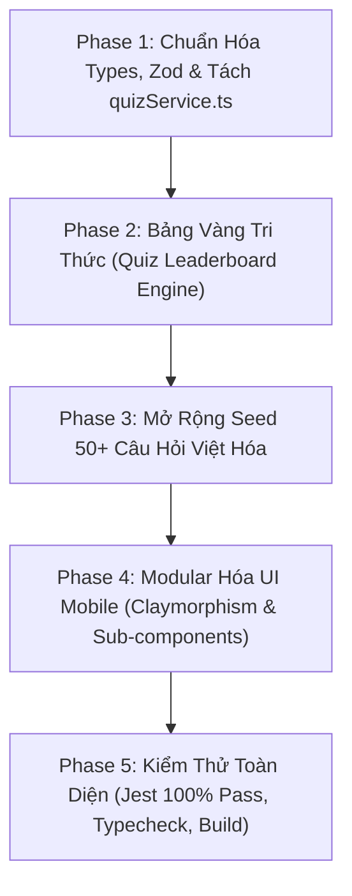

# 🧠 V2.5 — Quiz Game Overhaul & Gamification System

> **Chi tiết thực thi từng task:** Xem tại [`docs/superpowers/plans/2026-10-17-v2.5-quiz-game-overhaul.md`](file:///d:/Downloads/SE%20Project/Growary/docs/superpowers/plans/2026-10-17-v2.5-quiz-game-overhaul.md)
> **Kỹ năng áp dụng:** `superpowers:subagent-driven-development` hoặc `superpowers:executing-plans`
> **Quy chuẩn:** Tuân thủ 100% [ARCHITECTURE_RULES.md](file:///d:/Downloads/SE%20Project/Growary/plan%20update/ARCHITECTURE_RULES.md)

---

## 1. Mục Tiêu & Bối Cảnh
Hiện tại trong ứng dụng đã có khung sườn cơ bản của Quiz Game (`QuizEvent`, `QuizTopic`, `QuizQuestion`, `QuizAttempt`, màn hình `QuizEventScreen` và nút `FloatingQuizButton`), tuy nhiên vẫn còn ở dạng thử nghiệm đơn giản:
1. **Kiến trúc chưa chuẩn:** Business logic viết dồn trong `quizController.ts` thay vì `services/quizService.ts`, thiếu validation Zod.
2. **Thiếu cơ chế Gamification giữ chân người chơi:** Chỉ có trả lời đúng nhận coin đơn điệu; thiếu combo streak (thưởng liên tiếp), speed bonus (thưởng nhanh), không có thưởng EXP hay Vé Gacha.
3. **Chưa có Bảng Vàng (Leaderboard):** Người chơi không biết ai dẫn đầu điểm số hoặc kiến thức.
4. **Giao diện di động quá tải:** `QuizEventScreen.tsx` chạm ngưỡng 498 dòng (sắp vi phạm giới hạn 500 dòng), cần tách nhỏ sub-components.
5. **Ngân hàng câu hỏi hạn chế:** Chỉ có một vài câu mẫu, cần mở rộng 50+ câu hỏi đa dạng (đặc biệt là chủ đề Cây Trồng & Nông Nghiệp gắn với Growary).

---

## 2. Lộ Trình 5 Phase Của Bản 2.5

---

## 3. Danh Sách 10 Task Chi Tiết

| Task | Tên nhiệm vụ | File tác động chính | Trách nhiệm |
| :--- | :--- | :--- | :--- |
| **Task 1** | Chuẩn hóa Shared DTOs | `shared/types/quiz.ts` | Single Source of Truth cho Quiz types |
| **Task 2** | Zod Validation Layer | `backend/src/validators/quizValidator.ts` | Chống request bẩn / invalid payload |
| **Task 3** | Tách `quizService.ts` | `backend/src/services/quizService.ts` | Combo streak, Speed bonus, Perfect run 5/5 |
| **Task 4** | Leaderboard & Scoring | `backend/src/services/quizService.ts` | Đua top điểm số & vinh danh sự kiện |
| **Task 5** | Mở rộng Seed 50+ Câu hỏi | `backend/src/seeds/quizSeed.ts` | Cây trồng, Lịch sử, Khoa học, Đố mẹo |
| **Task 6** | `QuizQuestionCard` & `QuizTimerCircle` | `mobile/src/components/quiz/` | UI thẻ câu hỏi & đồng hồ tròn animation |
| **Task 7** | `QuizStreakBadge` & `QuizLobbyView` | `mobile/src/components/quiz/` | Hiệu ứng combo lửa bùng nổ & màn hình lobby |
| **Task 8** | `QuizResultView` & `QuizLeaderboardModal` | `mobile/src/components/quiz/` | Màn tổng kết pháo hoa & modal bảng vàng |
| **Task 9** | Modular hóa `QuizEventScreen.tsx` | `mobile/src/screens/QuizEventScreen.tsx` | Thu gọn $\le 350$ dòng, auto-resume |
| **Task 10**| Verification Monorepo Suite | Monorepo tests, tsc, build | Pass 100% Jest & lint rules |

---

## 4. Hướng Dẫn Bàn Giao Triển Khai
- **Cho Lập Trình Viên:** Mở file [`docs/superpowers/plans/2026-10-17-v2.5-quiz-game-overhaul.md`](file:///d:/Downloads/SE%20Project/Growary/docs/superpowers/plans/2026-10-17-v2.5-quiz-game-overhaul.md), làm tuần tự từng Task từ Task 1 đến Task 10, chạy test và commit sau mỗi Task.
- **Cho AI Agent:** Chỉ định skill `superpowers:subagent-driven-development` hoặc `superpowers:executing-plans` kèm đường dẫn file plan để AI tự động thực thi TDD khép kín.
