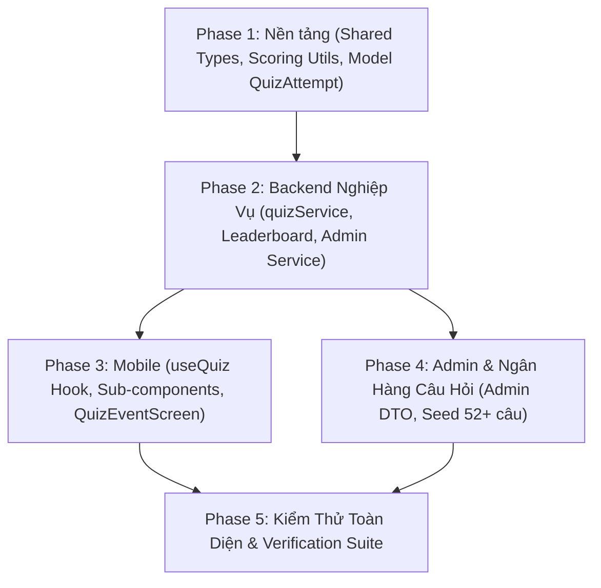

# 🧠 V2.5 — Quiz Game Overhaul & Gamification System

> **Chi tiết thực thi từng task (Đã cập nhật chuẩn hóa):** Xem tại [`docs/superpowers/plans/2026-10-17-v2.5-quiz-game-overhaul.md`](file:///d:/Downloads/SE%20Project/Growary/docs/superpowers/plans/2026-10-17-v2.5-quiz-game-overhaul.md)
> **Kỹ năng áp dụng:** `superpowers:subagent-driven-development` (khuyến nghị) hoặc `superpowers:executing-plans`
> **Quy chuẩn:** Tuân thủ 100% [ARCHITECTURE_RULES.md](file:///d:/Downloads/SE%20Project/Growary/plan%20update/ARCHITECTURE_RULES.md)

---

## 1. Mục Tiêu & Bối Cảnh

Nâng cấp toàn diện minigame Quiz từ phiên bản thử nghiệm sơ khai thành hệ thống **Tri Thức Đấu Trí** (Gamified Quiz Event) hoàn chỉnh, tuân thủ nghiêm ngặt bộ luật kiến trúc:
1. **Tách chuẩn Service Layer (Backend):** Di chuyển business logic từ `quizController.ts` sang `services/quizService.ts`, tạo `quizLeaderboardService.ts` và `quizAdminService.ts`. Controller giữ vai trò mỏng ($\le 120$ dòng).
2. **Hệ thống Gamification & Chống Gian Lận:** Combo Streak (nhân thưởng liên tiếp), Speed Bonus (trả lời trong $\le 10$s) kèm server-side timing verification chống hack thời gian; thưởng EXP và Vé Gacha khi đạt Perfect Run.
3. **Bảng Vàng Tri Thức (Leaderboard):** Bảng xếp hạng thi đấu theo từng sự kiện với công thức tính điểm minh bạch, hỗ trợ xếp hạng cá nhân ngay cả khi ngoài Top 20.
4. **Khôi phục trạng thái chơi (Resume State):** Tự động khôi phục lượt chơi dở dang khi rớt mạng hoặc văng app, chống exploit double-submit / double-reward bằng atomic updates.
5. **Đồng bộ Types & Chuẩn hóa Admin:** Xóa toàn bộ type khai báo trùng lặp tại Admin, chuyển về `shared/types/quiz.ts` (Single Source of Truth), bổ sung Zod validation cho toàn bộ write endpoints.
6. **Modular hóa Giao diện Mobile (Claymorphism):** Tách `QuizEventScreen.tsx` ($\le 350$ dòng) thành custom hook `useQuiz.ts` và 6 sub-components chuyên biệt.
7. **Ngân hàng câu hỏi phong phú:** Bổ sung $\ge 52$ câu hỏi chọn lọc qua seed idempotent, không xóa dữ liệu người dùng thật.

---

## 2. Lộ Trình 5 Phase & 11 Task Chi Tiết

### Danh Sách 11 Task Thực Chiến

| Task | Tên nhiệm vụ | File tác động chính | Trách nhiệm & Chuẩn đầu ra |
| :--- | :--- | :--- | :--- |
| **Task 1** | Chuẩn hóa Shared DTOs & Constants | `shared/types/quiz.ts`, `backend/src/constants.ts` | Single Source of Truth cho toàn monorepo; khóa thông số gameplay |
| **Task 2** | Pure Scoring & Anti-cheat Utils | `backend/src/utils/quizScoring.ts` | Timing clamp, streak multiplier, summary, leaderboard scoring |
| **Task 3** | Mở rộng Model `QuizAttempt` | `backend/src/models/QuizAttempt.ts` | Thêm tracking streak/speed/resume, partial unique index `in_progress` |
| **Task 4** | `quizService.ts` & Player Flow | `backend/src/services/quizService.ts`, `controllers/quizController.ts` | Start/Resume, atomic submit, finalize, tích hợp levelService EXP/ticket |
| **Task 5** | Bảng Vàng (Quiz Leaderboard) | `backend/src/services/quizLeaderboardService.ts` | Endpoint `GET /api/quiz/leaderboard`, ranking thi đấu, top 20 + rank cá nhân |
| **Task 6** | Chuẩn hóa Admin Quiz Backend | `backend/src/services/quizAdminService.ts`, `routes/admin/quiz.ts` | Zod validation, xóa N+1 query, controller mỏng, bảo vệ CRUD |
| **Task 7** | Typed API & `useQuiz` Hook | `mobile/src/services/quizService.ts`, `mobile/src/hooks/useQuiz.ts` | State machine phân tách, timer đồng bộ chống stale closure |
| **Task 8** | Sub-components & Refactor Mobile Screen | `mobile/src/components/quiz/*`, `mobile/src/screens/QuizEventScreen.tsx` | 6 sub-components Claymorphism, screen $\le 350$ dòng, auto-resume UX |
| **Task 9** | Đồng bộ Admin UI với Shared Types | `admin/src/services/quizService.ts`, `admin/src/pages/QuizManagementPage.tsx` | Xóa type duplicate (vi phạm C2), dùng service domain (3.3), cảnh báo thiếu câu |
| **Task 10**| Ngân hàng $\ge 52$ câu hỏi & Seed an toàn | `backend/src/seeds/data/quizQuestions.ts`, `backend/src/seeds/quizSeed.ts` | 4 chủ đề thuần Việt, upsert không xóa dữ liệu, xóa `scripts/quizSeed.ts` |
| **Task 11**| Monorepo Verification & QA Gate | Toàn bộ monorepo | Chạy suite test, typecheck, build, kiểm tra giới hạn dòng code |

---

## 3. Hướng Dẫn Bàn Giao Triển Khai

- **Tài liệu đặc tả thực thi duy nhất:** [`docs/superpowers/plans/2026-10-17-v2.5-quiz-game-overhaul.md`](file:///d:/Downloads/SE%20Project/Growary/docs/superpowers/plans/2026-10-17-v2.5-quiz-game-overhaul.md) chứa đầy đủ chữ ký hàm, schema Zod, test case failing mẫu, mã lệnh shell và kịch bản QA.
- **Dành cho Lập trình viên:** Đọc kỹ Pre-flight checklist, tuân thủ TDD (Test-Driven Development), commit sau mỗi Task theo chuẩn Conventional Commits.
- **Dành cho AI Agent:** Gọi lệnh `superpowers:subagent-driven-development` hoặc `superpowers:executing-plans` với đường dẫn file plan để tự động thực thi từng bước khép kín.
