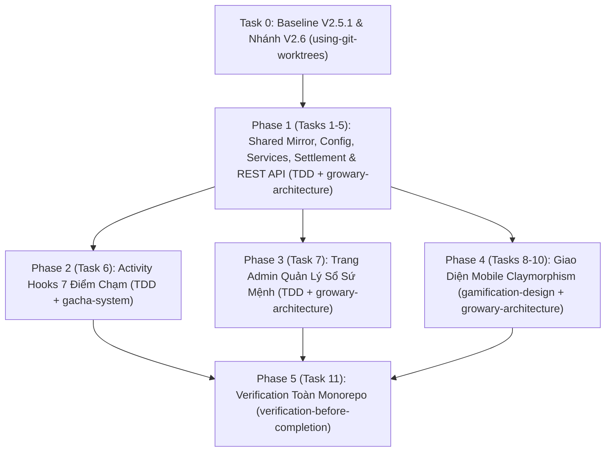

# 📜 V2.6 — Sổ Sứ Mệnh (Seasonal Journey / Battle Pass) — Bản Bàn Giao Dev

> **Kế hoạch thực thi chi tiết từng bước (Dev Handover Plan):** [`docs/superpowers/plans/2026-10-17-v2.6-seasonal-battlepass.md`](file:///d:/Downloads/SE%20Project/Growary/docs/superpowers/plans/2026-10-17-v2.6-seasonal-battlepass.md)
> **Báo cáo review kiến trúc & lỗ hổng đã xử lý:** [`v2.6-plan-review.md`](file:///C:/Users/ACER/.gemini/antigravity/brain/797a9036-e622-481d-a5cf-f75e520269aa/v2.6-plan-review.md)
> **Quy chuẩn kiến trúc bắt buộc:** Tuân thủ 100% [`ARCHITECTURE_RULES.md`](file:///d:/Downloads/SE%20Project/Growary/plan%20update/ARCHITECTURE_RULES.md)

---

## 1. Giải Bài Toán "Thiếu Nhiệt" & 4 Quyết Định Cân Bằng Kinh Tế Đã Chốt

Growary tuân thủ nguyên tắc **Zero Real-Money Exploitation** (không nạp tiền thật). Bản V2.6 áp dụng 5 đòn bẩy tâm lý đã được hiệu chỉnh toán học:

1. **Dual-Track Không Nạp Tiền:**
   - **Tập Sự (Free Track):** Mở tự động cho toàn bộ người chơi.
   - **Tinh Anh (Elite Track):** Mở khóa bằng **1.500 Xu tích lũy** hoặc **Miễn phí cho VIP $\ge 4$**. Thưởng ngay **+500 Pass XP**, nhân đôi tài nguyên track, nhận thêm Rương Sử Thi (`epic`), Rương Vô Cực (`legendary`), Vé Gacha và Khung Avatar độc quyền mùa.
2. **6 Bậc Danh Vị Trưởng Thành (Đạt Cấp 80 khoảng tuần 6–7 — Quyết định D1):**
   - Cấp 1–10: 🌱 **Mầm Xanh Tinh Khôi** (`#10B981`)
   - Cấp 11–25: 🧭 **Lữ Khách Tầm Đạo** (`#3B82F6`)
   - Cấp 26–45: 🛡️ **Hộ Vệ Kiên Cường** (`#8B5CF6`)
   - Cấp 46–65: ⚔️ **Hiệp Sĩ Khải Hoàn** (`#F59E0B`)
   - Cấp 66–80: 👑 **Đại Sư Tinh Anh** (`#EC4899`)
   - Cấp 81+: 🌟 **Thánh Giả Vô Ngân (Prestige Overcap)** (`#F97316`) — Mỗi 5 cấp vượt mốc (`500 Pass XP`) nhận 1 Rương Vô Cực, tối đa **10 rương vượt cấp/mùa**.
3. **Két Sắt Tiết Kiệm Cuối Mùa — Rút Linh Hoạt & Tích Tiếp (Quyết định D2):**
   - Tích lũy tối đa **2.000 Xu/mùa** từ nhiệm vụ Sổ Sứ Mệnh (`+5` Daily, `+15` Weekly, `+50` Season).
   - Đạt **Cấp 60** (hoặc trong **7 ngày cuối quý**) được **rút phần xu đang có (`vaultCoins`)** về ví; sau khi rút, két **vẫn tiếp tục tích lũy** cho tới hết trần 2.000 Xu; phần dư cuối mùa tự động tất toán vào tài khoản.
4. **Chống Farm Task & 9 Nhiệm Vụ Động (Quyết định D3):**
   - Giới hạn tối đa **10 task/ngày VN** được cộng `+12 Pass XP/task` (vẫn đếm tiến độ nhiệm vụ `daily_3_tasks`), hỗ trợ cả task thường lẫn task custom do Admin duyệt và cứu chuỗi Ngày 2.
5. **Trang Admin Quản Lý Sổ Sứ Mệnh Tối Giản (Quyết định D4) & Vinh Danh Profile:**
   - Admin có trang riêng để xem danh sách mùa, Bảng Vàng top 50, và chỉnh sửa quà từng cấp (1–80).
   - Profile lưu giữ kỷ lục các mùa (`seasonBadges`) và cho phép đeo/tháo Khung Avatar mùa.

---

## 2. Ma Trận Kết Hợp Superpower Skills Theo Từng Hạng Mục Phát Triển

Developer / Agent khi bắt tay vào bất kỳ phần nào **BẮT BUỘC** kích hoạt skill tương ứng trong `.agent/skills/`:

| Khi phát triển hạng mục... | Bắt buộc dùng Skill Superpower | Mục đích & Quy tắc kiểm soát |
| :--- | :--- | :--- |
| **Khởi tạo nhánh & Dọn baseline** | `using-git-worktrees` + `growary-architecture` | Commit sạch V2.5.1 (`backend/` trước, root sau), tạo nhánh `feature/v2.6-seasonal-battlepass`, chạy baseline test. |
| **Shared Types, Mirror & DB Schema** | `growary-architecture` | Khai báo `shared/types/` trước $\rightarrow$ copy sang `backend/src/shared/` $\rightarrow$ tạo Model ($\le 250$ dòng) có đủ compound indexes. |
| **Công thức Cấp độ, Két Sắt, 80 Cấp & Hiệu ứng UI** | `gamification-design` | Thiết kế đường cong phần thưởng ($\le 2.500$ Xu tổng 80 cấp), hiệu ứng pulse đếm ngược 24h cuối, rút Két Sắt và Bảng Vàng. |
| **Rương Bí Ẩn, Vé Gacha & Hook Vòng Quay** | `gacha-system` | Phát `MysteryBox` (`common`/`rare`/`epic`/`legendary`) vào `UserInventory`, cộng `gachaTickets`, gắn hook `spinGacha` & `openBox`. |
| **Backend Services, Validators, API & Hooks** | `test-driven-development` (TDD) | Viết failing test (RED) trước $\rightarrow$ chạy Jest thấy fail $\rightarrow$ viết code tối thiểu (GREEN) $\rightarrow$ Refactor. |
| **Triển khai Tuần tự hoặc Chia nhánh Song song** | `executing-plans` / `subagent-driven-development` + `dispatching-parallel-agents` | Sau khi xong **Task 5**, dùng `dispatching-parallel-agents` chạy song song 3 nhánh độc lập: **Task 6 (Hooks)**, **Task 7 (Admin)**, **Tasks 8–10 (Mobile)**. |
| **Sửa lỗi Test, Race Condition, Lệch Múi Giờ** | `systematic-debugging` | Khoanh vùng root cause theo 4 bước, tuyệt đối không đoán mò hay dùng `as any`. |
| **Nghiệm thu Cuối Phase & Đóng nhánh** | `requesting-code-review` + `verification-before-completion` + `finishing-a-development-branch` | Chạy đủ `tsc`, `npm test`, `npm run build`, kiểm tra trần dòng & `git diff` shared mirror trước khi bàn giao. |

---

## 3. Lộ Trình 5 Phase & 12 Task Bàn Giao Thực Chiến

| Task | Tên nhiệm vụ | Skill chủ đạo | File tác động chính | Ngân sách dòng & Chuẩn đầu ra | Trạng thái |
| :--- | :--- | :--- | :--- | :--- | :--- |
| **Task 0** | Baseline V2.5.1 & Nhánh V2.6 | `using-git-worktrees`, `growary-architecture` | `mobile/src/utils/offlineQueue.ts`, Git `backend/` & root | Sửa bỏ qua lỗi 4xx ở `offlineQueue`, commit sạch V2.5.1, tạo nhánh `feature/v2.6-seasonal-battlepass` | 🟢 Đã hoàn thành |
| **Task 1** | Shared Types, Mirror & Models | `growary-architecture`, `test-driven-development` | `shared/types/seasonPass.ts` (+ mirror `backend/src/shared/`), `SeasonPass.ts`, `UserPassProgress.ts`, `User.ts`, `DailyPlan.ts` | Models $\le 150$ dòng; diff shared mirror = 0; `seasonPassModels.test.ts` PASS | 🟢 Đã hoàn thành |
| **Task 2** | Config Thuần `seasonPassConfig.ts` | `gamification-design`, `test-driven-development` | `backend/src/utils/seasonPassConfig.ts`, `seasonPassConfig.test.ts` | $\le 220$ dòng; Quý UTC+7 (`Mùa 1 = Q4/2026`); 80 cấp tổng Xu $\le 2.500$; 9 quests; test PASS | 🟢 Đã hoàn thành |
| **Task 3** | Service Đọc Mùa & Cộng XP/Quest | `growary-architecture`, `test-driven-development` | `seasonPassService.ts` ($\le 280$), `seasonPassProgressionService.ts` ($\le 260$) | Cộng XP atomic 1 pipeline; tăng quest chống trùng phần tử; `seasonPassProgression.test.ts` PASS | 🟢 Đã hoàn thành |
| **Task 4** | Service Claim (Elite, Tier, Vault, Overcap) | `gacha-system`, `gamification-design`, `test-driven-development` | `backend/src/services/seasonPassClaimService.ts` ($\le 390$) | Mở Tinh Anh (+500 XP), claim cấp, claim-all, rút két tích tiếp, rương vượt cấp (cap 10); test PASS | 🟢 Đã hoàn thành |
| **Task 5** | Tất Toán Quý, Cron, REST API & Flow Tests | `growary-architecture`, `test-driven-development` | `seasonPassSettlementService.ts` ($\le 240$), `seasonPassJob.ts` ($\le 90$), `seasonPassController.ts` ($\le 190$), `routes/seasonPass.ts` | Batch settlement 200 user/lô, cron `00:05 VN`, 10 endpoints REST chuẩn Zod/AppError; flow tests PASS | 🟢 Đã hoàn thành |
| **Task 6** | Activity Hooks (7 Điểm Chạm) | `gacha-system`, `test-driven-development` | `seasonPassHooks.ts` ($\le 160$), `planController.ts` ($\le 385$), `routes/admin/tasks.ts`, `bossService.ts`, `gachaController.ts`, `quizController.ts`, `warehouseService.ts`, `rewardController.ts` | Cap 10 task/ngày, hỗ trợ Admin duyệt task custom & cứu chuỗi Ngày 2, không gãy test cũ; hooks test PASS | 🟢 Đã hoàn thành |
| **Task 7** | Trang Admin Quản Lý Sổ Sứ Mệnh | `growary-architecture`, `test-driven-development` | `routes/admin/seasonPass.ts` ($\le 120$), `SeasonPassManagement.tsx` ($\le 340$), `TierRewardEditorModal.tsx` ($\le 240$) | Chọn mùa, xem Bảng Vàng top 50, sửa quà cấp 1–80; `adminSeasonPass.test.ts` + `npm run build` PASS | 🟢 Đã hoàn thành |
| **Task 8** | Mobile API, `useSeasonPass`, Header & Vault | `gamification-design`, `growary-architecture` | `mobile/src/services/api.ts`, `useSeasonPass.ts` ($\le 210$), `seasonPassHelpers.ts` ($\le 110$), `PassHeaderBanner.tsx` ($\le 250$), `PassVaultCard.tsx` ($\le 190$) | 9 API methods, SWR cache, banner danh vị + thanh overcap, thẻ rút Két Sắt; `mobile tsc` PASS | 🟢 Đã hoàn thành |
| **Task 9** | Mobile Tier Track, Elite Modal, Quests & BXH | `gamification-design`, `growary-architecture` | `PassTierItem.tsx`, `PassTierTrack.tsx`, `PassEliteUnlockModal.tsx`, `PassQuestList.tsx`, `PassLeaderboardModal.tsx` (mỗi file $\le 250$) | Băng chuyền 80 cấp (`getItemLayout`), modal Tinh Anh, danh sách 9 nhiệm vụ, Bảng Vàng; `mobile tsc` PASS | 🟢 Đã hoàn thành |
| **Task 10**| `SeasonPassScreen`, `EventScreen` & `ProfileScreen` | `growary-architecture` | `SeasonPassScreen.tsx` ($\le 380$), `SeasonPassEventCard.tsx` ($\le 160$), `ProfileSeasonBadge.tsx` ($\le 240$), `EventScreen.tsx` ($< 466$), `ProfileScreen.tsx` ($\le 490$) | Mở khóa Concept 2 bằng card động, màn hình chính, huy hiệu mùa & chọn khung avatar; `mobile tsc` PASS | 🟢 Đã hoàn thành |
| **Task 11**| Verification Toàn Monorepo | `verification-before-completion`, `finishing-a-development-branch` | Toàn bộ `backend/`, `mobile/`, `admin/`, `shared/` | Pass 100% `npm test`, `tsc --noEmit`, `npm run build`, trần dòng & shared mirror diff = 0 | 🟢 Đã hoàn thành |
