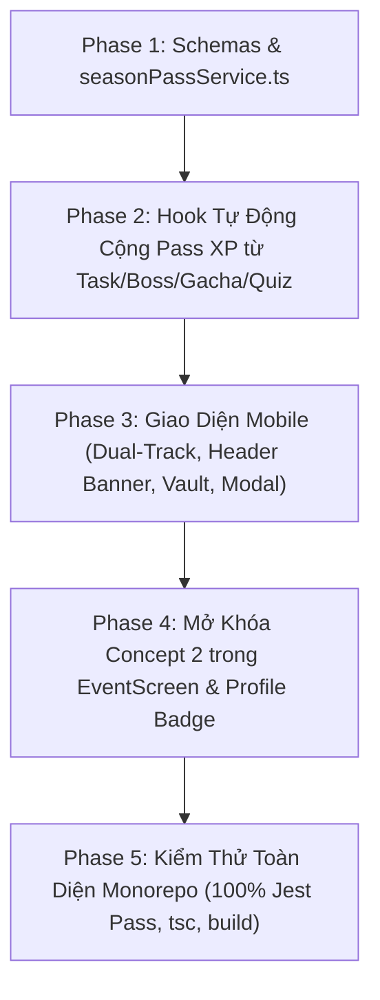

# 📜 V2.6 — Sổ Sứ Mệnh (Seasonal Journey / Battle Pass)

> **Chi tiết thực thi từng task:** Xem tại [`docs/superpowers/plans/2026-10-17-v2.6-seasonal-battlepass.md`](file:///d:/Downloads/SE%20Project/Growary/docs/superpowers/plans/2026-10-17-v2.6-seasonal-battlepass.md)
> **Kỹ năng áp dụng:** `superpowers:subagent-driven-development` hoặc `superpowers:executing-plans`
> **Quy chuẩn:** Tuân thủ 100% [ARCHITECTURE_RULES.md](file:///d:/Downloads/SE%20Project/Growary/plan%20update/ARCHITECTURE_RULES.md)

---

## 1. Giải Bài Toán "Thiếu Nhiệt" & Cơ Chế Giữ Chân Người Chơi
Growary là ứng dụng hướng đến phát triển thói quen và năng suất cá nhân, tuân thủ nguyên tắc **Zero Real-Money Exploitation** (không nạp tiền thật). Để Sổ Sứ Mệnh có sức hút và tạo sự cạnh tranh hưng phấn tương đương các tựa game hàng đầu, hệ thống áp dụng 5 đòn bẩy tâm lý:

1. **Dual-Track Không Nạp Tiền:**
   - Dòng **Tập Sự (Free Track)**: Mở tự động cho toàn bộ người chơi.
   - Dòng **Tinh Anh (Elite Track)**: Mở khóa bằng **1,500 Xu tích lũy** (tiền kiếm được nhờ làm việc chăm chỉ) hoặc **Miễn phí cho người chơi đạt VIP $\ge 4$**. Dòng này nhân đôi tài nguyên, thưởng thêm Rương Sử Thi, Vé Gacha và Khung Avatar độc quyền theo mùa.
2. **6 Bậc Danh Vị Trưởng Thành (Quarterly Season Ranks):**
   - Cấp 1–10: 🌱 **Mầm Xanh Tinh Khôi**
   - Cấp 11–25: 🧭 **Lữ Khách Tầm Đạo**
   - Cấp 26–45: 🛡️ **Hộ Vệ Kiên Cường**
   - Cấp 46–65: ⚔️ **Hiệp Sĩ Khải Hoàn**
   - Cấp 66–80: 👑 **Đại Sư Tinh Anh**
   - Cấp 80+: 🌟 **Thánh Giả Vô Ngân (Prestige Overcap)** — Vượt cấp 80 cứ mỗi 5 cấp lại được nhận thêm 1 Rương Vô Cực, không lo bị "kịch trần".
3. **Két Sắt Tiết Kiệm Cuối Mùa (Seasonal Vault):**
   - Tích lũy tối đa 5,000 Xu từ các nhiệm vụ hàng ngày. Vào tuần cuối quý hoặc khi cán mốc Cấp 60, cánh cổng két sắt sẽ nổ tung mang lại cảm giác nhận "cục thưởng quý" cực kỳ thỏa mãn.
4. **Vinh Danh Profile Vĩnh Viễn:**
   - Profile lưu giữ kỷ lục lịch sử các mùa (vd: *"Quý 1/2026: Cấp 84 - Thánh Giả Vô Ngân"*), tạo động lực cày cuốc để xây dựng bộ sưu tập danh hiệu.
5. **Đa Dạng Nhiệm Vụ Động (Dynamic Quests):**
   - Nhiệm vụ ngày (3 task, 100 EXP), tuần (săn boss, quay gacha, quiz), và thử thách mùa (streak 30 ngày, tích lũy xu).

---

## 2. Lộ Trình 5 Phase Của Bản 2.6

---

## 3. Danh Sách 10 Task Chi Tiết

| Task | Tên nhiệm vụ | File tác động chính | Trách nhiệm |
| :--- | :--- | :--- | :--- |
| **Task 1** | Schema & DTOs Sổ Sứ Mệnh | `models/SeasonPass.ts`, `models/UserPassProgress.ts` | Lưu trữ cấu trúc 80 cấp & tiến độ user |
| **Task 2** | `seasonPassService.ts` | `services/seasonPassService.ts` | Thăng cấp, mở Elite, claim quà, đập két sắt |
| **Task 3** | REST API & Controller | `controllers/seasonPassController.ts`, `routes/seasonPass.ts` | Cung cấp endpoints cho Mobile |
| **Task 4** | Activity Hooks | `planController.ts`, `bossService.ts`, `gachaRevampService.ts` | Tự động thưởng Pass XP khi chơi app |
| **Task 5** | `PassHeaderBanner` & `PassVaultCard` | `mobile/src/components/seasonPass/` | Banner danh vị & két sắt tiết kiệm |
| **Task 6** | `PassTierTrack` (Băng chuyền 2 dòng) | `mobile/src/components/seasonPass/PassTierTrack.tsx` | Cuộn mượt danh sách 80 cấp Free/Elite |
| **Task 7** | `PassEliteUnlockModal` & `PassQuestList` | `mobile/src/components/seasonPass/` | Modal mở Tinh Anh bằng Xu/VIP & tab quest |
| **Task 8** | `SeasonPassScreen.tsx` | `mobile/src/screens/SeasonPassScreen.tsx` | Màn hình chính & mở khóa Concept 2 |
| **Task 9** | Profile Badge & Season Seed | `mobile/src/screens/ProfileScreen.tsx`, `seasonPassSeed.ts` | Khởi tạo dữ liệu mẫu & vinh danh profile |
| **Task 10**| Verification Monorepo Suite | Monorepo tests, tsc, build | Pass 100% Jest & lint rules |
