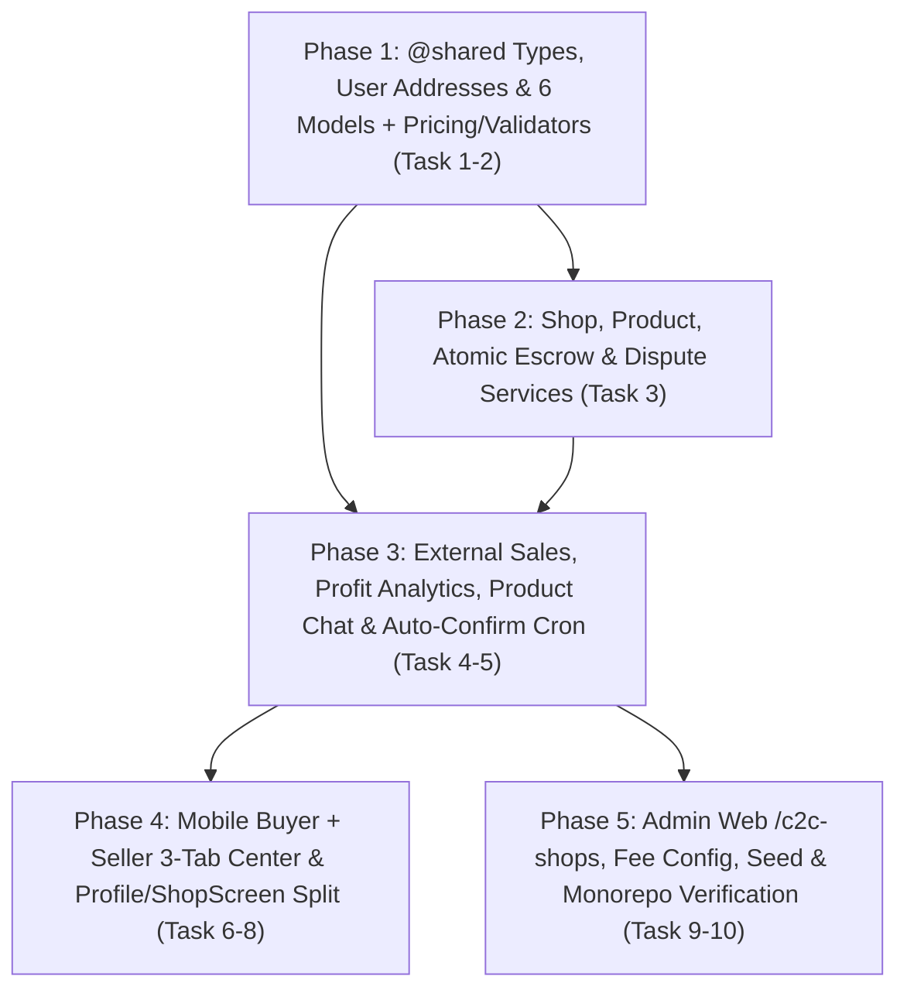

# 🛍️ V2.7 — Growary C2C User Shop (Mô Hình Shopee Shop)

> **Tài liệu Thiết kế (Design Spec):** Xem tại [`docs/superpowers/specs/2026-11-08-v2.7-c2c-user-shop-design.md`](file:///d:/Downloads/SE%20Project/Growary/docs/superpowers/specs/2026-11-08-v2.7-c2c-user-shop-design.md)
> **Chi tiết thực thi từng task (TDD & Interfaces):** Xem tại [`docs/superpowers/plans/2026-11-08-v2.7-c2c-user-shop.md`](file:///d:/Downloads/SE%20Project/Growary/docs/superpowers/plans/2026-11-08-v2.7-c2c-user-shop.md)
> **Kỹ năng áp dụng:** `superpowers:subagent-driven-development` (khuyến nghị) hoặc `superpowers:executing-plans`
> **Quy chuẩn:** Tuân thủ 100% [`plan update/ARCHITECTURE_RULES.md`](file:///d:/Downloads/SE%20Project/Growary/plan%20update/ARCHITECTURE_RULES.md)

---

## 1. Tổng Quan Nghiệp Vụ & Kiến Trúc V2.7

Phiên bản **V2.7** bổ sung hệ thống **C2C User Shop (theo mô hình Shopee Shop)** để người dùng tập kinh doanh sản phẩm nhỏ (LEGO, thú đan len, đồ handmade...) và mua bán trực tiếp bằng **Coin (`Xu`)** ngay trong hệ sinh thái Growary:

1. **Onboarding & Kiểm Duyệt từ Profile:**
   - Trong **Profile**, người dùng có nút **Mở Shop / Quản lý Shop**, đồng thời có **Sổ địa chỉ nhận hàng** (`shippingAddresses`) trong `EditProfile`.
   - Điền thông tin đăng ký (Tên shop, SĐT, địa chỉ lấy/gửi hàng, mô tả, ảnh đại diện optional) $\rightarrow$ **Chờ Admin duyệt** (`pending`) $\rightarrow$ mở khóa **Trang Quản lý Shop 3 tab**: **Sản phẩm**, **Thống kê**, **Chat**.
   - Nếu bị Admin từ chối (`rejected`), chủ shop xem được lý do và chỉnh sửa gửi duyệt lại ngay.

2. **Quản Lý Sản Phẩm, Nguồn Nhập, Giảm Giá % & Bán Ngoài:**
   - Mỗi sản phẩm lưu **Nguồn nhập (`importSource`)**, **Cost ban đầu (`costPrice`)**, **Giá bán niêm yết (`priceCoins`)**, **Giảm giá % (`0–90%`)**, tự động hiển thị **Giá sau giảm (`finalPriceCoins`)** và **Nhận về dự kiến (`sellerNetCoins`)** sau khi trừ phí sàn.
   - Tích hợp kênh **Đã bán ngoài**: chọn sản phẩm hiện có + nhập **Số lượng** + nhập **Giá ngoài/SP** $\rightarrow$ tự tính **Tổng giá ngoài**, trừ chung tồn kho `stock`, lưu **snapshot giá vốn** để thống kê **Cost — Doanh thu — Lợi nhuận** chính xác trên cả 2 kênh (**Trong App** + **Bán Ngoài**).

3. **Thanh Toán Coin Escrow, Giao Express & Nút `"Chưa nhận được"`:**
   - Người mua chọn địa chỉ giao hàng từ **Profile** hoặc nhập địa chỉ khác lúc đặt đơn; shop tự liên hệ **Express** gửi hàng ngoài app và cập nhật hãng + mã vận đơn.
   - Hệ thống giữ Coin tạm (**Escrow**), cô lập hoàn toàn với `VIP` / `Cashback` / `totalCoinsSpent` để chống farm xu. Chỉ khi người mua bấm **"Đã nhận hàng"** (hoặc quá `autoConfirmDays`, mặc định 7 ngày) mới giải ngân **90%** (hoặc `100% - platformFeePercent`) cho Shop.
   - Khi có sự cố giao hàng, người mua bấm **"Chưa nhận được"** để đóng băng giải ngân và được hoàn trả Coin (Admin/Shop xử lý trên hệ thống); mọi bồi thường mất hàng thực tế do đơn vị **Express** xử lý bên ngoài.

4. **Chat Trên Từng Sản Phẩm (Chưa Mua & Đã Mua):**
   - Nút **Chat với Shop** xuất hiện ở cả **Chi tiết sản phẩm** (hỏi trước khi mua) lẫn **Đơn hàng C2C của tôi** (trao đổi sau khi mua), hội tụ về Tab **Chat** của Chủ Shop (hỗ trợ giữ mạch chat hậu mãi ngay cả khi sản phẩm bị xóa mềm).

5. **Trang Quản Lý C2C Shop Cho Admin (`/c2c-shops`):**
   - Admin duyệt/từ chối/tạm khóa shop vi phạm, xử lý khiếu nại `"Chưa nhận được"` (`Hoàn Xu` hoặc `Giải ngân`), và tùy chỉnh trực tiếp **% phí sàn** (mặc định **10%**), tỷ giá quy đổi **VNĐ/Coin** thống kê, và số ngày tự xác nhận đơn.

---

## 2. Lộ Trình 5 Phase Của Bản 2.7

---

## 3. Danh Sách 10 Task Triển Khai

| Task | Tên nhiệm vụ | File tác động chính | Trách nhiệm & Chuẩn đầu ra |
| :--- | :--- | :--- | :--- |
| **Task 1** | Shared DTOs (`@shared` + Mirror) & 6 Models | `shared/types/c2cShop.ts`, `backend/src/shared/c2cShop.ts`, `User.ts`, `Notification.ts`, `UserShop.ts`, `ShopProduct.ts`, `ShopOrder.ts`, `ExternalSale.ts`, `ShopConversation.ts`, `ShopMessage.ts` | Đồng bộ `@shared` với `backend/src/shared/`, thêm `shippingAddresses`, `'shop'` Notification & compound indexes |
| **Task 2** | Pricing Math, Settings Service & Zod Validators | `c2cPricing.ts`, `c2cSettingsService.ts`, `c2cShopValidator.ts` | Bảo toàn `platformFeeCoins + sellerNetCoins === grossCoins`, JSDoc Rule 0.4, Zod v4 validation + test |
| **Task 3** | Onboarding, Marketplace & Escrow Order Service | `c2cShopService.ts`, `c2cOrderService.ts` | Atomic Coin/Stock rollback, price-lock `409`, anti-farm VIP, stock/suspension boundaries + Jest tests |
| **Task 4** | Bán Ngoài, Thống Kê, Chat & Auto-Confirm Cron | `c2cAnalyticsService.ts`, `c2cChatService.ts`, `c2cOrderAutoConfirmJob.ts` | Snapshot bán ngoài + void log, aggregate Cost/Doanh thu/Lợi nhuận, chat hậu mãi & cron skip shop khóa |
| **Task 5** | Controllers, REST Routes, Stats & Supertest Flow | `c2cShopController.ts`, `c2cOrderController.ts`, `c2cChatController.ts`, `c2cAdminController.ts`, `routes/c2cShop.ts`, `routes/admin/c2cShops.ts`, `server.ts`, `testApp.ts` | Toàn bộ `/api/c2c/*` & `/api/admin/c2c-*`, `login` trả `shippingAddresses`, `/admin/stats` badges + Supertest |
| **Task 6** | Mobile Service, Hooks & Tách `ProfileScreen` | `mobile/src/services/api.ts`, `c2cShopService.ts`, `hooks/useMarketplace.ts`, `useSellerShop.ts`, `useBuyerOrders.ts`, `useShopChat.ts`, `ProfileHeaderCard.tsx`, `ProfileShopEntryCard.tsx`, `ShippingAddressSection.tsx` | Đưa `ProfileScreen.tsx` xuống $\le 340$ dòng, sổ địa chỉ trong `EditProfileScreen`, `'shop'` Notification |
| **Task 7** | Mobile Buyer Flow & Tách `ShopScreen` | `AdminRewardShopView.tsx`, `ShopScreen.tsx`, `MarketplaceTab.tsx`, `C2CProductCard.tsx`, `C2CProductDetailScreen.tsx`, `C2CCheckoutScreen.tsx`, `MyC2COrdersScreen.tsx`, `SellerStorefrontScreen.tsx` | Chia `ShopScreen` 2 tab (`Quà Growary` \| `Chợ Cộng Đồng`) $\le 220$ dòng, chọn địa chỉ, `"Chưa nhận được"`, `"Chat"` |
| **Task 8** | Mobile Seller Center (3 Tab) & Chat Screen | `SellerRegisterScreen.tsx`, `SellerDashboardScreen.tsx`, `SellerProductsTab.tsx`, `ProductFormModal.tsx`, `ExternalSaleModal.tsx`, `ShipExpressModal.tsx`, `SellerAnalyticsTab.tsx`, `SellerChatTab.tsx`, `ShopChatThreadScreen.tsx` | Form Mở Shop chờ duyệt, Quản lý 3 Tab (**Sản phẩm**, **Thống kê**, **Chat**), Bán ngoài & Chat polling 5s |
| **Task 9** | Admin Shop Management (`/c2c-shops`) | `admin/src/services/c2cShopService.ts`, `C2CShopManagement.tsx`, `components/c2c/*`, `StatusBadge.tsx`, `Sidebar.tsx`, `App.tsx` | Tách service độc lập không đụng `api.ts` (266/300), duyệt/khóa shop, phán quyết khiếu nại & chỉnh `%` phí sàn |
| **Task 10** | Seed Data & Full Monorepo Verification | `backend/src/seeds/c2cShopSeed.ts`, `backend/package.json` | Seed idempotent LEGO/đan len, audit giới hạn dòng + zero `any` + chạy `tsc`/`jest`/`admin build` |

---

## 4. Hướng Dẫn Thực Thi

- **Implementation Plan chi tiết:** [`docs/superpowers/plans/2026-11-08-v2.7-c2c-user-shop.md`](file:///d:/Downloads/SE%20Project/Growary/docs/superpowers/plans/2026-11-08-v2.7-c2c-user-shop.md)
- **Design Spec đầy đủ:** [`docs/superpowers/specs/2026-11-08-v2.7-c2c-user-shop-design.md`](file:///d:/Downloads/SE%20Project/Growary/docs/superpowers/specs/2026-11-08-v2.7-c2c-user-shop-design.md)
- **Thực thi khuyến nghị:** Dùng `superpowers:subagent-driven-development` để triển khai khép kín từng task (backend tests $\rightarrow$ mobile screens $\rightarrow$ admin web) hoặc `superpowers:executing-plans` nếu muốn chạy tuần tự trong một phiên duy nhất.

